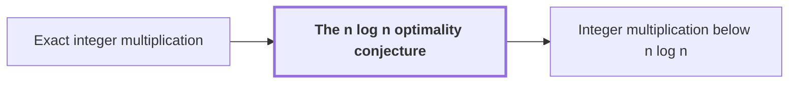

# The n log n optimality conjecture

!!! info "Before this page"

    The n log n optimality conjecture *bounds the cost of* [Exact integer multiplication](exact-integer-multiplication.md "The conjecture bounds the cost of Exact integer multiplication, where the input is two $n$-bit binary strings and the output is their $2n$-bit product."). Assumed known: Big-O notation.

!!! abstract "Where this fits"

    - Relied on to show: A deterministic fixed-tape machine multiplies two $n$-bit integers exactly in $O(n(\lg n)^{1-\kappa})$ time, with $\kappa=2^{-182}$, below the $n\lg n$ conjecture in this model. ([Integer multiplication below n log n](main-theorem.md "A deterministic fixed-tape machine that multiplies two n-bit integers exactly in O(n (lg n)^(1−κ)) time with κ = 2^−182, which disproves the n log n optimality conjecture in this model."))

??? note "Symbols from earlier pages"

    - $n$ — input length: The number of bits in each of the two inputs, the common length of x and y. (on [Exact integer multiplication](exact-integer-multiplication.md "Given binary strings x and y of length n, output the 2n-bit binary representation of their product."))

The n log n optimality conjecture is the claim that $n\log n$ is the optimal order of growth for the time needed to multiply two $n$-bit integers exactly. It is also called the Schönhage–Strassen conjecture, and it is the target against which faster multiplication methods are measured.

Let $n$ be the number of bits in each of the two input integers. The conjecture bounds the cost of [Exact integer multiplication](exact-integer-multiplication.md "Given binary strings x and y of length n, output the 2n-bit binary representation of their product."), where the input is two $n$-bit binary strings and the output is their $2n$-bit product.

Schoolbook multiplication takes $O(n^2)$ bit operations, so the question is how far below that the best method can go. In 1971 Schönhage and Strassen gave a multitape Turing machine algorithm running in $O(n\log n\log\log n)$ time<cite class="exegenius-ref" data-source="paper" data-locator="§11 A consequence for matrix transposition, p. 3" data-quote="Schönhage and Strassen proved in 1971 that two n-bit integers can be multiplied in O(n log n log log n) time on a multitape Turing machine" title="Schönhage and Strassen proved in 1971 that two n-bit integers can be multiplied in O(n log n log log n) time on a multitape Turing machine"> (see §11 A consequence for matrix transposition, p. 3)</cite>. They also proposed that $n\log n$ is the optimal order of growth<cite class="exegenius-ref" data-source="paper" data-locator="§11 A consequence for matrix transposition, p. 3" data-quote="proposed n log n as the optimal order of growth" title="proposed n log n as the optimal order of growth"> (see §11 A consequence for matrix transposition, p. 3)</cite>.

Harvey and van der Hoeven later reached an unconditional $O(n\log n)$ upper bound, meaning one that needs no extra unproven hypothesis<cite class="exegenius-ref" data-source="paper" data-locator="§11 A consequence for matrix transposition, p. 3" data-quote="Harvey and van der Hoeven reached the unconditional O(n log n) upper bound" title="Harvey and van der Hoeven reached the unconditional O(n log n) upper bound"> (see §11 A consequence for matrix transposition, p. 3)</cite>. The open question is whether this upper bound is also optimal: whether no exact method can do asymptotically better than $n\log n$.

## Connections

Used by:

- [Integer multiplication below n log n](main-theorem.md "It refutes the n log n optimality conjecture in this model.") *refutes* The n log n optimality conjecture

??? quote "From the sources"

    > proposed n log n as the optimal order of growth
    >
    > — Integer multiplication below n log n (OpenAI, 2026)
