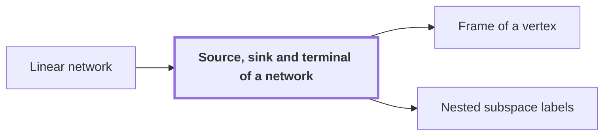

# Source, sink and terminal of a network

!!! info "Before this page"

    Source, sink and terminal of a network *is a source or sink of* [Linear network](linear-network.md "A source or sink of a Linear network is an end vertex of a wire, where data enter the network or leave it."). Assumed known: Directed graph.

!!! abstract "Where this fits"

    - Relied on to show: Interchanging two equal address fields of width $u$ costs less than linear in $u$ per unit volume. ([Fast interchange of address chunks](tape-interchange.md "A fixed-tape procedure that swaps two disjoint equal-width address fields of an array in time O(V u^τ) for a fixed τ < 1, where V is the stored volume and u the field width, using XOR combinations of intermediate data."))

A source or sink of a [Linear network](linear-network.md "A fixed network of wires with gates that apply fixed linear maps to the values on their wires, used here to exchange two banks of values while restoring all auxiliary values.") is an end vertex of a wire, where data enter the network or leave it. The terminals of a network are its sources and sinks, the places where the network meets its banks of values. This concept names those places, so that later pages can say which values a network reads at its start and writes at its end.

A wire carries one scalar through the network. Along it, the vertices are the points where the value is read or changed. A gate is a fixed linear map applied to the values on the wires it touches, and it changes only those wires.<cite class="exegenius-ref" data-source="paper" data-locator="§3 Two finite networks with a rank saving" data-quote="The vertices on a wire are its source, the gates that touch it in time order, and its sink" title="The vertices on a wire are its source, the gates that touch it in time order, and its sink"> (see §3 Two finite networks with a rank saving)</cite>. So the value at a source is changed by each gate on the wire in turn, and the sink holds the result.

For example, suppose a wire's source holds the value 3 and one gate on that wire doubles its value. The sink of that wire then holds 6. The source is where the network takes in 3, and the sink is where it delivers 6 to the bank it meets there.

## Connections

Used by:

- [Frame of a vertex](frame.md "A frame of a vertex is an invertible linear operator attached to a gate of a Linear network, or to a Source, sink and terminal of a network of it, that fixes how the array on each wire there is stored.") *is attached to* Source, sink and terminal of a network
- [Nested subspace labels](subspace-labels.md "Each label sits at a gate or at a Source, sink and terminal of a network.") *sit at* Source, sink and terminal of a network

??? quote "From the sources"

    > wire are its source, the gates that touch it in time order, and its sink
    >
    > — [Integer multiplication below n log n (OpenAI, 2026)](https://github.com/openai/math/tree/fd4aeeb2ee4fc729c18d98444fed42fd0529eeeb/preprints/Integer-multiplication-below-n-log-n-September-23-2026)
