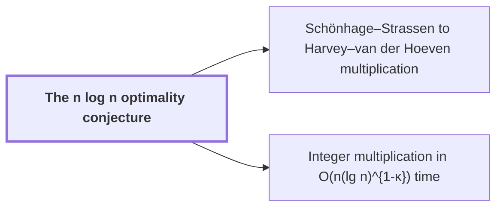

# The n log n optimality conjecture

!!! info "Before this page"

    Assumed known: Big-O notation and Multitape Turing machine.

!!! abstract "Where this fits"

    - Relied on to show: An $n$-bit integer product is computed by a fixed-tape machine in $O(n(\lg n)^{1-\kappa})$ time, $\kappa=2^{-182}$. ([Integer multiplication in O(n(lg n)^{1-κ}) time](main-theorem.md "Deterministic fixed-tape Turing machine multiplying n-bit integers in O(n(lg n)^{1-κ}), κ=2^{-182}, by reducing to ring convolution with fast address interchanges and simultaneous butterfly layers, disproving the n log n conjecture in this model."))

The $n\log n$ optimality conjecture is Schönhage and Strassen's proposal that $n\log n$ is the optimal order of cost for multiplying two integers, where $n$ is the number of bits in each integer. It is the benchmark that a faster algorithm must beat.

Costs are running times on a multitape Turing machine with a fixed, finite number of tapes. A cost has order $f(n)$ when it is $O(f(n))$, that is, at most a constant times $f(n)$ for all large $n$. "Optimal" means that no algorithm in this model runs in $o(n\log n)$ time.

Schönhage and Strassen's 1971 algorithm runs in $O(n\log n\log\log n)$ time<cite class="exegenius-ref" data-source="paper" data-locator="§1 Introduction" data-quote="two $n$-bit integers can be multiplied in $O(n\log n\log\log n)$ time on a multitape Turing machine" title="two $n$-bit integers can be multiplied in $O(n\log n\log\log n)$ time on a multitape Turing machine"> (see §1 Introduction)</cite>. Harvey and van der Hoeven reached $O(n\log n)$<cite class="exegenius-ref" data-source="paper" data-locator="§1 Introduction" data-quote="Harvey and van der Hoeven reached the unconditional $O(n\log n)$ upper bound" title="Harvey and van der Hoeven reached the unconditional $O(n\log n)$ upper bound"> (see §1 Introduction)</cite>. Their algorithm also runs on a multitape machine, so $O(n\log n)$ is achievable in the model the conjecture is stated for, and the conjecture asks whether that cost can be beaten. The conjecture is posed against the chain of upper bounds traced in [Schönhage–Strassen to Harvey–van der Hoeven multiplication](ss-hh-background.md "Chain of multitape algorithms from O(n log n log log n) to the unconditional O(n log n) bound, using transforms over rings with cheap roots of unity.").

The conjecture fails in the fixed-tape model used here. Let $A$ be the deterministic Turing machine of the paper's main theorem, with a fixed finite alphabet and a fixed finite number of one-dimensional tapes, so $A$ is one of the machines the conjecture quantifies over. Let $T_A(n)$ be its worst-case running time on pairs of $n$-bit inputs. Let $\kappa=2^{-182}$ be a fixed positive constant. The paper proves<cite class="exegenius-ref" data-source="paper" data-locator="§1 Introduction" data-quote="T_A(n)=O\!\left(n(\lg n)^{1-\kappa}\right)" title="T_A(n)=O\!\left(n(\lg n)^{1-\kappa}\right)"> (see §1 Introduction)</cite>, which has the power $1-\kappa<1$ on the logarithm where the conjecture has power $1$. So $A$ runs in $o(n\log n)$ time and the conjecture fails in this model.<cite class="exegenius-ref" data-source="paper" data-locator="§1 Introduction" data-quote="The theorem refutes an eventual $\Omega(n\log n)$ lower bound for every fixed multiplication machine in this model" title="The theorem refutes an eventual $\Omega(n\log n)$ lower bound for every fixed multiplication machine in this model"> (see §1 Introduction)</cite>.

## Connections

Used by:

- [Schönhage–Strassen to Harvey–van der Hoeven multiplication](ss-hh-background.md "The chain's cost is measured against the The n log n optimality conjecture.") *is measured against* The n log n optimality conjecture
- [Integer multiplication in O(n(lg n)^{1-κ}) time](main-theorem.md "It disproves the n log n optimality conjecture for this model.") *disproves* The n log n optimality conjecture

??? quote "From the sources"

    > proposed $n\log n$ as the optimal order of growth
    >
    > — [Integer multiplication below n log n (OpenAI, 2026)](https://github.com/openai/math/tree/fd4aeeb2ee4fc729c18d98444fed42fd0529eeeb/preprints/Integer-multiplication-below-n-log-n-September-23-2026)
