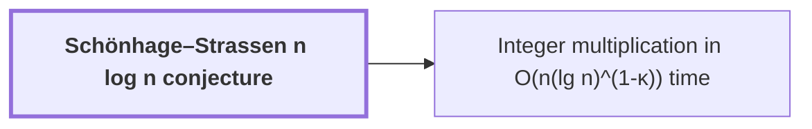

# Schönhage–Strassen n log n conjecture

!!! info "Before this page"

    Assumed known: Big-O notation and Multitape Turing machine.

!!! abstract "Where this fits"

    - Relied on to show: Two $n$-bit integers can be multiplied exactly in $O(n(\lg n)^{1-\kappa})$ worst-case time on a deterministic multitape Turing machine, for a fixed $\kappa=2^{-182}$. ([Integer multiplication in O(n(lg n)^(1-κ)) time](integer-multiplication-target.md "A deterministic multitape Turing machine that multiplies two n-bit integers exactly in O(n(lg n)^(1-κ)) worst-case time for a fixed κ = 2^(-182) > 0, beating the n log n conjecture in this model."))

Here $n$ is the number of bits in each input integer, and time is worst-case running time as a function of $n$. The Schönhage–Strassen conjecture says that $n\log n$ is the optimal order of growth of the time to multiply two integers on a multitape Turing machine.

"Optimal" has two halves: $n\log n$ is achievable, and no algorithm is faster. A running time is $o(n\log n)$ when its ratio to $n\log n$ tends to $0$ as $n \to \infty$, so it grows strictly more slowly. The conjecture says that no multiplication algorithm on this machine has running time $o(n\log n)$.

The upper half is known. Schönhage and Strassen gave a multiplication method with running time $O(n\log n\log\log n)$<cite class="exegenius-ref" data-source="paper" data-locator="§1 Introduction" data-quote="proved in 1971 that two $n$-bit integers can be multiplied in $O(n\log n\log\log n)$ time" title="proved in 1971 that two $n$-bit integers can be multiplied in $O(n\log n\log\log n)$ time"> (see §1 Introduction)</cite>. The conjectured order is matched from above by the unconditional $O(n\log n)$ bound of [Harvey–van der Hoeven O(n log n) multiplication](harvey-hoeven-multiplier.md "The unconditional O(n log n) multiplication algorithm on a multitape Turing machine, used in this result as an ordinary subroutine."). The open question is therefore the lower half.

The exponent gap $\kappa = 2^{-182}$ is a fixed positive constant. The conjecture is refuted by [Integer multiplication in O(n(lg n)^(1-κ)) time](integer-multiplication-target.md "A deterministic multitape Turing machine that multiplies two n-bit integers exactly in O(n(lg n)^(1-κ)) worst-case time for a fixed κ = 2^(-182) > 0, beating the n log n conjecture in this model."), which multiplies in $O(n(\lg n)^{1-\kappa})$ worst-case time. Its time is $o(n\log n)$: changing the base of a logarithm multiplies it by a constant, so $n\log n$ is a constant times $n\lg n$. The ratio of the two is then a constant times $(\lg n)^{1-\kappa}/\lg n = (\lg n)^{-\kappa}$, which tends to $0$ because $\kappa > 0$. Hence the conjecture is false in this model.

## Connections

Used by:

- [Integer multiplication in O(n(lg n)^(1-κ)) time](integer-multiplication-target.md "Integer multiplication in $O(n(\lg n)^{1-\kappa})$ time disproves the Schönhage–Strassen n log n conjecture in this model.") *disproves* Schönhage–Strassen n log n conjecture

??? quote "From the sources"

    > proposed $n\log n$ as the optimal order of growth
    >
    > — [Integer multiplication below n log n (OpenAI, 2026)](https://github.com/openai/math/tree/fd4aeeb2ee4fc729c18d98444fed42fd0529eeeb/preprints/Integer-multiplication-below-n-log-n-September-23-2026)
