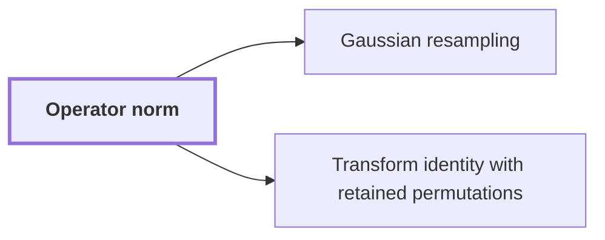

# Operator norm

!!! info "Before this page"

    Assumed known: Matrix, linear map, rank and invertibility and Complex numbers.

!!! abstract "Where this fits"

    - Relied on to show: The maps $A=S'$ and $B_0=D'J'C$ are linear contractions, since $\|C\|=1$ and $\|S'\|$, $\|J'\|$, $\|D'\|$ are below their stated bounds.

??? note "Symbols from earlier pages"

    - $F_q$ — discrete Fourier transform: The map sending a vector $x$ of length $q$ to the vector $y = F_q x$ defined by the weighted sum above. (on [Discrete Fourier transform](discrete-fourier-transform.md "The map sending a vector of q values to its q values weighted by powers of a q-th root of unity, normalized by 1/q."))
    - $q$ — sequence length: The number of entries in each vector of the transform, and the order of the root of unity. (on [Discrete Fourier transform](discrete-fourier-transform.md "The map sending a vector of q values to its q values weighted by powers of a q-th root of unity, normalized by 1/q."))
    - $j$ — output index: The index of an output entry of the transform, running from 0 to q-1. (on [Discrete Fourier transform](discrete-fourier-transform.md "The map sending a vector of q values to its q values weighted by powers of a q-th root of unity, normalized by 1/q."))
    - $k$ — input index: The index of an input entry of the transform, running from 0 to q-1. (on [Discrete Fourier transform](discrete-fourier-transform.md "The map sending a vector of q values to its q values weighted by powers of a q-th root of unity, normalized by 1/q."))

The operator norm of a linear map is the largest factor by which the map can stretch a vector. It is what lets a bound on each map in a chain be multiplied into a bound on the whole chain.

Here $w$ denotes a complex vector of length $q$. Its vector norm $\|w\|$ is the largest modulus among its coordinates.<cite class="exegenius-ref" data-source="paper" data-locator="§2 M (3ℓ + 1)2-p, p. 48" data-quote="The vector norm is the maximum modulus of its coordinates." title="The vector norm is the maximum modulus of its coordinates."> (see §2 M (3ℓ + 1)2-p, p. 48)</cite> For example, if $w=(1+i,\,-2,\,0.5i)$, the moduli of the coordinates are $\sqrt{2}$, $2$ and $0.5$, so $\|w\|=2$.

Here $L$ denotes a linear map from complex vectors to complex vectors. Its operator norm is

$$\|L\| = \sup_{\|w\|\le 1} \|Lw\|,$$

the supremum (least upper bound) of $\|Lw\|$ over all $w$ with $\|w\|\le 1$.<cite class="exegenius-ref" data-source="paper" data-locator="§2 M (3ℓ + 1)2-p, p. 48" data-quote="All operator norms are induced by this norm" title="All operator norms are induced by this norm"> (see §2 M (3ℓ + 1)2-p, p. 48)</cite>.

For $w\neq 0$, the vector $w/\|w\|$ has norm one, so $\|Lw\|\le\|L\|\,\|w\|$ for every $w$. For another linear map $M$, the composition $LM$ applies $M$ first and then $L$. Applying the bound to $Mw$ and then to $w$ gives $\|LM\|\le\|L\|\,\|M\|$.

A linear map $L$ is a linear contraction when $\|L\|\le 1$. A [normalized Fourier transform](discrete-fourier-transform.md "The map sending a vector of q values to its q values weighted by powers of a q-th root of unity, normalized by 1/q.") $F_q$ is one: each output $\frac1q\sum_j w_j e^{-2\pi i jk/q}$ averages inputs multiplied by complex numbers of modulus one, so its modulus is at most $\|w\|$.

Here $S'$ denotes half of a [Gaussian resampling](gaussian-resampling.md "A technique that replaces a Fourier transform of arbitrary length by transforms whose axis lengths are powers of two, using Gaussian weights to move between the two sets of frequencies.") map. Here $J'$ denotes half the inverse of an invertible map close to the identity. Here $D'$ denotes a diagonal map scaled by a fixed factor at most one. Here $C$ denotes a map that selects some coordinates, so each output entry copies one input entry and $\|C\|\le 1$.

The argument uses these for $A=S'$ and $B_0=D'J'C$. The Gaussian resampling estimates give $\|S'\|<\frac34$, $\|J'\|<\frac78$ and $\|D'\|<1$. Hence $\|A\|<1$, and $\|B_0\|\le\|D'\|\,\|J'\|\,\|C\|<1$. So $A$ and $B_0$ are linear contractions.

## Connections

Used by:

- [Gaussian resampling](gaussian-resampling.md "The error $E$ is measured in the operator norm for the maximum-modulus vector norm, and $\|E\|=\|N-I\|$.") *is measured in* Operator norm
- [Transform identity with retained permutations](transform-identity.md "The two maps are linear contractions, bounded in the operator norm by one, meaning each sends a vector to one of norm at most its input norm.") *is bounded in* Operator norm

??? quote "From the sources"

    > All operator norms are induced by this norm
    >
    > — Integer multiplication below n log n (OpenAI, 2026)
