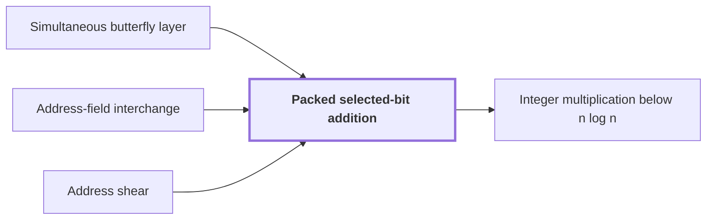

# Packed selected-bit addition

!!! info "Before this page"

    Packed selected-bit addition *supplies the binary basis changes for* [Simultaneous butterfly layer](simultaneous-butterfly-layer.md "It supplies the binary basis changes for the simultaneous butterfly layer, whose exact computation needs them."), *is built from* [Address-field interchange](address-interchange.md "Packed selected-bit addition is built from three streaming operations, fixed multitape procedures whose time grows with the volume they process: an address-field interchange of equal-width chunks, cyclic shifts of chunk ranges, and a fixed permutation of two-bit values.") and *is a restricted form of* [Address shear](address-shear.md "Packed selected-bit addition is a restricted form of the address shear that changes only the selected positions.").

!!! abstract "Where this fits"

    - Relied on to show: A compatible choice of rational parameters makes every term of the cost table fit the bound of Theorem 1.

??? note "Symbols from earlier pages"

    - $\tau$ — cost exponent: A fixed constant less than 1 in the cost bound $O(V u^{\tau})$. (on [Address-field interchange](address-interchange.md "A tape procedure that swaps two disjoint contiguous address fields of an array in time that grows like a power of the field width, rather than linearly."))

Packed selected-bit addition is a fixed multitape procedure that performs many binary row additions in one pass. It supplies the binary basis changes for the [simultaneous butterfly layer](simultaneous-butterfly-layer.md "The tensor product of the two-point map H0 applied to several selected address bits at once, computed exactly in one pass rather than one axis at a time."), whose exact computation needs them. Its time bound is one term of the cost table, and a compatible choice of rational parameters makes every term fit the bound of Theorem 1.

A binary row addition XORs one address chunk into another. Here only the selected bit positions change, and the procedure performs all the XORs of one such addition together rather than one bit position at a time.

The record's address is split into three chunks, each of $L$ bits, so $L$ is the chunk width. The procedure XORs [selected bits](transform-layout.md "A permutation of address bits that places the selected bits of all participating axes at a common offset in consecutive chunks, so that a simultaneous butterfly layer applies to each transform round.") of the source chunk $\xi$ into the target chunk $\eta$, leaving the third chunk $\zeta$ as it is. Here $\mu$ is the number of selected positions in each chunk, and $\nu$ indexes them, from $0$ to $\mu-1$. The letter $K$ is the spacing between selected positions here, not the chunk width of the transform layout page. Each chunk has $L = \mu K$ bits. The first selected position is at offset $\rho$, with $0 \le \rho < K$, and the $\nu$-th one is $\rho + \nu K$ for $0 \le \nu < \mu$, counted from the least significant bit. The procedure computes

$$\eta_{\rho+\nu K} \leftarrow \eta_{\rho+\nu K} \oplus \xi_{\rho+\nu K} \qquad (0 \le \nu < \mu),$$

where $\eta_{\rho+\nu K}$ and $\xi_{\rho+\nu K}$ are the bits at that position, and $\oplus$ is exclusive or.

For example, take $\mu=2$, $K=6$, $L=12$ and $\rho=1$, so the selected positions are $1$ and $7$. If the $\xi$ bits there are $1$ and $0$, and the $\eta$ bits are $1$ and $1$, the procedure leaves the $\eta$ bits as $0$ and $1$.

Packed selected-bit addition is built from three streaming operations, fixed multitape procedures whose time grows with the volume they process: an [address-field interchange](address-interchange.md "A tape procedure that swaps two disjoint contiguous address fields of an array in time that grows like a power of the field width, rather than linearly.") of equal-width chunks, cyclic shifts of chunk ranges, and a fixed permutation of two-bit values. A coordinate range is the finite set of values one address coordinate takes, and a cyclic shift of a chunk range adds an offset, set by the other chunks, to that chunk's value modulo $2^L$. Packed selected-bit addition is a restricted form of the [address shear](address-shear.md "The map that updates two address fields H, D to H + D, D, which is implemented by a small number of field interchanges.") that changes only the selected positions.

Each record has $E$ bits, the number of bits in one record. Let $\lambda_0,\dots,\lambda_3$ be the sizes of the four other coordinate ranges. Write $M = 2^{3L}\lambda_0\lambda_1\lambda_2\lambda_3$ for the number of records, since each of the three chunks takes $2^L$ values. $V = ME$ is the total number of bits.

The construction first applies a constant number of cyclic shifts, whose composition is $\sigma$. Let $T$ be the exact map that performs the XORs on every record, and let $Z$ be the set of exceptional addresses, where $\sigma$ and $T$ disagree. The fraction $\delta = \min\{1, 80(\mu-1)2^{-K}\}$ is small when $K$ is large. The paper's exceptional set, here $Z$, has size at most $\delta M$ by a union bound over the guards<cite class="exegenius-ref" data-source="paper" data-locator="§11 A consequence for matrix transposition, p. 30" data-quote="|B| ≤ δbad M" title="|B| ≤ δbad M"> (see §11 A consequence for matrix transposition, p. 30)</cite>.

Because the paper's ideal map, which is $T$ here, preserves all guard values, it preserves $Z$<cite class="exegenius-ref" data-source="paper" data-locator="§11 A consequence for matrix transposition, p. 30" data-quote="The ideal map T0 preserves all guard values and therefore preserves B" title="The ideal map T0 preserves all guard values and therefore preserves B"> (see §11 A consequence for matrix transposition, p. 30)</cite>. Since $T$ preserves $Z$, it also maps addresses outside $Z$ to addresses outside $Z$. As $\sigma$ and $T$ agree outside $Z$ and both are bijections, the correction $T\sigma^{-1}$ fixes every address outside $Z$ and permutes $Z$. Applying the correction after the shifts therefore gives $T$ exactly.

Under the asymptotic conditions of the lemma, the time is $O(V(L^\tau+1))$<cite class="exegenius-ref" data-source="paper" data-locator="§11 A consequence for matrix transposition, p. 29" data-quote="When Arect = O(p), R exceeds every fixed polynomial in p, f ≤ d ≤ p, and K/ log p → ∞, this is O(V (Lτ + 1))" title="When Arect = O(p), R exceeds every fixed polynomial in p, f ≤ d ≤ p, and K/ log p → ∞, this is O(V (Lτ + 1))"> (see §11 A consequence for matrix transposition, p. 29)</cite>, where $\tau$ is the cost exponent of the field interchange.

## Connections

Used by:

- [Integer multiplication below n log n](main-theorem.md "It adds selected bits with packed selected-bit addition.") *adds selected bits with* Packed selected-bit addition

??? quote "From the sources"

    > Packed selected-bit addition on one rectangle
    >
    > — Integer multiplication below n log n (OpenAI, 2026)
