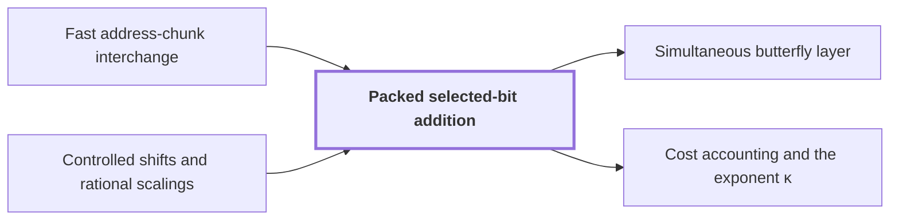

# Packed selected-bit addition

!!! info "Before this page"

    Packed selected-bit addition *swaps chunks by* [Fast address-chunk interchange](address-interchange.md "It rotates chunks by Controlled shifts and rational scalings in $O(V)$ time and swaps by Fast address-chunk interchange in $O(VL^\tau)$, for $\tau<1$.") and *rotates chunks by* [Controlled shifts and rational scalings](controlled-shifts.md "It rotates chunks by Controlled shifts and rational scalings in $O(V)$ time and swaps by Fast address-chunk interchange in $O(VL^\tau)$, for $\tau<1$.").

!!! abstract "Where this fits"

    1. A single deterministic Turing machine with a fixed finite alphabet and a fixed finite number of one-dimensional tapes multiplies two $n$-bit integers exactly in $O(n(\lg n)^{1-\kappa})$ worst-case time with $\kappa=2^{-182}$, disproving the $n\log n$ optimality conjecture of Sch\"onhage and Strassen in this model. — how: Build two power-saving tape procedures (chunk interchange and simultaneous butterfly layer) from fixed finite linear networks; use them to accelerate the synthetic polynomial transforms and ring convolution; use Gaussian resampling with retained permutations and chirps to reduce the prime-length cyclic convolution of the radix-digit coefficients to those power-of-two transforms; assemble the exact product with a proof that the error is below $1/2$; and total the cost to show a power of $\log n$ is saved. ([Power-saving integer multiplication](main-result.md "A deterministic fixed-tape Turing machine multiplying two n-bit integers exactly in O(n(lg n)^{1−κ}) time with κ = 2^{−182}, disproving the n log n optimality conjecture in this model."))
    2. Both tape primitives (the interchange of two address chunks of $u$ digits and the simultaneous butterfly layer on up to $d$ axes) cost the volume times a power below one of their width, because a call at parameter $mf$ makes $s$ calls at parameter $f$ on streams of volume $V/W$ with $s<Wm$, so the cost per unit volume grows by $s/W<m$ per factor $m$ of the parameter. — how: Build a fixed finite linear network of $W$ wires that exchanges two banks and restores all scratch values, make the representation of each wire's array vary along the network through frames so that an edge costs one smaller call per unit of rank, show the total rank $s$ is below $Wm$, fix an exponent, and solve the recurrence in the bit variant (interchange) and the complex variant (butterfly layer). ([Recursive power saving](rank-recurrence.md "Each call at parameter m·f makes s calls at parameter f on streams of 1/W the volume, so cost per unit volume grows by s/W < m per factor m, giving a power saving."))
    3. Complex variant: the tensor product of $H_0=\frac12\begin{pmatrix}1&1\\1&-1\end{pmatrix}$ on one bit of each of $D\le d$ address chunks (each of $K$ bits, selected at a common offset), acting coefficientwise on polynomial records with $r$ complex $p$-bit coefficients, is computed exactly followed by one truncation $Q_p$, in $O(Vd^{\lambda'})$ time with $\lambda'<1$, rather than $D$ whole-array passes. — how: Rewrite $H_0^{\otimes D}$ as $b^D\mathcal S_DC^{\otimes D}\mathcal S_D$ with the kernel $C$, apply $C^{\otimes e}$ to a group of $e=mf$ axes by the complex network with column phase frames (the binary changes of basis done by packed selected-bit additions), so that each of the $s_{\rm c}$ edge-residual vectors is one child on $f=e/m$ axes of volume $V/W$, and unroll the resulting recurrence with an exact-width guard bound. ([Simultaneous butterfly layer](simultaneous-layer.md "The second tape procedure: applying H₀ coefficientwise on the same bit of up to d address chunks in time O(V·d^λ′) for a fixed λ′ < 1, instead of d passes."))
    4. **This page:** Selected bits of two chunks can be XORed (with a third chunk as restored scratch) by eight cyclic shifts of whole chunk ranges plus a repair of an explicitly bounded exceptional set of addresses, in time $O(V(L^\tau+1)+MA_{\rm rect}^3+\delta_{\rm bad}MA_{\rm rect}(R+A_{\rm rect}))$.

??? note "Symbols from earlier pages"

    - $\tau$ — interchange exponent: The fixed exponent below $1$ in the cost $O(Vu^\tau)$ of the interchange. (on [Fast address-chunk interchange](address-interchange.md "The first tape procedure: exchanging two disjoint equal-width address fields of u digits in time O(V·u^τ) for a fixed τ < 1, using XOR combinations of intermediate data."))
    - $p$ — fractional bits: The number of fractional bits of the grid on which stored values lie. (on [Fixed-point Gaussian dyadic records](fixed-point.md "Complex values stored as signed two's-complement integers over a power-of-two denominator 2^{-p}; intermediate values are exact and one truncation Q_p rounds back to the p-bit grid."))
    - $d$ — axis count: The number of axes of the underlying cyclic convolution. (on [Cyclic convolution](convolution.md "The product of two sequences (or elements of a polynomial quotient ring) where indices wrap around: (f∗g)_k = Σ f_j g_{k−j}."))

Packed selected-bit addition XORs selected bits of an address chunk $x$ into chunk $y$, restoring a scratch chunk $z$, using shifts of whole chunks plus a repair of few exceptional addresses; the [simultaneous butterfly layer](simultaneous-layer.md "The second tape procedure: applying H₀ coefficientwise on the same bit of up to d address chunks in time O(V·d^λ′) for a fixed λ′ < 1, instead of d passes.") needs it for its binary changes of basis.

For a control bit $c$ (not a scaling integer) and integers $u,w$ (not a [DFT](dft.md "The normalized transform (F_q u)_k = (1/q) Σ u_j e^{−2πi jk/q}, which turns convolution into pointwise multiplication.") sequence, a chunk width or a wire index), $c[P]$ is $c$ if $P$ holds, else $0$. Perform in order
$$\begin{array}{llll}
(1)\ u\leftarrow u-c[w\bmod2=0] & (2)\ w\leftarrow w-c[u\bmod2=0] & (3)\ u\leftarrow u+c[w\bmod2=0] & (4)\ w\leftarrow w+c[u\bmod2=0]\\
(5)\ w\leftarrow w+c[u\bmod2=1] & (6)\ u\leftarrow u+c[w\bmod2=1] & (7)\ w\leftarrow w-c[u\bmod2=1] & (8)\ u\leftarrow u-c[w\bmod2=1]
\end{array}$$
For $c=1$, substituting the four parity pairs shows lines 1 to 4 permute the parities of $(u,w)$ by $(00\ 01\ 10)$ and lines 5 to 8 by $(01\ 10\ 11)$, composing to $(00\ 10)(01\ 11)$. So $(u',w')=(u+c(1-2(u\bmod2)),w)$: $u$ flips parity iff $c=1$, quotients by two persist, $w$ is restored. Each variable moves at most four.

Each address holds an $R$-bit record ($R$ is neither the scalar ring nor a row count) and three chunks $x,y,z$ ($y$ is not the ring variable) of $L=fK$ bits ($L$ is not a dimension loss), with $K\ge6$ the segment spacing ($K$ is not a tensor line) and $f$ the number of selected bits; other coordinates are spectators. Let $M$ count addresses ($M$ is not a vertex matrix), $V=MR$, and $A_{\rm rect}=\lceil\log_2(2V)\rceil$ bound counter lengths. Selected positions are $j_i=\rho+iK$, $0\le i<f$, with offset $0\le\rho<K$ ($\rho$ is not a role map); the goal is $y_{j_i}\leftarrow y_{j_i}\oplus x_{j_i}$.

Omit $j_{f-1}$ temporarily. For $0\le i<f-1$ the $K$ bits of $y$ from $j_i$ form a disjoint segment of value $u_i=2g_i+a_i$, and those of $z$ one of value $w_i=2h_i+b_i$, with bits $a_i,b_i$ and guard values $g_i,h_i\in\{0,\dots,2^{K-1}-1\}$, written $g$ for either ($g$ is a guard, not a gap). The control is $c_i=x_{j_i}$. Line (1) on all segments at once is
$$y\leftarrow y-\sum_{i=0}^{f-2}2^{j_i}[x_{j_i}=1][z_{j_i}=0]\pmod{2^L},$$
a cyclic shift of the whole chunk $y$ by an offset independent of $y$, hence a bijection of addresses. The others vary sign, parity or roles. Let $S_0$ compose the eight.

Let $\mathcal B$, the exceptional addresses, be those where some guard fails $10\le g\le2^{K-1}-11$. Off $\mathcal B$ each segment lies in $[20,2^K-21]$, so displacement eight stays in $[0,2^K-1]$: no carry or borrow between segments, so $S_0$ equals the ideal map $T_0$ doing the XORs at $j_0,\dots,j_{f-2}$.

Ten values are excluded at each end, twenty per guard<cite class="exegenius-ref" data-source="paper" data-locator="§5.2 Packed changes of selected address bits" data-quote="There are exactly twenty excluded values for each guard in" title="There are exactly twenty excluded values for each guard in"> (see §5.2 Packed changes of selected address bits)</cite>. At fixed spectator coordinates $y$ and $z$ range over all $2^L$ values, so each guard takes every value equally often and a fraction $20/2^{K-1}$ fail it. A union bound over the $2(f-1)$ guards gives $|\mathcal B|\le\delta_{\rm bad}M$, $\delta_{\rm bad}=\min\{1,80(f-1)2^{-K}\}$.

$T_0$ preserves guards, hence $\mathcal B$; bijections agreeing off $\mathcal B$ give $S_0(\mathcal B^c)=T_0(\mathcal B^c)=\mathcal B^c$ and $S_0(\mathcal B)=\mathcal B$. After $S_0$, the record at address $q$ ($q$ is not a radix or sequence length) came from $S_0^{-1}(q)$ and belongs at $q'=T_0S_0^{-1}(q)$, which fixes $\mathcal B^c$ and permutes $\mathcal B$.

Scan, counting each record's rank (stream index); dividing by the fixed field lengths gives the values of $x,y,z$ and their strides (records per unit step). Extract the records of $\mathcal B$ and compute $q'$ by undoing the eight shifts in reverse, then applying the XORs directly. The destination's rank is the current rank plus, per chunk, the signed value change times the stride. Attach it as a key; mark the vacated place, a hole. Stable radix sort touches only extracted records. As $q'$ permutes $\mathcal B$, keys are distinct and equal the holes' ranks, so one scan refilling holes in order applies $T_0$. Counters have $O(A_{\rm rect})$ bits and schoolbook operations cost $O(A_{\rm rect}^2)$ each, over $f\le A_{\rm rect}$ positions: $O(A_{\rm rect}^3)$ per record.

A rotation needs its target after its controls: swap it rightmost, rotate, undo the swap. That is at most sixteen swaps and eight rotations<cite class="exegenius-ref" data-source="paper" data-locator="§5.2 Packed changes of selected address bits" data-quote="There are at most sixteen swaps and eight rotations in $S_0$." title="There are at most sixteen swaps and eight rotations in $S_0$."> (see §5.2 Packed changes of selected address bits)</cite>. It rotates chunks by [Controlled shifts and rational scalings](controlled-shifts.md "Updating a target address field by an offset computed from earlier control fields, or multiplying it by a unit, in time linear in the array volume.") in $O(V)$ time and swaps by [Fast address-chunk interchange](address-interchange.md "The first tape procedure: exchanging two disjoint equal-width address fields of u digits in time O(V·u^τ) for a fixed τ < 1, using XOR combinations of intermediate data.") in $O(VL^\tau)$, for $\tau<1$.

Movement costs $O(V(L^\tau+1))$<cite class="exegenius-ref" data-source="paper" data-locator="§5.2 Packed changes of selected address bits" data-quote="The movement costs $O(V(L^\tau+1))$." title="The movement costs $O(V(L^\tau+1))$."> (see §5.2 Packed changes of selected address bits)</cite>. Scans cost $O(MA_{\rm rect}^3+V)$<cite class="exegenius-ref" data-source="paper" data-locator="§5.2 Packed changes of selected address bits" data-quote="costs $O(MA_{\rm rect}^3+V)$, and the at most $A_{\rm rect}$ radix passes cost" title="costs $O(MA_{\rm rect}^3+V)$, and the at most $A_{\rm rect}$ radix passes cost"> (see §5.2 Packed changes of selected address bits)</cite>, and radix passes $O(|\mathcal B|A_{\rm rect}(R+A_{\rm rect}))$<cite class="exegenius-ref" data-source="paper" data-locator="§5.2 Packed changes of selected address bits" data-quote="$O(|\mathcal B|A_{\rm rect}(R+A_{\rm rect}))$; skip them when the extracted bank is empty." title="$O(|\mathcal B|A_{\rm rect}(R+A_{\rm rect}))$; skip them when the extracted bank is empty."> (see §5.2 Packed changes of selected address bits)</cite>. Counters, positioning, rewinds and cleanup are included in this accounting<cite class="exegenius-ref" data-source="paper" data-locator="§5.2 Packed changes of selected address bits" data-quote="All counters, positioning, rewinds, and cleanup are included." title="All counters, positioning, rewinds, and cleanup are included."> (see §5.2 Packed changes of selected address bits)</cite>. Adding the three costs and using $|\mathcal B|\le\delta_{\rm bad}M$, the time is $O(V(L^\tau+1)+MA_{\rm rect}^3+\delta_{\rm bad}MA_{\rm rect}(R+A_{\rm rect}))$. Per $V$ the extra terms are $A_{\rm rect}^3/R$ and $80(f-1)2^{-K}A_{\rm rect}(1+A_{\rm rect}/R)$, both tending to zero when $A_{\rm rect}=O(p)$, $R$ exceeds every polynomial in $p$, $f\le d\le p$, $K/\log p\to\infty$; the cost is $O(V(L^\tau+1))$.

## Connections

Used by:

- [Simultaneous butterfly layer](simultaneous-layer.md "The layer performs each row addition by Packed selected-bit addition, which XORs them with a third chunk as restored scratch, by eight cyclic shifts of whole chunk ranges plus a repair of a bounded set of exceptional addresses.") *performs each row addition by* Packed selected-bit addition
- [Cost accounting and the exponent κ](cost-accounting.md "Exceptional addresses, where the packed shifts of Packed selected-bit addition fail, are bounded to a fraction $O(d2^{-K})$ of addresses.") *bounds the exceptional addresses of* Packed selected-bit addition

??? quote "From the sources"

    > Packed selected-bit addition on one rectangle
    >
    > — [Integer multiplication below n log n (OpenAI, 2026)](https://github.com/openai/math/tree/fd4aeeb2ee4fc729c18d98444fed42fd0529eeeb/preprints/Integer-multiplication-below-n-log-n-September-23-2026)

    > We implement a binary row addition on corresponding selected bits in two
    >
    > — [Integer multiplication below n log n (OpenAI, 2026)](https://github.com/openai/math/tree/fd4aeeb2ee4fc729c18d98444fed42fd0529eeeb/preprints/Integer-multiplication-below-n-log-n-September-23-2026)
