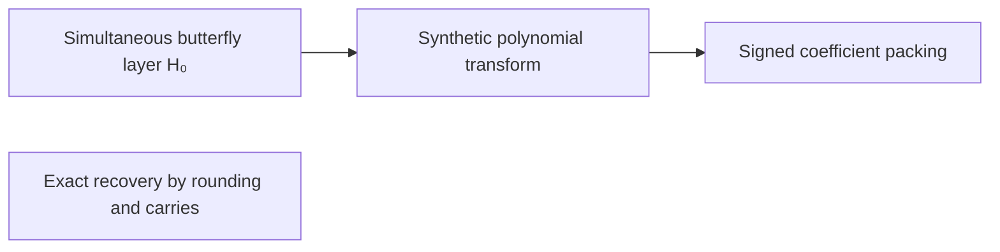

# Packed polynomial convolution

The normalized convolution is computed over $\mathbb{C}[y]/(y^r+1)$ by [butterfly layers](../butterfly-layer.md "The map H₀(u,v) = ((u+v)/2, (u−v)/2) applied at once to a selected coordinate bit of every chunk, a two-point butterfly acting coefficientwise on polynomial records.") and [synthetic transforms](../synthetic-transform.md "A discrete Fourier transform whose roots of unity are powers of y in the polynomial ring, so that each twiddle multiplication is a signed shift and the transform is computed by simultaneous butterfly layers."), in which twiddle multiplications become signed shifts. [Signed coefficient packing](../signed-packing.md "Encoding a polynomial with signed integer coefficients as one integer by placing coefficients at fixed bit offsets, so that a polynomial product becomes an integer product.") turns the polynomial products into integer products. [Exact recovery](../exact-recovery.md "Recovering the exact integer coefficients of a convolution by rounding the computed values, whose error is below one half, and then propagating carries in radix 2^b.") rounds the computed values, whose error is below $1/2$, and then propagates carries to give the binary product.

## Pages

1. [Simultaneous butterfly layer H₀](../butterfly-layer.md "The map H₀(u,v) = ((u+v)/2, (u−v)/2) applied at once to a selected coordinate bit of every chunk, a two-point butterfly acting coefficientwise on polynomial records.") — The map H₀(u,v) = ((u+v)/2, (u−v)/2) applied at once to a selected coordinate bit of every chunk, a two-point butterfly acting coefficientwise on polynomial records.
2. [Synthetic polynomial transform](../synthetic-transform.md "A discrete Fourier transform whose roots of unity are powers of y in the polynomial ring, so that each twiddle multiplication is a signed shift and the transform is computed by simultaneous butterfly layers.") — A discrete Fourier transform whose roots of unity are powers of y in the polynomial ring, so that each twiddle multiplication is a signed shift and the transform is computed by simultaneous butterfly layers.
3. [Signed coefficient packing](../signed-packing.md "Encoding a polynomial with signed integer coefficients as one integer by placing coefficients at fixed bit offsets, so that a polynomial product becomes an integer product.") — Encoding a polynomial with signed integer coefficients as one integer by placing coefficients at fixed bit offsets, so that a polynomial product becomes an integer product.
4. [Exact recovery by rounding and carries](../exact-recovery.md "Recovering the exact integer coefficients of a convolution by rounding the computed values, whose error is below one half, and then propagating carries in radix 2^b.") — Recovering the exact integer coefficients of a convolution by rounding the computed values, whose error is below one half, and then propagating carries in radix 2^b.

## Map

Arrows point from a page to the pages that build on it.

