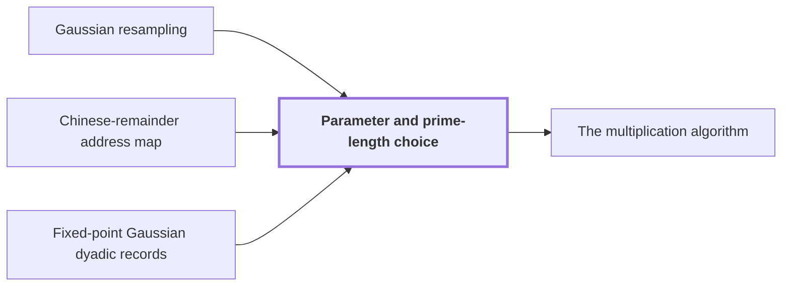

# Parameter and prime-length choice

!!! info "Before this page"

    Parameter and prime-length choice *fixes size for hypotheses of* [Gaussian resampling](gaussian-resampling.md "This page fixes every exponent and size for $n$-bit inputs so that the hypotheses of the butterfly-layer lemma and of Gaussian resampling hold at once."), *supplies the prime axis lengths of* [Chinese-remainder address map](crt-map.md "This choice supplies the prime axis lengths of the Chinese-remainder address map.") and *sets the precision of* [Fixed-point Gaussian dyadic records](fixed-point.md "Here $b$ is the digit width, $p$ sets the precision of the Fixed-point Gaussian dyadic records, and $d$ is the axis count.").

!!! abstract "Where this fits"

    1. A single deterministic Turing machine with a fixed finite alphabet and a fixed finite number of one-dimensional tapes multiplies two $n$-bit integers exactly in $O(n(\lg n)^{1-\kappa})$ worst-case time with $\kappa=2^{-182}$, disproving the $n\log n$ optimality conjecture of Sch\"onhage and Strassen in this model. — how: Build two power-saving tape procedures (chunk interchange and simultaneous butterfly layer) from fixed finite linear networks; use them to accelerate the synthetic polynomial transforms and ring convolution; use Gaussian resampling with retained permutations and chirps to reduce the prime-length cyclic convolution of the radix-digit coefficients to those power-of-two transforms; assemble the exact product with a proof that the error is below $1/2$; and total the cost to show a power of $\log n$ is saved. ([Power-saving integer multiplication](main-result.md "A deterministic fixed-tape Turing machine multiplying two n-bit integers exactly in O(n(lg n)^{1−κ}) time with κ = 2^{−182}, disproving the n log n optimality conjecture in this model."))
    2. The exact $2n$-bit product of the two inputs is obtained from the radix-digit convolution by the chain: radix digits, Chinese-remainder address map to a product of prime cyclic axes, two forward source transforms (resampling and chirps), pointwise product, opposite transform, rescaling, rounding, and carry propagation, with total error below $1/2$. — how: Reduce the integer product to a cyclic convolution of $S$ short coefficients and compute it through the chain of reductions (digits, CRT address map, Gaussian resampling with chirps, twist to the polynomial ring, synthetic-transform convolution); recover exact integers because the accumulated error is below $1/2$. ([The multiplication algorithm](multiplication-algorithm.md "Digits, then the CRT map, two forward transforms with resampling and chirps, a pointwise product, the opposite transform, rescaling, rounding and carry propagation yield the exact 2n-bit product."))
    3. **This page:** Fixed rational exponents and sizes make every hypothesis of the lemmas hold: $b=\lceil\log_2n\rceil$, $p=6b$, $d=\lfloor b^\epsilon\rfloor$, $K=\lfloor d^c\rfloor$, a power of two $T\in[4n/b,8n/b)$, $r=2^{\lceil(\log_2T)/d\rceil}$, axis lengths $t_i\in\{r/2,r\}$ with $\prod t_i=T$, $t_d=r$, and distinct odd primes $s_i\in((1-2\eta)t_i,(1-\eta)t_i]$.

??? note "Symbols from earlier pages"

    - $n$ — bit length: The number of bits in each of the two integers being multiplied. (on [Schönhage–Strassen optimality conjecture](conjecture.md "The 1971 proposal that n log n is the optimal order of growth for multiplying n-bit integers on a multitape Turing machine."))
    - $\kappa$ — power saving: A fixed positive constant, the amount by which the exponent of the logarithm is lowered. (on [Schönhage–Strassen optimality conjecture](conjecture.md "The 1971 proposal that n log n is the optimal order of growth for multiplying n-bit integers on a multitape Turing machine."))
    - $p$ — fractional bits: The number of fractional bits of the grid on which stored values lie. (on [Fixed-point Gaussian dyadic records](fixed-point.md "Complex values stored as signed two's-complement integers over a power-of-two denominator 2^{-p}; intermediate values are exact and one truncation Q_p rounds back to the p-bit grid."))
    - $T$ — padded length: The number of coefficients of the padded array, a power of two between 4n/b and 8n/b. (on [Multiplication as radix-digit convolution](radix-digit-reduction.md "Splitting each integer into radix-2^b digits turns the product into a convolution of short integer coefficients, which carry propagation turns back into a binary number."))
    - $r$ — record length: The number of complex coefficients in a polynomial of the ring, always a power of two. (on [Polynomial ring modulo y^r + 1](ring-y.md "Polynomials of degree below r over the complex numbers with y^r = −1, so multiplying by a power of y is a signed shift of the coefficient list."))
    - $\ell$ — address bits: The number of address bits of an axis of length r. (on [Chinese-remainder address map](crt-map.md "An isomorphism that places a cyclic convolution of length S = s₁⋯s_d on pairwise coprime prime axes, implemented as triangular controlled shifts."))
    - $t_i$ — padded axis length: The length of axis i after padding with zero records, a power of two between r/2 and r. (on [Chinese-remainder address map](crt-map.md "An isomorphism that places a cyclic convolution of length S = s₁⋯s_d on pairwise coprime prime axes, implemented as triangular controlled shifts."))
    - $i$ — axis index: The index of an axis, from 1 to d. (on [Chinese-remainder address map](crt-map.md "An isomorphism that places a cyclic convolution of length S = s₁⋯s_d on pairwise coprime prime axes, implemented as triangular controlled shifts."))
    - $\alpha$ — width parameter: The integer width parameter of the Gaussian weights, with 2 <= alpha < sqrt p. (on [Gaussian resampling](gaussian-resampling.md "Re-expressing a Fourier transform of prime length s through a transform of nearby power-of-two length t using Gaussian weights, so that only power-of-two transforms are needed."))
    - $s_i$ — axis length: The length of source axis i, pairwise coprime with the other axis lengths. (on [Chinese-remainder address map](crt-map.md "An isomorphism that places a cyclic convolution of length S = s₁⋯s_d on pairwise coprime prime axes, implemented as triangular controlled shifts."))
    - $S$ — convolution length: The length of the cyclic convolution, between T/2 and T, a product of distinct odd primes. (on [Multiplication as radix-digit convolution](radix-digit-reduction.md "Splitting each integer into radix-2^b digits turns the product into a convolution of short integer coefficients, which carry propagation turns back into a binary number."))

This page fixes every exponent and size for $n$-bit inputs so that the hypotheses of the butterfly-layer lemma and of [Gaussian resampling](gaussian-resampling.md "Re-expressing a Fourier transform of prime length s through a transform of nearby power-of-two length t using Gaussian weights, so that only power-of-two transforms are needed.") hold at once.

Fixed rational exponents make each inequality among them an integer comparison. In the [simultaneous butterfly layer](simultaneous-layer.md "The second tape procedure: applying H₀ coefficientwise on the same bit of up to d address chunks in time O(V·d^λ′) for a fixed λ′ < 1, instead of d passes."), $\tau$ is the exponent in the cost of a chunk interchange, $\sigma$ bounds the growth exponent of recursive calls, $\beta$ sets the threshold $d^\beta$ below which active chunks are handled singly, $\lambda$ is the per-node overhead exponent, $\lambda'$ is the final exponent of the cost $Vd^{\lambda'}$ (up to a constant) on bit volume $V$, $c$ is the exponent of the address-chunk width (here it is not the scaling integer of [Controlled shifts and rational scalings](controlled-shifts.md "Updating a target address field by an offset computed from earlier control fields, or multiplying it by a unit, in time linear in the array volume.")), $\epsilon$ is the exponent of the axis count, $C_1$ is the exponent of the guard bits, and $\delta$ is the resampling-cost slack.

Take $\tau=\sigma=1-2^{-50}$, $\beta=1/2$ and $\delta=1/16$. Take $\lambda=1-2^{-52}$ and $c=2^{-56}$. Take $\lambda'=1-2^{-54}$. Take $C_1=20$, $\epsilon=2^{-75}$ and $\kappa=2^{-182}$.

The layer needs $\max\{\tau,\sigma\}<\lambda<1$, $\tau(1+c/\beta)<\lambda$, $\max\{\lambda,\sigma+\beta(1-\sigma)\}<\lambda'<1$ and $\epsilon C_1<1$. The layer conditions hold with room to spare: $\tau(1+c/\beta)<1-31\cdot2^{-55}<\lambda$, since $\tau(1+c/\beta)=(1-2^{-50})(1+2^{-55})=1-31\cdot2^{-55}-2^{-105}$ and $\lambda=1-8\cdot2^{-55}$. Also $\sigma+\beta(1-\sigma)=1-2^{-51}<\lambda<\lambda'<1$, and $\epsilon C_1=20\cdot2^{-75}<1$.

## Sizes

For large $n$ put $b=\lceil\log_2n\rceil$, $p=6b$, $d=\lfloor b^\epsilon\rfloor$. Here $b$ is the digit width, $p$ sets the precision of the [Fixed-point Gaussian dyadic records](fixed-point.md "Complex values stored as signed two's-complement integers over a power-of-two denominator 2^{-p}; intermediate values are exact and one truncation Q_p rounds back to the p-bit grid."), and $d$ is the axis count. Put $K=\lfloor d^c\rfloor$, the width in bits of an address chunk. Take the power of two $T$ in $[4n/b,8n/b)$, so $Tp\in[24n,48n)$.

Let $r=2^{\lceil(\log_2T)/d\rceil}$ and $\ell=\log_2r$; choose $d\ell-\log_2T\in[0,d)$ of the axis lengths to be $r/2$ and the others $r$, with the last axis of length $r$. The count lies in $[0,d)$ since $\ell$ rounds up, so some axis has length $r$; the product is $r^d/2^{d\ell-\log_2T}=T$. Thus $t_i\in\{r/2,r\}$, $\prod_it_i=T$ and $t_d=r$.

The lemmas assume $a_dp^\epsilon\le d\le b_dp^\epsilon$, $2^{a_rp/d}\le r\le2^{b_rp/d}$ and $d\ell\le C_\ell p$ for fixed constants $a_d,b_d,a_r,b_r,C_\ell$. Since $2^{b-1}<n\le2^b$, we get $b/2\le\log_2T\le b$ for large $b$; with $b^\epsilon/2\le d\le b^\epsilon\le b$ this yields $\frac1{12}p^\epsilon\le d\le p^\epsilon$ and $\frac p{12d}\le\ell\le\frac p{3d}$. These choices give $Tp=\Theta(n)$, $d=\Theta(p^\epsilon)$, $K=\Theta(p^{\epsilon c})$, $\ell=\Theta(p^{1-\epsilon})$, $r=2^{\Theta(p^{1-\epsilon})}$, so the comparison constants $a_d=a_r=1/12$, $b_d=1$, $b_r=1/3$, $C_\ell=1$ can be fixed for all lengths at once.

## Primes

Put $\alpha=\lceil(12d^2b)^{1/4}\rceil$, the Gaussian width of resampling. Put $\gamma=2d\alpha^2$ and $\eta=1/(4d)$, where $\gamma$ is the exponent of the scale factor $2^\gamma$ of $d$-axis resampling, and $\eta$ is the smallest relative distance at which a prime $s_i$ may lie below $t_i$. As $\lceil A\rceil\le2A$ for real $A\ge1$ and $8\sqrt{12}<28$, then $\gamma<28d^2\sqrt b\le28b^{1/2+2\epsilon}\le28b^{2/3}$, so $2\le\alpha<\sqrt p$ eventually and $\gamma=o(b)$.

In the prime-interval lemma, $q$ is an integer, not a radix or a sequence length. By the prime-interval lemma of Harvey and van der Hoeven (used without proof), for $0<\eta<1/4$ and real $x>e^{2/\eta}$ the interval $(1-2\eta)x<q\le(1-\eta)x$ contains at least $\eta x/(2\log x)$ primes<cite class="exegenius-ref" data-source="paper" data-locator="§9.2.2 Prime source lengths" data-quote="contains at least $\eta x/(2\log x)$ primes" title="contains at least $\eta x/(2\log x)$ primes"> (see §9.2.2 Prime source lengths)</cite>. Both $x=r/2$ and $x=r$ qualify since $\log x>8d=2/\eta$, because $\log(r/2)/d=\Theta(p^{1-2\epsilon})\to\infty$; the count $x/(8d\log x)$ exceeds $d$ because $x>8d^2\log x$, as $\log(8d^2\log x)=\Theta(\log p)=o(\log x)$.

The two intervals are disjoint since $(1-\eta)r/2<(1-2\eta)r$, and lie above $2$. Choose distinct odd primes with $(1-2\eta)t_i<s_i\le(1-\eta)t_i$; $\gcd(s_i,t_i)=1$ as $t_i$ is a power of two. This choice supplies the prime axis lengths of the [Chinese-remainder address map](crt-map.md "An isomorphism that places a cyclic convolution of length S = s₁⋯s_d on pairwise coprime prime axes, implemented as triangular controlled shifts."). Put $S=\prod_is_i$, the product of the chosen prime lengths.

Multiplying the lower bounds and applying strict Bernoulli gives $S/T>(1-1/(2d))^d>1/2$ for $d\ge2$. With $s_i<t_i$ this gives $T/2<S<T$.

With $\theta_i=t_i/s_i-1\ge\eta/(1-\eta)>\eta$ we get $\alpha^4\theta_i>12d^2b/(4d)=3db\ge6b=p$, the separation hypothesis of the resampling lemma; also $t_i\le r\le T<2^p$.

The machine scans both intervals and trial-divides each candidate, at cost $dr^{3/2}\operatorname{poly}(p)$ with logarithm $o(p)$. The deterministic search for the primes takes $n^{o(1)}=o(n)$ time, since its logarithm is $o(p)$ and $p=\Theta(\log n)$; all primes and length parameters are generated by the machine, not given as advice.<cite class="exegenius-ref" data-source="paper" data-locator="§9.2.2 Prime source lengths" data-quote="the search takes $n^{o(1)}=o(n)$ time" title="the search takes $n^{o(1)}=o(n)$ time"> (see §9.2.2 Prime source lengths)</cite>

## Why $\kappa=2^{-182}$

The constants are conservative: no optimization is claimed<cite class="exegenius-ref" data-source="paper" data-locator="§9.1 A fixed rational choice" data-quote="These constants are deliberately conservative; no optimization is claimed." title="These constants are deliberately conservative; no optimization is claimed."> (see §9.1 A fixed rational choice)</cite>. They only need to give some fixed $\kappa>0$, and $\kappa$ is then forced by the cost accounting. Divided by $V=Tp$, the cost of each of seven kinds of operation is a power of $p$, and each of these exponents is at most $1-2\kappa$<cite class="exegenius-ref" data-source="paper" data-locator="§9.8 The complete time bound" data-quote="Each of the seven displayed powers is at most $1-2\kappa$" title="Each of the seven displayed powers is at most $1-2\kappa$"> (see §9.8 The complete time bound)</cite>. Any fixed power of $\log p$ is eventually at most $p^\kappa$<cite class="exegenius-ref" data-source="paper" data-locator="§9.8 The complete time bound" data-quote="Any fixed power of $\log p$ is at most $p^\kappa$" title="Any fixed power of $\log p$ is at most $p^\kappa$"> (see §9.8 The complete time bound)</cite>. So the total is, up to a constant, $Tp\cdot p^{1-2\kappa}p^{\kappa}=Tp\cdot p^{1-\kappa}$, which is $n(\log n)^{1-\kappa}$ since $p=\Theta(\log n)$ and $Tp=\Theta(n)$: one $\kappa$ of the margin absorbs the logarithmic factors and the other is the saving. Hence $2\kappa$ may not exceed the smallest margin below one.

The smallest margin belongs to the chunk exchanges, whose normalized cost $pK^{\tau-1}$ is a power $1-\epsilon c(1-\tau)$ of $p$ because $K=\Theta(p^{\epsilon c})$. Its margin is $\epsilon c(1-\tau)=2^{-75}\cdot2^{-56}\cdot2^{-50}=2^{-181}$. The next smallest is $\epsilon(1-\lambda')=2^{-129}$ for the simultaneous butterfly rounds, and the others are larger. So the smallest margin is $2^{-181}=2\kappa$<cite class="exegenius-ref" data-source="paper" data-locator="§9.8 The complete time bound" data-quote="=2^{-181}=2\kappa" title="=2^{-181}=2\kappa"> (see §9.8 The complete time bound)</cite>, and $2^{-182}$ is the largest power of two allowed. The product of three small exponents is unavoidably tiny: $\epsilon(2-\tau)<1-\tau$ and $\tau(1+c/\beta)<1$ already force $\epsilon<2^{-50}$ and $c<2^{-50}$.

## Connections

Used by:

- [The multiplication algorithm](multiplication-algorithm.md "It takes its sizes from Parameter and prime-length choice: $b=\lceil\log_2 n\rceil$ bits per radix digit, $p=6b$ fractional bits for every stored value, distinct odd primes $s_i$ with product $S$, and powers of two $t_i$ just above $s_i$ with product $T$.") *takes its sizes from* Parameter and prime-length choice

??? quote "From the sources"

    > b=\lceil\log_2n\rceil,\quad p=6b,\quad d=\lfloor b^\epsilon\rfloor,
    >
    > — [Integer multiplication below n log n (OpenAI, 2026)](https://github.com/openai/math/tree/fd4aeeb2ee4fc729c18d98444fed42fd0529eeeb/preprints/Integer-multiplication-below-n-log-n-September-23-2026)

    > The distinct prime lengths $s_i$ must be close to the powers of two
    >
    > — [Integer multiplication below n log n (OpenAI, 2026)](https://github.com/openai/math/tree/fd4aeeb2ee4fc729c18d98444fed42fd0529eeeb/preprints/Integer-multiplication-below-n-log-n-September-23-2026)
