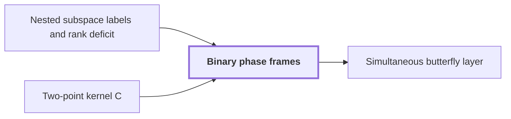

# Binary phase frames

!!! info "Before this page"

    Binary phase frames *are attached to the labels of* [Nested subspace labels and rank deficit](subspace-labels.md "Binary phase frames are operators attached to the labels of Nested subspace labels and rank deficit in the complex network, chosen so that every edge difference splits into one two-point kernel per dimension of change, which makes each residual dimension one smaller call of a butterfly-type operation, as the recursion needs.") and *is a translate of* [Two-point kernel C](phase-kernel.md "Each edge factor is a translate $aI+bX_v$ of Two-point kernel C, one per basis vector.").

!!! abstract "Where this fits"

    1. A single deterministic Turing machine with a fixed finite alphabet and a fixed finite number of one-dimensional tapes multiplies two $n$-bit integers exactly in $O(n(\lg n)^{1-\kappa})$ worst-case time with $\kappa=2^{-182}$, disproving the $n\log n$ optimality conjecture of Sch\"onhage and Strassen in this model. — how: Build two power-saving tape procedures (chunk interchange and simultaneous butterfly layer) from fixed finite linear networks; use them to accelerate the synthetic polynomial transforms and ring convolution; use Gaussian resampling with retained permutations and chirps to reduce the prime-length cyclic convolution of the radix-digit coefficients to those power-of-two transforms; assemble the exact product with a proof that the error is below $1/2$; and total the cost to show a power of $\log n$ is saved. ([Power-saving integer multiplication](main-result.md "A deterministic fixed-tape Turing machine multiplying two n-bit integers exactly in O(n(lg n)^{1−κ}) time with κ = 2^{−182}, disproving the n log n optimality conjecture in this model."))
    2. Both tape primitives (the interchange of two address chunks of $u$ digits and the simultaneous butterfly layer on up to $d$ axes) cost the volume times a power below one of their width, because a call at parameter $mf$ makes $s$ calls at parameter $f$ on streams of volume $V/W$ with $s<Wm$, so the cost per unit volume grows by $s/W<m$ per factor $m$ of the parameter. — how: Build a fixed finite linear network of $W$ wires that exchanges two banks and restores all scratch values, make the representation of each wire's array vary along the network through frames so that an edge costs one smaller call per unit of rank, show the total rank $s$ is below $Wm$, fix an exponent, and solve the recurrence in the bit variant (interchange) and the complex variant (butterfly layer). ([Recursive power saving](rank-recurrence.md "Each call at parameter m·f makes s calls at parameter f on streams of 1/W the volume, so cost per unit volume grows by s/W < m per factor m, giving a power saving."))
    3. Attaching to the gates nondegenerate subspaces of an $m$-dimensional space, nested along every edge, the number of smaller calls (the total rank of the edge changes) is $s_{\rm b}=W_{\rm b}m-N+2L_{\rm b}$ for the bit network and $s_{\rm c}=W_{\rm c}m-2N+2L_{\rm c}$ for the complex network, both strictly less than $Wm$, because $L/N<1/2$. — how: Choose labels in $\mathcal F=F^{\otimes3}$ built from the triple indicator vectors, with terminal labels $U_a\to\mathcal F$ on $X_a$ and $0\to U_a^\perp$ on $Y_a$; expose one tensor factor per stage; tabulate dimension changes edge by edge to find that all decreases are the central wires' return from time 3 to 4; then convert the dimension count into rational rank (bit) and Gaussian-dyadic phase kernels (complex). ([Nested subspace labels and rank deficit](subspace-labels.md "Assigning nondegenerate subspaces of an m-dimensional space to gates so adjacent labels are nested; the total dimension change over edges, the number s of smaller calls, is strictly less than W·m."))
    4. **This page:** Complex network: with binary labels and the phase frames $\mathcal C_U=H^{\otimes m}\operatorname{diag}(i^{\operatorname{wt}(P_Ux)\bmod 4})H^{\otimes m}$, every edge difference is a product of one translation kernel $aI+bX_v$ (or its inverse) per vector of an orthonormal basis of the edge residual; the total number of kernels is $s_{\rm c}=W_{\rm c}m-2N+2L_{\rm c}<W_{\rm c}m$ and, after endpoint corrections, the network applies $C^{\otimes m}$ on every role.

??? note "Symbols from earlier pages"

    - $U$ — subspace: A subspace of a space with a symmetric bilinear form; later a label. (on [Nested subspace labels and rank deficit](subspace-labels.md "Assigning nondegenerate subspaces of an m-dimensional space to gates so adjacent labels are nested; the total dimension change over edges, the number s of smaller calls, is strictly less than W·m."))
    - $X$ — bit flip: The 2x2 matrix swapping the two entries of a pair. (on [Two-point kernel C](phase-kernel.md "The matrix C = aI + bX with a = (1+i)/2, b = (1−i)/2, a square root of the bit flip, linked to the butterfly by H₀ = b·S·C·S with S = diag(1, i)."))
    - $C$ — two-point kernel: The matrix aI + bX. (on [Two-point kernel C](phase-kernel.md "The matrix C = aI + bX with a = (1+i)/2, b = (1−i)/2, a square root of the bit flip, linked to the butterfly by H₀ = b·S·C·S with S = diag(1, i)."))
    - $H$ — Hadamard matrix: The normalized Hadamard matrix sqrt(2) H_0. (on [Two-point kernel C](phase-kernel.md "The matrix C = aI + bX with a = (1+i)/2, b = (1−i)/2, a square root of the bit flip, linked to the butterfly by H₀ = b·S·C·S with S = diag(1, i)."))
    - $I$ — identity matrix: The 2x2 identity matrix. (on [Two-point kernel C](phase-kernel.md "The matrix C = aI + bX with a = (1+i)/2, b = (1−i)/2, a square root of the bit flip, linked to the butterfly by H₀ = b·S·C·S with S = diag(1, i)."))
    - $L_{\rm c}$ — complex loss: The total dimension lost on the decreasing edges of the complex network. (on [Nested subspace labels and rank deficit](subspace-labels.md "Assigning nondegenerate subspaces of an m-dimensional space to gates so adjacent labels are nested; the total dimension change over edges, the number s of smaller calls, is strictly less than W·m."))
    - $N$ — bank size: The number of values in each data bank. (on [Linear exchange network with restored scratch wires](exchange-network.md "A fixed network of linear gates on wires holding values that swaps two banks with a prescribed sign while undoing the effect of arbitrary initial scratch values, built from three-element subsets."))
    - $W_{\rm c}$ — complex wire count: The total number of wires in the complex network. (on [Linear exchange network with restored scratch wires](exchange-network.md "A fixed network of linear gates on wires holding values that swaps two banks with a prescribed sign while undoing the effect of arbitrary initial scratch values, built from three-element subsets."))
    - $s_{\rm c}$ — complex smaller-call count: The number of smaller calls made by the edges of the complex network. (on [Nested subspace labels and rank deficit](subspace-labels.md "Assigning nondegenerate subspaces of an m-dimensional space to gates so adjacent labels are nested; the total dimension change over edges, the number s of smaller calls, is strictly less than W·m."))
    - $\mathcal F$ — label space: The label space F tensor F tensor F, of dimension m. (on [Nested subspace labels and rank deficit](subspace-labels.md "Assigning nondegenerate subspaces of an m-dimensional space to gates so adjacent labels are nested; the total dimension change over edges, the number s of smaller calls, is strictly less than W·m."))
    - $U_a$ — data line: The line spanned by the tensor product of the indicators of the three triples of the data index a. (on [Nested subspace labels and rank deficit](subspace-labels.md "Assigning nondegenerate subspaces of an m-dimensional space to gates so adjacent labels are nested; the total dimension change over edges, the number s of smaller calls, is strictly less than W·m."))

Binary phase frames are operators attached to the labels of [Nested subspace labels and rank deficit](subspace-labels.md "Assigning nondegenerate subspaces of an m-dimensional space to gates so adjacent labels are nested; the total dimension change over edges, the number s of smaller calls, is strictly less than W·m.") in the complex network, chosen so that every edge difference splits into one two-point kernel per dimension of change, which makes each residual dimension one smaller call of a butterfly-type operation, as the recursion needs.

Several letters change meaning on this page. Here $v$ is a binary vector, not the number of triples on the exchange-network page. Here $E$ is an edge residual, not the first tensor factor on the tensor-product page. Here $k$ counts columns of data, not the depth on the fixed-point page. Here $u$ is a binary vector, not the input sequence on the [discrete Fourier transform](dft.md "The normalized transform (F_q u)_k = (1/q) Σ u_j e^{−2πi jk/q}, which turns convolution into pointwise multiplication.") page. Labels are subspaces of $\mathbb F_2^m$ ($m$ the label dimension), and $u,v,w,z$ are vectors of $\mathbb F_2^m$ here. The support $\operatorname{supp}(z)$ of a vector is the set of coordinates where it is $1$. Write $\operatorname{wt}(x)=|\operatorname{supp}(x)|$ for the Hamming weight, $[b]\in\{0,1\}$ for the integer representative of $b\in\mathbb F_2$, $P_U$ for projection onto a label $U$, and $z\cdot w$ for the dot product, both over $\mathbb F_2$. A vector $v$ has binary norm one when $v\cdot v=1$, equivalently $\operatorname{wt}(v)$ is odd; a basis is orthonormal when its vectors have norm one and are pairwise orthogonal. Let $X_v$ be the translation $(X_vf)(x)=f(x+v)$, and $C=H\operatorname{diag}(1,i)H=aI+bX$ with $a=\frac{1+i}{2}$, $b=\frac{1-i}{2}$, where $H=\tfrac1{\sqrt2}\begin{pmatrix}1&1\\1&-1\end{pmatrix}$.

For a label $U$ put $q_U(x)=\operatorname{wt}(P_Ux)\bmod 4$, with the projection taken over $\mathbb F_2$. The phase frame is $\mathcal C_U=H^{\otimes m}\operatorname{diag}_x(i^{q_U(x)})H^{\otimes m}$, with Gaussian-dyadic entries.<cite class="exegenius-ref" data-source="paper" data-locator="§3.5 The binary phase interface" data-quote="Each entry of $\mathcal C_U$ and its inverse is a Gaussian integer divided by $2^m$" title="Each entry of $\mathcal C_U$ and its inverse is a Gaussian integer divided by $2^m$"> (see §3.5 The binary phase interface)</cite>

## Weight modulo four

For binary vectors $z,w$, $\operatorname{wt}(z+w)=\operatorname{wt}(z)+\operatorname{wt}(w)-2|\operatorname{supp}(z)\cap\operatorname{supp}(w)|$, since a coordinate in both supports holds $1+1=0$. If $z\cdot w=0$ the intersection cardinality is even, so weight is additive modulo four on orthogonal vectors.

Take an edge from $U$ to $V=U\perp E$, where $E$, the edge residual, has orthonormal basis $\mathcal B$. Then $P_Vx=P_Ux+\sum_{v\in\mathcal B}[v\cdot x]\,v$, a sum of pairwise orthogonal vectors. So $q_V(x)-q_U(x)=\sum_{v\in\mathcal B}\operatorname{wt}(v)[v\cdot x]\pmod 4$, negated on a decreasing edge, and each $\operatorname{wt}(v)$ is odd. Each term is therefore $\varepsilon[v\cdot x]$ with $\varepsilon=\pm1$ modulo four, the sign including the edge direction. The function $i^{\varepsilon[v\cdot x]}$ equals $\frac{1+i^\varepsilon}2+\frac{1-i^\varepsilon}2(-1)^{v\cdot x}$, as checking $v\cdot x=0,1$ shows.

## From phases to kernels

Since $H^2=I$, $\mathcal C_V\mathcal C_U^{-1}=H^{\otimes m}\operatorname{diag}(i^{q_V-q_U})H^{\otimes m}$, a product over $\mathcal B$. The character $(-1)^{v\cdot x}$ is $\operatorname{diag}(1,-1)$ on the coordinates in $\operatorname{supp}(v)$. Since $H\operatorname{diag}(1,-1)H=X$, the character $(-1)^{v\cdot x}$ becomes the translation $X_v$, so the phase becomes $aI+bX_v$ or its inverse. For $\varepsilon=-1$ the coefficients swap, giving $bI+aX_v$, the inverse because $a^2+b^2=0$ and $2ab=1$. Each edge factor is a translate $aI+bX_v$ of [Two-point kernel C](phase-kernel.md "The matrix C = aI + bX with a = (1+i)/2, b = (1−i)/2, a square root of the bit flip, linked to the butterfly by H₀ = b·S·C·S with S = diag(1, i)."), one per basis vector.

Let $L_{\rm c}$ be the total dimension lost on decreasing edges, $N$ the bank size and $W_{\rm c}$ the wire count. The number of translation-kernel factors over the network is $s_{\rm c}=W_{\rm c}m-2N+2L_{\rm c}=1873807244636671267308000000<W_{\rm c}m$.<cite class="exegenius-ref" data-source="paper" data-locator="§3.5 The binary phase interface" data-quote="s_{\rm c}=W_{\rm c}m-2N+2L_{\rm c}" title="s_{\rm c}=W_{\rm c}m-2N+2L_{\rm c}"> (see §3.5 The binary phase interface)</cite> The deficit of $s_{\rm c}$ from $W_{\rm c}m$ is $2N-2L_{\rm c}>0$, since $L_{\rm c}/N<\frac12$.

## Terminal pairs

Source and sink labels are $U_a\to\mathcal F$ on $X_a$, $0\to U_a^\perp$ on $Y_a$ and $0\to\mathcal F$ on scratch, with $U_a$ the line spanned by $u_a=t_{a_1}\otimes t_{a_2}\otimes t_{a_3}$. For $k$ columns (an address is a $k$-tuple), [Frames on wire arrays](array-frames.md "Replacing each wire scalar by an array and assigning an invertible operator D_v (a frame) at each gate so the pointwise gate commutes with the frame and only the endpoint frames matter.") gives each role the $k$th tensor power of the sink frame times the inverse source frame, with $X_a,Y_a$ exchanged. Label $0$ has frame $I$. For $\mathcal F$, $q_{\mathcal F}(x)=\operatorname{wt}(x)$ and $i^{\operatorname{wt}(x)}=\prod_ji^{x_j}$, so its frame is $C^{\otimes m}$. Only $X_a\to Y_a$ differs.

For it take $u=u_a$, with $3^3=27$ ones, so $u\cdot u=1$ and $P_{U_a}x=[u\cdot x]u$. Orthogonality of $P_{U_a}x$ and $P_{U_a^\perp}x$ gives $\operatorname{wt}(x)\equiv q_{U_a}+q_{U_a^\perp}$, hence $q_{U_a^\perp}-q_{U_a}=\operatorname{wt}(x)-2\operatorname{wt}(u)[u\cdot x]=\operatorname{wt}(x)+2[u\cdot x]\pmod 4$. As $2[u\cdot x]\equiv2\sum_{j\in\operatorname{supp}(u)}x_j$, the phase per coordinate is $i^{-x_j}$ on the 27 coordinates of $\operatorname{supp}(u)$ and $i^{x_j}$ elsewhere, so the operator is $C^{-1}$ on the 27 coordinates of $\operatorname{supp}(u)$ and $C$ elsewhere.

With $Z=\operatorname{diag}(1,-1)$ we have $ZXZ=-X$ and $C^{-1}=bI+aX$; since $ib=a$ and $ia=-b$, $C=iZC^{-1}Z$. Let $Z_{a,k}$ be $Z$ on those 27 coordinates in every column. Apply $Z_{a,k}$ before the network at $X_a$ and $i^{27k}Z_{a,k}$ after it at $Y_a$. The identity $C=iZC^{-1}Z$ turns each of the $27k$ inverse factors into $C$, so every role, including scratch roles, receives $C^{\otimes mk}$ once the physical $X$ outputs, which carry the minus sign of the scalar exchange, are negated and outputs are renamed to input roles.

## Connections

Used by:

- [Simultaneous butterfly layer](simultaneous-layer.md "The group is handled by the network of Binary phase frames, with $W$ wires and $s$ smaller calls.") *is handled by the network of* Binary phase frames

??? quote "From the sources"

    > \mathcal C_U=H^{\otimes m}\operatorname{diag}_x(i^{q_U(x)})H^{\otimes m}
    >
    > — [Integer multiplication below n log n (OpenAI, 2026)](https://github.com/openai/math/tree/fd4aeeb2ee4fc729c18d98444fed42fd0529eeeb/preprints/Integer-multiplication-below-n-log-n-September-23-2026)

    > The binary phase interface
    >
    > — [Integer multiplication below n log n (OpenAI, 2026)](https://github.com/openai/math/tree/fd4aeeb2ee4fc729c18d98444fed42fd0529eeeb/preprints/Integer-multiplication-below-n-log-n-September-23-2026)
