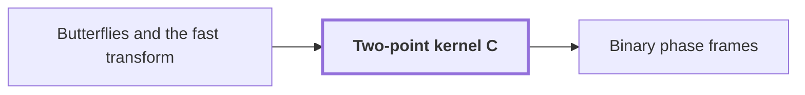

# Two-point kernel C

!!! info "Before this page"

    Two-point kernel C *is obtained from* [Butterflies and the fast transform](butterfly.md "The kernel $C$ is obtained from the two-point step of Butterflies and the fast transform by conjugating with $\mathsf S$ and rescaling:"). Assumed known: Complex numbers.

!!! abstract "Where this fits"

    - Relied on to show: Complex network: with binary labels and the phase frames $\mathcal C_U=H^{\otimes m}\operatorname{diag}(i^{\operatorname{wt}(P_Ux)\bmod 4})H^{\otimes m}$, every edge difference is a product of one translation kernel $aI+bX_v$ (or its inverse) per vector of an orthonormal basis of the edge residual; the total number of kernels is $s_{\rm c}=W_{\rm c}m-2N+2L_{\rm c}<W_{\rm c}m$ and, after endpoint corrections, the network applies $C^{\otimes m}$ on every role. ([Binary phase frames](phase-frames.md "Frames C_U = H^{⊗m} diag(i^{wt(P_U x) mod 4}) H^{⊗m} whose edge differences are products of translation kernels aI + bX_v, one per vector of an orthonormal residual basis."))
    - Relied on to show: Complex variant: the tensor product of $H_0=\frac12\begin{pmatrix}1&1\\1&-1\end{pmatrix}$ on one bit of each of $D\le d$ address chunks (each of $K$ bits, selected at a common offset), acting coefficientwise on polynomial records with $r$ complex $p$-bit coefficients, is computed exactly followed by one truncation $Q_p$, in $O(Vd^{\lambda'})$ time with $\lambda'<1$, rather than $D$ whole-array passes. ([Simultaneous butterfly layer](simultaneous-layer.md "The second tape procedure: applying H₀ coefficientwise on the same bit of up to d address chunks in time O(V·d^λ′) for a fixed λ′ < 1, instead of d passes."))
    - Relied on to show: The kernel $C=aI+bX$ satisfies $H_0=b\,\mathsf SC\mathsf S$ (with $\mathsf S=\operatorname{diag}(1,i)$), $C^2=X$ and $C^4=I$.
    - Relied on to show: A group of $e=mf$ axes is handled by the complex network: each edge residual vector is one child on $f$ axes, an arbitrary residual basis is moved into coordinate position by binary changes of basis (products of at most $m(m-1)+3m$ row additions), and inverse children use forward ones, so there are exactly $s_{\rm c}$ children.

The two-point kernel is a $2\times 2$ matrix that squares to the bit flip and differs from the butterfly step only by phase factors; it is the building block of the phase networks used later.

Let $a=\frac{1+i}{2}$ be a complex constant, which is not a bank index. Let $b=\frac{1-i}{2}$ be the kernel coefficient, which here is not the lowest bit of the output index as on the butterfly page. Let $I$ be the $2\times 2$ identity matrix, and let $X=\begin{pmatrix}0&1\\1&0\end{pmatrix}$ be the bit flip, which swaps the two entries of a pair $(u,v)$. The kernel is $C=aI+bX$. Let $\mathsf S=\operatorname{diag}(1,i)$ be the phase matrix that multiplies the second entry of a pair by $i$. Let $H_0=\frac12\begin{pmatrix}1&1\\1&-1\end{pmatrix}$ be the matrix of the averaging and differencing step $(u,v)\mapsto\bigl(\tfrac{u+v}{2},\tfrac{u-v}{2}\bigr)$, and let $H=\sqrt2\,H_0$ be the normalized Hadamard matrix, which is symmetric and satisfies $H^2=I$.

## Why it is a square root of the flip

Since $a^2+b^2=\frac{i}{2}-\frac{i}{2}=0$ and $2ab=1$, we get $C^2=(a^2+b^2)I+2ab\,X=X$, and therefore $C^4=X^2=I$. In terms of eigenvectors, $X$ has eigenvalue $1$ on $(1,1)$ and $-1$ on $(1,-1)$, while $C$ has eigenvalues $a+b=1$ and $a-b=i$ on the same vectors. Equivalently $C=H\mathsf SH$<cite class="exegenius-ref" data-source="paper" data-locator="§5.1 Phase frames for a simultaneous butterfly layer" data-quote="C=H\mathsf SH=aI+bX" title="C=H\mathsf SH=aI+bX"> (see §5.1 Phase frames for a simultaneous butterfly layer)</cite>. Thus $C$ applies the phase $\mathsf S$ in the basis where $X$ is diagonal, and one application of $C$ is "half" a flip.

## Link to the butterfly

The kernel $C$ is obtained from the two-point step of [Butterflies and the fast transform](butterfly.md "A two-point averaging/differencing step H₀(u,v) = ((u+v)/2, (u−v)/2) whose repeated use over address bits, with twiddle multiplications, computes a transform in log t layers.") by conjugating with $\mathsf S$ and rescaling:
$$H_0=b\,\mathsf S\,C\,\mathsf S,\qquad C^2=X$$
<cite class="exegenius-ref" data-source="paper" data-locator="§5.1 Phase frames for a simultaneous butterfly layer" data-quote="H_0=b\mathsf SC\mathsf S,\qquad C^2=X" title="H_0=b\mathsf SC\mathsf S,\qquad C^2=X"> (see §5.1 Phase frames for a simultaneous butterfly layer)</cite>. One can check the first identity by multiplying out: $\mathsf SC\mathsf S=\begin{pmatrix}a&ib\\ib&-a\end{pmatrix}$, and multiplying by $b$ uses $ab=\frac12$ and $ib^2=\frac12$.

The reason to prefer $C$ is that it is a combination $aI+bX$ of the identity and a bit flip. When the flip acts on one address bit of a larger array, such a combination is a translation-like kernel, and the networks built from these kernels are described on the page on binary phase frames. The coefficients $a$ and $b$ are Gaussian dyadic (real and imaginary parts are dyadic rationals), so $C$ and its inverse $C^{-1}=bI+aX$ are exact on fixed-point records. The Hadamard factors in $C=H\mathsf SH$ serve to prove identities and need not be executed by the machine.

## Connections

Used by:

- [Binary phase frames](phase-frames.md "Each edge factor is a translate $aI+bX_v$ of Two-point kernel C, one per basis vector.") *is a translate of* Two-point kernel C

??? quote "From the sources"

    > C=H\mathsf SH=aI+bX
    >
    > — [Integer multiplication below n log n (OpenAI, 2026)](https://github.com/openai/math/tree/fd4aeeb2ee4fc729c18d98444fed42fd0529eeeb/preprints/Integer-multiplication-below-n-log-n-September-23-2026)

    > H_0=b\mathsf SC\mathsf S,\qquad C^2=X
    >
    > — [Integer multiplication below n log n (OpenAI, 2026)](https://github.com/openai/math/tree/fd4aeeb2ee4fc729c18d98444fed42fd0529eeeb/preprints/Integer-multiplication-below-n-log-n-September-23-2026)
