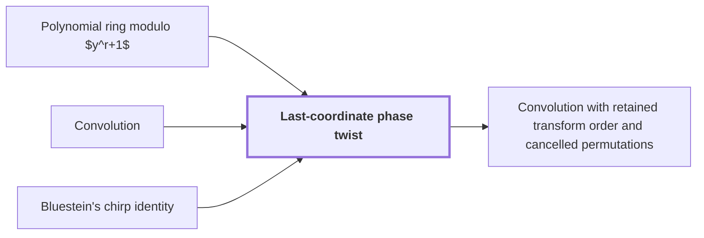

# Last-coordinate phase twist

!!! info "Before this page"

    Last-coordinate phase twist *turns the last cyclic coordinate into* [Polynomial ring modulo $y^r+1$](poly-ring-y-r.md "The twist turns the last cyclic coordinate into the Polynomial ring modulo $y^r+1$."), *rescales the coefficients of* [Convolution](convolution.md "The twist rescales the coefficients of a Convolution so that its cyclic wrap on the last axis becomes a negative wrap in $\mathbb C[y]/(y^r+1)$.") and *is applied after* [Bluestein's chirp identity](bluestein-chirp.md "It is applied after Bluestein's chirp identity has turned the middle transform into a cyclic convolution.").

!!! abstract "Where this fits"

    1. An $n$-bit integer product is computed by a fixed-tape machine in $O(n(\lg n)^{1-\kappa})$ time, $\kappa=2^{-182}$. — how: reduce multiplication to ring convolution and speed up its address moves and butterfly layers ([Integer multiplication in O(n(lg n)^{1-κ}) time](main-theorem.md "Deterministic fixed-tape Turing machine multiplying n-bit integers in O(n(lg n)^{1-κ}), κ=2^{-182}, by reducing to ring convolution with fast address interchanges and simultaneous butterfly layers, disproving the n log n conjecture in this model."))
    2. **This page:** A phase twist turns the last cyclic coordinate into a polynomial modulo $y^r+1$, whose negative wrap gives the original cyclic wrap after untwisting.

??? note "Symbols from earlier pages"

    - $r$ — ring degree: The number of complex coefficients in each element of the ring, a power of two. (on [Polynomial ring modulo $y^r+1$](poly-ring-y-r.md "Complex-coefficient polynomials in y reduced by y^r = -1, so multiplying by a power of y is a signed shift of the coefficient list and powers of y serve as roots of unity."))

A last-coordinate phase twist is a coefficientwise rescaling that makes the last cyclic axis of a convolution behave like a product of polynomials, so that the remaining axes can be convolved over a polynomial ring. It is applied after [Bluestein's chirp identity](bluestein-chirp.md "Rewrites a discrete Fourier transform as a cyclic convolution via chirp phases.") has turned the middle transform into a cyclic convolution.

Let $\sigma$ and $\tau$ be exponents on the last axis, with $0\le \sigma,\tau<r$. Let $x$ be the variable of the cyclic ring $\mathbb C[x]/(x^r-1)$, whose exponents wrap modulo $r$. Let $\lambda=e^{\pi \mathrm i/r}$, where $\mathrm i$ is the imaginary unit, so $\lambda^r=-1$. The twist is the ring map $x\mapsto \lambda y$, well defined since $(\lambda y)^r=1$. The twist turns the last cyclic coordinate into the [Polynomial ring modulo $y^r+1$](poly-ring-y-r.md "Complex-coefficient polynomials in y reduced by y^r = -1, so multiplying by a power of y is a signed shift of the coefficient list and powers of y serve as roots of unity."). Applied to a polynomial $\sum_\sigma \xi_\sigma x^\sigma$ with coefficients $\xi_\sigma$, the twist gives $\sum_\sigma \xi_\sigma\lambda^\sigma y^\sigma$: coefficient $\sigma$ is multiplied by $\lambda^\sigma$, and untwisting multiplies it by $\lambda^{-\sigma}$.

Every sum $\sigma+\tau$ can be written $\sigma+\tau=\mu+\eta r$ with $0\le\mu<r$ and $\eta\in\{0,1\}$, where $\mu$ is the cyclic index of the product and $\eta$ records whether the exponent wrapped. The cyclic product is $x^{\sigma+\tau}=x^\mu$. In $y$-powers, $y^{\sigma+\tau}=(-1)^\eta y^\mu$, because $y^r=-1$, so exponents past $r$ wrap with a minus sign. The twist contributes $\lambda^{\sigma+\tau}=(-1)^\eta\lambda^\mu$, because $\lambda^r=-1$. The two signs cancel, so $(\lambda^\sigma y^\sigma)(\lambda^\tau y^\tau)=\lambda^\mu y^\mu$. Untwisting this term by $\lambda^{-\mu}$ leaves exactly $x^\mu$, the original cyclic term. The negative wrap is therefore the original cyclic wrap once the twist is removed<cite class="exegenius-ref" data-source="paper" data-locator="§1.3 From transforms to the exact product" data-quote="its negative wrap gives precisely the original cyclic wrap after the twist is removed" title="its negative wrap gives precisely the original cyclic wrap after the twist is removed"> (see §1.3 From transforms to the exact product)</cite>.

For example, if $r=2$ then $\lambda=\mathrm i$, and $(\mathrm iy)(\mathrm iy)=-y^2=1$ modulo $y^2+1$, which untwists to $x\cdot x=1$.

On the remaining axes each entry is an element of $\mathbb C[y]/(y^r+1)$. Let $X$ and $Y$ be two entries, with untwisted coefficients $X_\sigma$ and $Y_\tau$, so $X=\sum_\sigma X_\sigma\lambda^\sigma y^\sigma$ and $Y=\sum_\tau Y_\tau\lambda^\tau y^\tau$. By the same sign cancellation, $XY$ has $y^\mu$-coefficient $\lambda^\mu\sum_{\sigma+\tau\equiv\mu\ (\mathrm{mod}\ r)}X_\sigma Y_\tau$, so untwisting by $\lambda^{-\mu}$ gives their cyclic product. The twist leaves the other axes unchanged, so the product on those axes is a convolution over $\mathbb C[y]/(y^r+1)$. The twist rescales the coefficients of a [Convolution](convolution.md "Product of polynomials / combination of coefficient lists where entries sum by index (cyclic if indices wrap).") so that its cyclic wrap on the last axis becomes a negative wrap in $\mathbb C[y]/(y^r+1)$.

## Connections

Used by:

- [Convolution with retained transform order and cancelled permutations](ring-convolution-retained-order.md "This convolution is taken over the ring from the Last-coordinate phase twist, in which the negative wrap gives the original cyclic wrap.") *is taken over the ring from* Last-coordinate phase twist

??? quote "From the sources"

    > A phase twist changes the last cyclic coordinate into a polynomial
    >
    > — [Integer multiplication below n log n (OpenAI, 2026)](https://github.com/openai/math/tree/fd4aeeb2ee4fc729c18d98444fed42fd0529eeeb/preprints/Integer-multiplication-below-n-log-n-September-23-2026)
