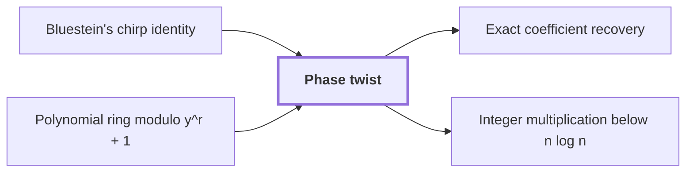

# Phase twist

!!! info "Before this page"

    Phase twist *follows* [Bluestein's chirp identity](bluestein-chirp-identity.md "The phase twist follows Bluestein's chirp identity, which has already turned the middle transform into a normalized cyclic convolution.") and *is based on* [Polynomial ring modulo y^r + 1](polynomial-ring-mod-yr-plus-1.md "A phase twist is based on the polynomial ring modulo $y^r+1$, into which it maps that axis.").

!!! abstract "Where this fits"

    1. A deterministic fixed-tape machine multiplies two $n$-bit integers exactly in $O(n(\lg n)^{1-\kappa})$ time, with $\kappa=2^{-182}$, below the $n\lg n$ conjecture in this model. — how: bound the cost of an exact multiplication whose transform layers are made cheap by two tape procedures, then fix parameters so every cost term fits ([Integer multiplication below n log n](main-theorem.md "A deterministic fixed-tape machine that multiplies two n-bit integers exactly in O(n (lg n)^(1−κ)) time with κ = 2^−182, which disproves the n log n optimality conjecture in this model."))
    2. The exact product of two $n$-bit integers is obtained from the convolution of their radix-digit coefficients, computed by transforms on a fixed tape layout and then recovered and carried. — how: reduce the convolution by a Chinese-remainder map, Gaussian resampling, Bluestein's identity and a phase twist to a convolution over a polynomial ring, then recover coefficients and propagate carries ([Radix-digit convolution](radix-digit-convolution.md "Writing both integers as polynomials in a power of two whose coefficients are their digits, so that their product is a polynomial convolution of short coefficients."))
    3. **This page:** A phase twist changes the last cyclic coordinate into a polynomial ring modulo $y^r+1$, whose negative wrap gives the original cyclic wrap.

??? note "Symbols from earlier pages"

    - $a$ — first input sequence: The first sequence of t complex numbers, indexed from 0 to t-1. (on [Cyclic convolution](glossary.md#cyclic-convolution "The product of two sequences in which indices wrap around modulo the sequence length."))
    - $b$ — second input sequence: The second sequence of t complex numbers, indexed from 0 to t-1. (on [Cyclic convolution](glossary.md#cyclic-convolution "The product of two sequences in which indices wrap around modulo the sequence length."))
    - $c$ — cyclic convolution: The output sequence a \ast b of length t, whose k-th entry is the sum of a_i b_j over all pairs with i+j congruent to k modulo t. (on [Cyclic convolution](glossary.md#cyclic-convolution "The product of two sequences in which indices wrap around modulo the sequence length."))
    - $i$ — index into a: The index of an entry of a, ranging over 0 to t-1. (on [Cyclic convolution](glossary.md#cyclic-convolution "The product of two sequences in which indices wrap around modulo the sequence length."))
    - $j$ — index into b: The index of an entry of b, ranging over 0 to t-1. (on [Cyclic convolution](glossary.md#cyclic-convolution "The product of two sequences in which indices wrap around modulo the sequence length."))
    - $k$ — index into c: The index of an entry of the output sequence c, ranging over 0 to t-1. (on [Cyclic convolution](glossary.md#cyclic-convolution "The product of two sequences in which indices wrap around modulo the sequence length."))
    - $r$ — record length: The number of complex coefficients in a polynomial record, a power of two. (on [Polynomial ring modulo y^r + 1](polynomial-ring-mod-yr-plus-1.md "The ring of polynomials with complex coefficients in which y^r is identified with −1, so that y has order 2r and wrap-around flips a sign."))
    - $y$ — polynomial variable: The indeterminate of the polynomial ring, whose powers act as roots of unity. (on [Polynomial ring modulo y^r + 1](polynomial-ring-mod-yr-plus-1.md "The ring of polynomials with complex coefficients in which y^r is identified with −1, so that y has order 2r and wrap-around flips a sign."))

A phase twist is a coefficientwise multiplication by roots of unity that turns the wrap-around of one cyclic axis into a sign change, so that a [cyclic convolution](glossary.md#cyclic-convolution "The product of two sequences in which indices wrap around modulo the sequence length.") along that axis can be computed in a polynomial ring.

The phase twist follows [Bluestein's chirp identity](bluestein-chirp-identity.md "An identity that rewrites a Fourier transform as a cyclic convolution multiplied by chirp factors, so that it can be computed with convolution."), which has already turned the middle transform into a normalized cyclic convolution. A phase twist is based on the [polynomial ring modulo $y^r+1$](polynomial-ring-mod-yr-plus-1.md "The ring of polynomials with complex coefficients in which y^r is identified with −1, so that y has order 2r and wrap-around flips a sign."), into which it maps that axis. Without the twist, the ring product would negate every wrapped term, which the cyclic product does not do.

Let $a$ and $b$ be length-$r$ sequences with cyclic product $c_k=\sum_{i+j\equiv k \pmod r} a_i b_j$. Let $\theta$, a primitive $2r$-th root of unity, be the twist root. The twisted input of $a$ is $A(y)=\sum_j \theta^j a_j y^j$. The twisted input of $b$ is $B(y)=\sum_j \theta^j b_j y^j$.

Since $y^r=-1$, a term with $i+j\ge r$ becomes $-y^{i+j-r}$. Fix an output index $k$ with $0\le k<r$. The pairs with $i+j\equiv k \pmod r$ have either $i+j=k$ or $i+j=k+r$. The first kind contributes $\theta^k a_i b_j y^k$. The second kind contributes $\theta^{k+r}a_i b_j y^{k+r}=\theta^k a_i b_j y^k$, because $\theta^r=-1$ and $y^r=-1$. So the coefficient of $y^k$ in $A(y)B(y)$ is $\theta^k c_k$, and multiplying by $\theta^{-k}$ recovers $c_k$.<cite class="exegenius-ref" data-source="paper" data-locator="§11 A consequence for matrix transposition, p. 5" data-quote="its negative wrap gives precisely the original cyclic wrap after the twist is removed" title="its negative wrap gives precisely the original cyclic wrap after the twist is removed"> (see §11 A consequence for matrix transposition, p. 5)</cite>.

For $r=2$ and $\theta=\sqrt{-1}$, let $A(y)=a_0+\theta a_1 y$ and $B(y)=b_0+\theta b_1 y$. Their product is $a_0b_0+\theta(a_0b_1+a_1b_0)y+\theta^2a_1b_1y^2$. With $y^2=-1$ and $\theta^2=-1$, this is $(a_0b_0+a_1b_1)+\theta(a_0b_1+a_1b_0)y$, so the two coefficients are $c_0$ and $\theta c_1$.

## Connections

Used by:

- [Exact coefficient recovery](recovery-and-error.md "Recovery undoes the phase twist before the coefficients are read, which restores the original cyclic wrap-around.") *undoes* Phase twist
- [Integer multiplication below n log n](main-theorem.md "It converts the last cyclic coordinate by a phase twist.") *converts the last cyclic coordinate by* Phase twist

??? quote "From the sources"

    > A phase twist changes the last cyclic coordinate
    >
    > — Integer multiplication below n log n (OpenAI, 2026)
