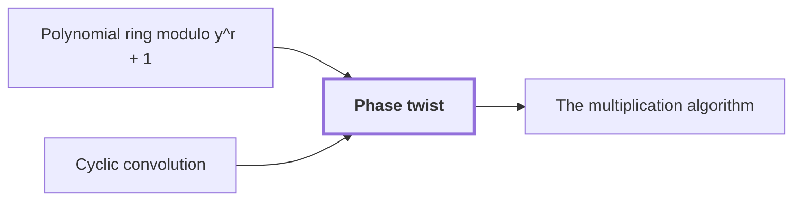

# Phase twist

!!! info "Before this page"

    Phase twist *converts the last cyclic axis into* [Polynomial ring modulo y^r + 1](ring-y.md "The twist converts the last cyclic axis into the coordinate of the Polynomial ring modulo y^r + 1, and the sign is repaired by a phase.") and *reproduces* [Cyclic convolution](convolution.md "The twist reproduces Cyclic convolution on that axis.").

!!! abstract "Where this fits"

    1. A single deterministic Turing machine with a fixed finite alphabet and a fixed finite number of one-dimensional tapes multiplies two $n$-bit integers exactly in $O(n(\lg n)^{1-\kappa})$ worst-case time with $\kappa=2^{-182}$, disproving the $n\log n$ optimality conjecture of Sch\"onhage and Strassen in this model. — how: Build two power-saving tape procedures (chunk interchange and simultaneous butterfly layer) from fixed finite linear networks; use them to accelerate the synthetic polynomial transforms and ring convolution; use Gaussian resampling with retained permutations and chirps to reduce the prime-length cyclic convolution of the radix-digit coefficients to those power-of-two transforms; assemble the exact product with a proof that the error is below $1/2$; and total the cost to show a power of $\log n$ is saved. ([Power-saving integer multiplication](main-result.md "A deterministic fixed-tape Turing machine multiplying two n-bit integers exactly in O(n(lg n)^{1−κ}) time with κ = 2^{−182}, disproving the n log n optimality conjecture in this model."))
    2. The exact $2n$-bit product of the two inputs is obtained from the radix-digit convolution by the chain: radix digits, Chinese-remainder address map to a product of prime cyclic axes, two forward source transforms (resampling and chirps), pointwise product, opposite transform, rescaling, rounding, and carry propagation, with total error below $1/2$. — how: Reduce the integer product to a cyclic convolution of $S$ short coefficients and compute it through the chain of reductions (digits, CRT address map, Gaussian resampling with chirps, twist to the polynomial ring, synthetic-transform convolution); recover exact integers because the accumulated error is below $1/2$. ([The multiplication algorithm](multiplication-algorithm.md "Digits, then the CRT map, two forward transforms with resampling and chirps, a pointwise product, the opposite transform, rescaling, rounding and carry propagation yield the exact 2n-bit product."))
    3. **This page:** With $\zeta=e^{\pi i/r}$ the map $\Theta:\mathbb C[x_d]/(x_d^r-1)\to\mathcal R_r$, $x_d\mapsto\zeta y$, is an isomorphism multiplying coefficient $k$ by $\zeta^k$; hence normalized complex cyclic convolution is $\mathcal M_{\mathbb C}(f,g)=D_-\iota^{-1}\mathcal M_r(\iota D_+f,\iota D_+g)=f*g/T$.

??? note "Symbols from earlier pages"

    - $d$ — axis count: The number of axes of the underlying cyclic convolution. (on [Cyclic convolution](convolution.md "The product of two sequences (or elements of a polynomial quotient ring) where indices wrap around: (f∗g)_k = Σ f_j g_{k−j}."))
    - $r$ — record length: The number of complex coefficients in a polynomial of the ring, always a power of two. (on [Polynomial ring modulo y^r + 1](ring-y.md "Polynomials of degree below r over the complex numbers with y^r = −1, so multiplying by a power of y is a signed shift of the coefficient list."))
    - $T$ — coefficient count: The number of complex coefficients in an array. (on [Cyclic convolution](convolution.md "The product of two sequences (or elements of a polynomial quotient ring) where indices wrap around: (f∗g)_k = Σ f_j g_{k−j}."))
    - $y$ — ring variable: The indeterminate of the polynomials; it satisfies y^r = -1 in the ring. (on [Polynomial ring modulo y^r + 1](ring-y.md "Polynomials of degree below r over the complex numbers with y^r = −1, so multiplying by a power of y is a signed shift of the coefficient list."))
    - $M$ — address count: The number of addresses of an array, the product of the axis lengths. (on [Cyclic convolution](convolution.md "The product of two sequences (or elements of a polynomial quotient ring) where indices wrap around: (f∗g)_k = Σ f_j g_{k−j}."))

The phase twist is a diagonal change of basis that turns the last cyclic axis of a complex array into the coefficient coordinate of a negacyclic ring, so that complex cyclic convolution can be computed by convolution over that ring; it is undone afterwards.

Let $f$ and $g$ be complex arrays with $d$ axes, the last of length $r$, and $T$ entries in all. The fast convolution of the later stages, [Convolution from the retained transform layout](ring-convolution.md "Convolution over the ring modulo y^r + 1 on the remaining axes by two forward synthetic transforms, pointwise polynomial products and the opposite transform, normalized by 1/(rM)."), convolves the first $d-1$ axes of an array whose entries are records in $\mathcal R_r=\mathbb C[y]/(y^r+1)$. It does so with the [Synthetic polynomial transform](synthetic-transform.md "A transform over the ring modulo y^r + 1 whose roots of unity are powers of y, so every twiddle multiplication is a signed shift of a coefficient list."), which relies on multiplying by a power of $y$ being only a signed shift of coefficients. So the last axis must become the polynomial coordinate of that ring. But convolution along it is multiplication in $\mathbb C[x_d]/(x_d^r-1)$, where $x_d$ is the variable of that axis and the wrap is cyclic, whereas in $\mathcal R_r$ the wrap changes sign. The twist converts the last cyclic axis into the coordinate of the [Polynomial ring modulo y^r + 1](ring-y.md "Polynomials of degree below r over the complex numbers with y^r = −1, so multiplying by a power of y is a signed shift of the coefficient list."), and the sign is repaired by a phase.

## The map

Let $\zeta=e^{\pi i/r}$, so $\zeta^r=-1$. Define $\Theta:\mathbb C[x_d]/(x_d^r-1)\to\mathcal R_r$ by $x_d\mapsto\zeta y$. It is well defined because $(\zeta y)^r=(-1)(-1)=1$.

Here $k$ and $l$ index coefficients along the last axis (not depth). Since $\Theta(x_d^k)=\zeta^k y^k$, $\Theta$ is diagonal on the bases $(x_d^k)$ and $(y^k)$, multiplying coefficient $k$ by $\zeta^k\ne0$. It is therefore an isomorphism, with inverse multiplying by $\zeta^{-k}$. Both maps preserve the coefficient sup norm, since $|\zeta^{\pm k}|=1$<cite class="exegenius-ref" data-source="paper" data-locator="§9.4 Complex convolution by a coefficient twist" data-quote="Both exact maps preserve the coefficient sup norm." title="Both exact maps preserve the coefficient sup norm."> (see §9.4 Complex convolution by a coefficient twist)</cite>

## The wrap

Take $k,l<r$ and write $k+l=j+hr$, with $j<r$ the resulting position and $h\in\{0,1\}$ the wrap indicator. After twisting, the term carries $\zeta^{k+l}$, and negacyclic reduction contributes $(-1)^h$, so the factor is
$$\zeta^{k+l}(-1)^h=\zeta^j(\zeta^r)^h(-1)^h=\zeta^j.$$
The coefficient of $y^j$ is thus $\zeta^j$ times the cyclic coefficient, so untwisting by $\zeta^{-j}$ recovers it with the correct sign. The twist reproduces [Cyclic convolution](convolution.md "The product of two sequences (or elements of a polynomial quotient ring) where indices wrap around: (f∗g)_k = Σ f_j g_{k−j}.") on that axis.

For $r=2$, $\zeta=i$. Twisting $(f_0,f_1)$ and $(g_0,g_1)$ gives $(f_0,if_1)$ and $(g_0,ig_1)$. Their product has constant term $f_0g_0+f_1g_1$ and $y$-coefficient $i(f_0g_1+f_1g_0)$. Multiplying the second by $\zeta^{-1}=-i$ gives the cyclic result.

## Whole arrays

Then $M=T/r$ is the number of lines along the last axis. Let $\iota$ read each line $(f_{\boldsymbol j,k})_k$ as the polynomial $\sum_k f_{\boldsymbol j,k}y^k$, giving an array of $M$ records in $\mathcal R_r$, and let $(D_\pm f)_{\boldsymbol j,k}=\zeta^{\pm k}f_{\boldsymbol j,k}$ multiply entry $k$ of each line by $\zeta^{\pm k}$. Then $\iota D_+$ applies $\Theta$ to every line, with inverse $D_-\iota^{-1}$.

Let $\mathcal M_r$ be the ring convolution: it convolves the first $d-1$ axes over $\mathcal R_r$, dividing by $T$. The normalized complex cyclic convolution $\mathcal M_{\mathbb C}$ is
$$\mathcal M_{\mathbb C}(f,g)=D_-\iota^{-1}\mathcal M_r(\iota D_+f,\iota D_+g)=\frac{f*g}{T}.$$
Here $*$ is cyclic convolution over all $d$ axes.

## Contraction

Let $\|f\|$ be the sup norm of $f$, the largest modulus of a scalar coefficient. A bilinear map is a bilinear contraction if its value has norm at most the product of the norms of its arguments ([Contractions and bilinear contractions](contraction-maps.md "A linear map that never increases the norm of a vector, and a bilinear map whose output norm is at most the product of the input norms, so errors in the inputs do not grow beyond a controlled bound.")). $\mathcal M_r$ is one: a fixed output coefficient averages $rM$ signed scalar products of coefficients, each at most $\|f\|\|g\|$ in modulus<cite class="exegenius-ref" data-source="paper" data-locator="§7.1 The normalized convolution interface" data-quote="$rM$ signed scalar products, and $\mathcal M_r$ is a bilinear" title="$rM$ signed scalar products, and $\mathcal M_r$ is a bilinear"> (see §7.1 The normalized convolution interface)</cite>.

The maps $\iota^{\pm1}$ only regroup scalars and $D_\pm$ multiplies by numbers of modulus $1$, so all are linear and keep the sup norm. Hence
$$\|\mathcal M_{\mathbb C}(f,g)\|\le\|\iota D_+f\|\,\|\iota D_+g\|=\|f\|\,\|g\|,$$
and $\mathcal M_{\mathbb C}$ is a bilinear contraction.

## Connections

Used by:

- [The multiplication algorithm](multiplication-algorithm.md "Here $\mathcal M_{\mathbb C}(f,g)=f*g/T$ is normalized cyclic convolution, computed through the Phase twist and Convolution from the retained transform layout.") *computes convolution through* Phase twist

??? quote "From the sources"

    > A phase twist changes the last cyclic coordinate into a polynomial
    >
    > — [Integer multiplication below n log n (OpenAI, 2026)](https://github.com/openai/math/tree/fd4aeeb2ee4fc729c18d98444fed42fd0529eeeb/preprints/Integer-multiplication-below-n-log-n-September-23-2026)

    > x_d\longmapsto\zeta y
    >
    > — [Integer multiplication below n log n (OpenAI, 2026)](https://github.com/openai/math/tree/fd4aeeb2ee4fc729c18d98444fed42fd0529eeeb/preprints/Integer-multiplication-below-n-log-n-September-23-2026)
