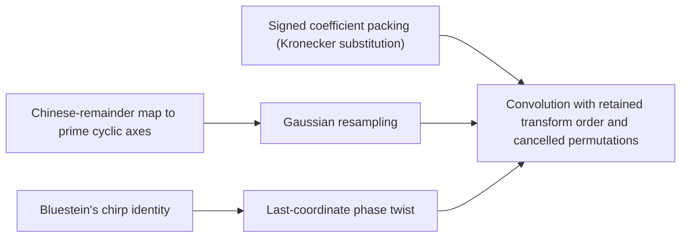

# Placing the convolution on axes

The coefficient list is moved onto a product of prime cyclic axes, where the transforms become simpler. The [Chinese-remainder map](../crt-address-map.md "Places the coefficient list on a product of distinct prime cyclic axes by a map preserving convolution, implemented via triangular controlled shifts and axis moves.") preserves convolution, and [Gaussian resampling](../gaussian-resampling.md "Harvey–van der Hoeven reduction expressing each Fourier transform of prime-length axes through a multidimensional transform with power-of-two axis lengths.") and [Bluestein's identity](../bluestein-chirp.md "Rewrites a discrete Fourier transform as a cyclic convolution via chirp phases.") rewrite the transforms on those axes. The [phase twist](../phase-twist-convolution.md "Twisting the last cyclic coordinate into a polynomial modulo y^r+1 whose negative wrap equals the original cyclic wrap after untwisting."), [signed packing](../signed-packing.md "Packs polynomial coefficients into one integer so polynomial products are done by an ordinary n log n integer multiplier."), and [retained-order convolution](../ring-convolution-retained-order.md "Two forward synthetic transforms keep the same frequency order through the pointwise product, and the opposite transform consumes it, so retained permutations cancel without separate sorts.") finish the reduction to packed polynomial products.

## Pages

1. [Chinese-remainder map to prime cyclic axes](../crt-address-map.md "Places the coefficient list on a product of distinct prime cyclic axes by a map preserving convolution, implemented via triangular controlled shifts and axis moves.") — Places the coefficient list on a product of distinct prime cyclic axes by a map preserving convolution, implemented via triangular controlled shifts and axis moves.
2. [Gaussian resampling](../gaussian-resampling.md "Harvey–van der Hoeven reduction expressing each Fourier transform of prime-length axes through a multidimensional transform with power-of-two axis lengths.") — Harvey–van der Hoeven reduction expressing each Fourier transform of prime-length axes through a multidimensional transform with power-of-two axis lengths.
3. [Bluestein's chirp identity](../bluestein-chirp.md "Rewrites a discrete Fourier transform as a cyclic convolution via chirp phases.") — Rewrites a discrete Fourier transform as a cyclic convolution via chirp phases.
4. [Last-coordinate phase twist](../phase-twist-convolution.md "Twisting the last cyclic coordinate into a polynomial modulo y^r+1 whose negative wrap equals the original cyclic wrap after untwisting.") — Twisting the last cyclic coordinate into a polynomial modulo y^r+1 whose negative wrap equals the original cyclic wrap after untwisting.
5. [Signed coefficient packing (Kronecker substitution)](../signed-packing.md "Packs polynomial coefficients into one integer so polynomial products are done by an ordinary n log n integer multiplier.") — Packs polynomial coefficients into one integer so polynomial products are done by an ordinary n log n integer multiplier.
6. [Convolution with retained transform order and cancelled permutations](../ring-convolution-retained-order.md "Two forward synthetic transforms keep the same frequency order through the pointwise product, and the opposite transform consumes it, so retained permutations cancel without separate sorts.") — Two forward synthetic transforms keep the same frequency order through the pointwise product, and the opposite transform consumes it, so retained permutations cancel without separate sorts.

## Map

Arrows point from a page to the pages that build on it.

