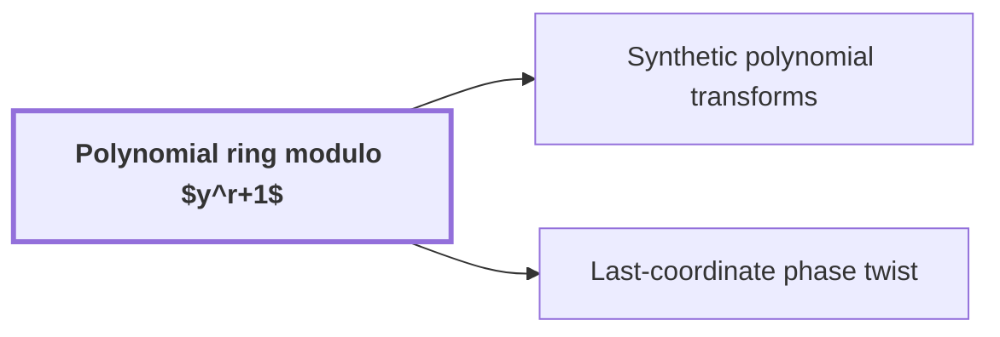

# Polynomial ring modulo $y^r+1$

!!! info "Before this page"

    Assumed known: Polynomials and Complex numbers.

!!! abstract "Where this fits"

    - Relied on to show: A simultaneous layer of $H_0(u,v)=((u+v)/2,(u-v)/2)$ on selected address bits of polynomial-valued arrays costs $O(Vd^{\lambda'})$ with $\lambda'<1$, with a single truncation at the end. ([Fast simultaneous butterfly layers](fast-butterfly-layers.md "Applies H0(u,v)=((u+v)/2,(u-v)/2) on selected address bits of polynomial-valued arrays with exact Gaussian dyadics in O(V d^λ') with λ'<1, one truncation at the end."))
    - Relied on to show: A phase twist turns the last cyclic coordinate into a polynomial modulo $y^r+1$, whose negative wrap gives the original cyclic wrap after untwisting. ([Last-coordinate phase twist](phase-twist-convolution.md "Twisting the last cyclic coordinate into a polynomial modulo y^r+1 whose negative wrap equals the original cyclic wrap after untwisting."))
    - Relied on to show: Convolution over $\mathbb C[y]/(y^r+1)$ on the remaining axes is computed by synthetic transforms and packed polynomial products. ([Convolution with retained transform order and cancelled permutations](ring-convolution-retained-order.md "Two forward synthetic transforms keep the same frequency order through the pointwise product, and the opposite transform consumes it, so retained permutations cancel without separate sorts."))
    - Relied on to show: Synthetic transforms over the polynomial ring need only signed shifts, address rearrangements and butterflies. ([Synthetic polynomial transforms](synthetic-transforms.md "Nussbaumer-style transforms over the polynomial ring where root multiplications are signed shifts, leaving address rearrangements, shifts and butterflies."))

??? note "Symbols from earlier pages"

    - $b$ — input list b: The second input coefficient list, with entries $b_0,\dots,b_{n-1}$. (on [Convolution](convolution.md "Product of polynomials / combination of coefficient lists where entries sum by index (cyclic if indices wrap)."))

The polynomial ring modulo a power-of-two wrap is the ring of complex polynomials in one variable in which that variable's wrap power is identified with $-1$. It is the coefficient ring in which the root multiplications of the remaining transform axes become cheap signed shifts.

Here $y$ is the ring variable, the polynomial variable whose powers act as roots of unity. The ring degree $r$ is the number of complex coefficients in each element, a power of two. In the paper, one coordinate is stored as the coefficient list of a polynomial modulo $y^r+1$<cite class="exegenius-ref" data-source="paper" data-locator="§1.1 The two tape operations" data-quote="the coefficient list of a polynomial modulo $y^r+1$" title="the coefficient list of a polynomial modulo $y^r+1$"> (see §1.1 The two tape operations)</cite>, with $r$ a power of two<cite class="exegenius-ref" data-source="paper" data-locator="§1.1 The two tape operations" data-quote="with $r$ a power of two" title="with $r$ a power of two"> (see §1.1 The two tape operations)</cite>.

An element is a polynomial in $y$ of degree below $r$, stored as its list of $r$ coefficients from $y^0$ up to $y^{r-1}$. Addition is coefficientwise. Multiplication takes the ordinary product, then replaces each power $y^{r+j}$ by $-y^j$, where $j$ is the exponent left after removing $y^r$ and $0\le j<r$; this holds because $y^{r+j}=y^r y^j=-y^j$. The letter $j$ denotes an index into the list $b$ on the convolution page, so here it changes meaning. Equivalently, the ring is the quotient of $\mathbb{C}[y]$ by the ideal $(y^r+1)$, the set of all polynomial multiples of $y^r+1$; the rule gives the representative of degree below $r$.

Since $y^r=-1$, $y^{2r}=(y^r)^2=1$, so every power of $y$ equals $y^s$ for an exponent $s$ with $0\le s<2r$, where $s$ is the exponent reduced modulo $2r$.

If $s<r$, multiplying by $y^s$ moves each coefficient up $s$ places, and a coefficient pushed past position $r-1$ re-enters at the bottom with its sign reversed. This is a signed shift by $s$. If $r\le s<2r$, then $y^s=-y^{s-r}$, so multiplying by $y^s$ is minus a signed shift by $s-r$. For $r=4$, multiplying $1+2y+3y^2+4y^3$ by $y^3$ gives $-2-3y-4y^2+y^3$, the list $(-2,-3,-4,1)$.

The paper's multidimensional transforms have axis lengths that are powers of two<cite class="exegenius-ref" data-source="paper" data-locator="§1.1 The two tape operations" data-quote="whose axis lengths are powers of two" title="whose axis lengths are powers of two"> (see §1.1 The two tape operations)</cite>. A transform along one axis combines the entries that differ only in that coordinate, using roots of unity of the axis's length. Powers of $y$<cite class="exegenius-ref" data-source="paper" data-locator="§1.1 The two tape operations" data-quote="serve as roots of unity in the remaining axes" title="serve as roots of unity in the remaining axes"> (see §1.1 The two tape operations)</cite>. By the two cases above, every root multiplication on such an axis is a signed shift, possibly negated.

A fast transform along an axis is built from butterflies: each butterfly takes two entries, multiplies one by a root, and replaces the pair with their sum and their difference. Address rearrangements move entries between butterfly layers. So a transform whose roots are powers of $y$ needs only signed shifts, address rearrangements, and additions and subtractions, with no general complex multiplication.

## Connections

Used by:

- [Synthetic polynomial transforms](synthetic-transforms.md "Synthetic polynomial transforms are defined over the Polynomial ring modulo $y^r+1$, where every root of unity is a power of $y$, so the transform avoids general complex multiplications.") *are defined over* Polynomial ring modulo $y^r+1$
- [Last-coordinate phase twist](phase-twist-convolution.md "The twist turns the last cyclic coordinate into the Polynomial ring modulo $y^r+1$.") *turns the last cyclic coordinate into* Polynomial ring modulo $y^r+1$

??? quote "From the sources"

    > one coordinate is stored as the coefficient list of a polynomial modulo $y^r+1$
    >
    > — [Integer multiplication below n log n (OpenAI, 2026)](https://github.com/openai/math/tree/fd4aeeb2ee4fc729c18d98444fed42fd0529eeeb/preprints/Integer-multiplication-below-n-log-n-September-23-2026)
