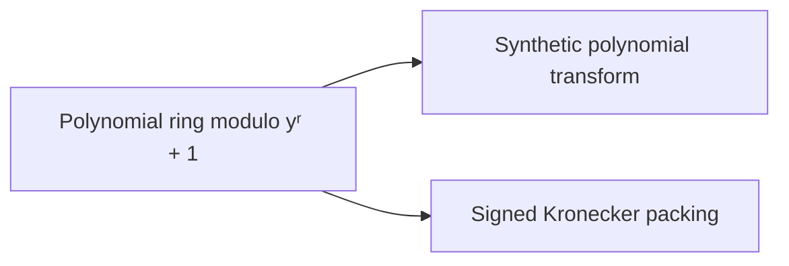

# Polynomial ring and synthetic transforms

The last cyclic coordinate is lifted into a polynomial ring in which multiplying by a power of $y$ is a signed shift, so wrap-around costs no multiplication. The [polynomial ring modulo $y^r+1$](../polynomial-ring-y.md "The ring of complex polynomials in y reduced modulo y^r + 1, where multiplying by a power of y is a signed cyclic shift of the coefficient list.") provides this ring, and the [synthetic transform](../synthetic-transform.md "A transform over a polynomial ring in which the roots of unity are powers of y, so that each transform stage uses only signed shifts and butterfly additions.") over it uses only signed shifts and butterfly additions. [Signed Kronecker packing](../kronecker-packing.md "Encoding a polynomial with bounded signed coefficients as an integer by evaluating it at a large power of two, so that polynomial products become integer products.") then turns products over the ring into integer products that the $O(n\log n)$ multiplier can compute.

## Pages

1. [Polynomial ring modulo yʳ + 1](../polynomial-ring-y.md "The ring of complex polynomials in y reduced modulo y^r + 1, where multiplying by a power of y is a signed cyclic shift of the coefficient list.") — The ring of complex polynomials in y reduced modulo y^r + 1, where multiplying by a power of y is a signed cyclic shift of the coefficient list.
2. [Synthetic polynomial transform](../synthetic-transform.md "A transform over a polynomial ring in which the roots of unity are powers of y, so that each transform stage uses only signed shifts and butterfly additions.") — A transform over a polynomial ring in which the roots of unity are powers of y, so that each transform stage uses only signed shifts and butterfly additions.
3. [Signed Kronecker packing](../kronecker-packing.md "Encoding a polynomial with bounded signed coefficients as an integer by evaluating it at a large power of two, so that polynomial products become integer products.") — Encoding a polynomial with bounded signed coefficients as an integer by evaluating it at a large power of two, so that polynomial products become integer products.

## Map

Arrows point from a page to the pages that build on it.

