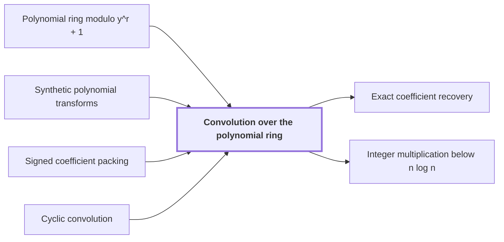

# Convolution over the polynomial ring

!!! info "Before this page"

    Convolution over the polynomial ring *takes its records from* [Polynomial ring modulo y^r + 1](polynomial-ring-mod-yr-plus-1.md "Convolution over the polynomial ring takes its records from the Polynomial ring modulo y^r + 1, in which $y^r = -1$."), *computes its transforms with* [Synthetic polynomial transforms](synthetic-transforms.md "Convolution over the polynomial ring computes its transforms with Synthetic polynomial transforms, so the transforms need only signed shifts and additions, because multiplying by a power of $y$ is a signed shift of coefficients."), *computes its products with* [Signed coefficient packing](signed-packing.md "Convolution over the polynomial ring computes its products with Signed coefficient packing.") and *is the cyclic product of* [Cyclic convolution](glossary.md#cyclic-convolution "Convolution over the polynomial ring is the cyclic product of two arrays of records, in the sense of Cyclic convolution.").

!!! abstract "Where this fits"

    1. A deterministic fixed-tape machine multiplies two $n$-bit integers exactly in $O(n(\lg n)^{1-\kappa})$ time, with $\kappa=2^{-182}$, below the $n\lg n$ conjecture in this model. — how: bound the cost of an exact multiplication whose transform layers are made cheap by two tape procedures, then fix parameters so every cost term fits ([Integer multiplication below n log n](main-theorem.md "A deterministic fixed-tape machine that multiplies two n-bit integers exactly in O(n (lg n)^(1−κ)) time with κ = 2^−182, which disproves the n log n optimality conjecture in this model."))
    2. The exact product of two $n$-bit integers is obtained from the convolution of their radix-digit coefficients, computed by transforms on a fixed tape layout and then recovered and carried. — how: reduce the convolution by a Chinese-remainder map, Gaussian resampling, Bluestein's identity and a phase twist to a convolution over a polynomial ring, then recover coefficients and propagate carries ([Radix-digit convolution](radix-digit-convolution.md "Writing both integers as polynomials in a power of two whose coefficients are their digits, so that their product is a polynomial convolution of short coefficients."))
    3. **This page:** Convolution on the remaining axes over $\mathbb{C}[y]/(y^r+1)$ is computed by two forward synthetic transforms, a pointwise product, and an opposite transform.

??? note "Symbols from earlier pages"

    - $i$ — index into a: The index of an entry of a, ranging over 0 to t-1. (on [Cyclic convolution](glossary.md#cyclic-convolution "The product of two sequences in which indices wrap around modulo the sequence length."))
    - $j$ — index into b: The index of an entry of b, ranging over 0 to t-1. (on [Cyclic convolution](glossary.md#cyclic-convolution "The product of two sequences in which indices wrap around modulo the sequence length."))
    - $k$ — index into c: The index of an entry of the output sequence c, ranging over 0 to t-1. (on [Cyclic convolution](glossary.md#cyclic-convolution "The product of two sequences in which indices wrap around modulo the sequence length."))
    - $y$ — polynomial variable: The indeterminate of the polynomial ring, whose powers act as roots of unity. (on [Polynomial ring modulo y^r + 1](polynomial-ring-mod-yr-plus-1.md "The ring of polynomials with complex coefficients in which y^r is identified with −1, so that y has order 2r and wrap-around flips a sign."))
    - $r$ — record length: The number of complex coefficients in a polynomial record, a power of two. (on [Polynomial ring modulo y^r + 1](polynomial-ring-mod-yr-plus-1.md "The ring of polynomials with complex coefficients in which y^r is identified with −1, so that y has order 2r and wrap-around flips a sign."))

Convolution over the polynomial ring is the cyclic product of two arrays of records, in the sense of [Cyclic convolution](glossary.md#cyclic-convolution "The product of two sequences in which indices wrap around modulo the sequence length."). It is the step that convolves the axes left after the earlier reductions. Convolution over the polynomial ring takes its records from the [Polynomial ring modulo y^r + 1](polynomial-ring-mod-yr-plus-1.md "The ring of polynomials with complex coefficients in which y^r is identified with −1, so that y has order 2r and wrap-around flips a sign."), in which $y^r = -1$.

Let $a$ and $b$ be arrays of $q$ records, where $q$, the number of records in each array, is a power of two dividing $2r$. Their convolution is
$$c_k = \sum_{\substack{0 \le i,j < q \\ i+j \equiv k \pmod{q}}} a_i b_j,$$
so $c_k$ sums the products $a_i b_j$ over pairs whose indices add to $k$ modulo $q$. Computed directly, this takes $q^2$ record products.

Let $\rho = y^{2r/q}$, a synthetic root of unity: since $y$ has order $2r$, $\rho^q = 1$. The index $\lambda$ runs from $0$ to $q-1$ and labels the frequency of an entry. Let $\Phi$ be the forward transform, $\Phi(a)_\lambda = \sum_j a_j\rho^{j\lambda}$, and let $\Psi$ be the opposite transform, which takes an array $Y$ of $q$ records to $\Psi(Y)_k = \frac{1}{q}\sum_\lambda Y_\lambda\rho^{-k\lambda}$, dividing by $q$ and using the inverse root $\rho^{-1}$. Both forward transforms keep the same frequency order, so one index $\lambda$ pairs $\Phi(a)_\lambda$ with $\Phi(b)_\lambda$<cite class="exegenius-ref" data-source="paper" data-locator="§11 A consequence for matrix transposition, p. 5" data-quote="The two forward synthetic transforms retain the same frequency order" title="The two forward synthetic transforms retain the same frequency order"> (see §11 A consequence for matrix transposition, p. 5)</cite>.

The method is
$$c = \Psi\big(\Phi(a) \odot \Phi(b)\big).$$
Here $\odot$ multiplies two arrays entrywise in the ring, the pointwise product. This is the convolution theorem for these transforms: transforming turns the cyclic sum into a pointwise product, and the opposite transform brings the result back. The pointwise product needs only $q$ record products, not $q^2$.

Expanding the $k$-th entry shows that this is exact:
$$\Psi\big(\Phi(a)\odot\Phi(b)\big)_k = \sum_{i,j} a_i b_j\,\frac{1}{q}\sum_{\lambda=0}^{q-1}\rho^{\delta\lambda},$$
where $\delta = i+j-k$ is the offset of the pair $(i,j)$ from $k$. If $q$ divides $\delta$, every term of the inner sum is $1$, so the sum is $q$. Otherwise $(\rho^{\delta}-1)\sum_\lambda \rho^{\delta\lambda} = \rho^{\delta q}-1 = 0$. The factor $\rho^{\delta}-1$ is invertible: the ring is isomorphic to $\mathbb{C}^r$ by evaluation at the $r$ distinct roots of $y^r+1$, each of order $2r$, and at each such root $\rho^{\delta}$ equals $1$ only if $q$ divides $\delta$. So the inner sum is $0$. Only pairs with $i+j \equiv k \pmod{q}$ survive, each with weight $1$, which gives $c_k$.

Take $q=2$, so $\rho = y^r = -1$. Then $\Phi(a) = (a_0+a_1,\ a_0-a_1)$, and $\Phi(b)$ is the same with $b$. Their pointwise product $Y$ has entries $Y_0 = (a_0+a_1)(b_0+b_1)$ and $Y_1 = (a_0-a_1)(b_0-b_1)$, and $\Psi(Y)_0 = \frac{Y_0+Y_1}{2}$, $\Psi(Y)_1 = \frac{Y_0-Y_1}{2}$. These give $c_0 = a_0b_0 + a_1b_1$ and $c_1 = a_0b_1 + a_1b_0$, the cyclic product for $q=2$.

Convolution over the polynomial ring computes its transforms with [Synthetic polynomial transforms](synthetic-transforms.md "Fourier-type transforms whose roots of unity are powers of y in a polynomial ring, so that multiplying by a root is a signed shift of coefficients."), so the transforms need only signed shifts and additions, because multiplying by a power of $y$ is a signed shift of coefficients.

The pointwise products are polynomial products. Convolution over the polynomial ring computes its products with [Signed coefficient packing](signed-packing.md "Encoding polynomial coefficients, including negative ones, as one large integer by fixed-width blocks, so that polynomial multiplication becomes integer multiplication."). Packing turns each record product into one integer product, which the [Established O(n log n) multiplier](glossary.md#established-multiplier "The known fixed-tape integer multiplier running in O(n log n) time, used here only as a black-box subroutine.") computes as an ordinary subroutine.

## Connections

Used by:

- [Exact coefficient recovery](recovery-and-error.md "Recovery is applied to the output of the Convolution over the polynomial ring, after the known normalizations and digit scales are removed.") *is applied to the output of* Convolution over the polynomial ring
- [Integer multiplication below n log n](main-theorem.md "It multiplies its records by convolution over the polynomial ring.") *multiplies its records by* Convolution over the polynomial ring

??? quote "From the sources"

    > The two forward synthetic transforms retain the same frequency order
    >
    > — Integer multiplication below n log n (OpenAI, 2026)
