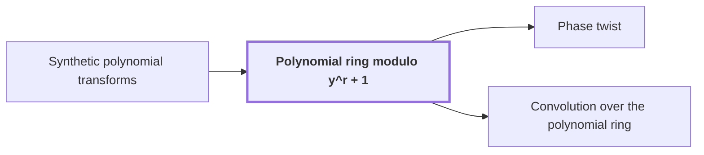

# Polynomial ring modulo $y^r + 1$

!!! info "Before this page"

    Polynomial ring modulo y^r + 1 *is the coefficient ring of* [Synthetic polynomial transforms](synthetic-transforms.md "The ring is the coefficient ring of the Synthetic polynomial transforms, whose roots of unity are powers of $y$."). Assumed known: Polynomials.

!!! abstract "Where this fits"

    - Relied on to show: A phase twist changes the last cyclic coordinate into a polynomial ring modulo $y^r+1$, whose negative wrap gives the original cyclic wrap. ([Phase twist](phase-twist.md "A coefficientwise multiplication by roots of unity that converts the last cyclic coordinate into a polynomial ring, so its wrap-around becomes the negative wrap of that ring."))
    - Relied on to show: Convolution on the remaining axes over $\mathbb{C}[y]/(y^r+1)$ is computed by two forward synthetic transforms, a pointwise product, and an opposite transform. ([Convolution over the polynomial ring](polynomial-ring-convolution.md "The normalized product of two arrays of records in the polynomial ring, computed by two forward synthetic transforms, a pointwise product, and an opposite transform."))

The negacyclic polynomial ring is the ring of polynomials with complex coefficients in which a wrap-around past the top degree returns with a minus sign, so every product reduces to a polynomial of lower degree. It is the coefficient setting of the transforms in this argument, and the [Phase twist](phase-twist.md "A coefficientwise multiplication by roots of unity that converts the last cyclic coordinate into a polynomial ring, so its wrap-around becomes the negative wrap of that ring.") page turns a cyclic wrap into this sign-flipped wrap.

Here $y$ is the indeterminate of the polynomial ring, whose powers act as roots of unity. Here $r$ is the number of complex coefficients in a polynomial record, a power of two. The ring is written $\mathbb{C}[y]/(y^r+1)$: polynomials in $y$ in which $y^r$ is identified with $-1$. The ring is the coefficient ring of the [Synthetic polynomial transforms](synthetic-transforms.md "Fourier-type transforms whose roots of unity are powers of y in a polynomial ring, so that multiplying by a root is a signed shift of coefficients."), whose roots of unity are powers of $y$.

An element is stored as its record $(\alpha_0, \alpha_1, \dots, \alpha_{r-1})$ of $r$ coefficients, standing for $\alpha_0 + \alpha_1 y + \dots + \alpha_{r-1} y^{r-1}$. Here $\alpha_i$ is the coefficient of $y^i$ in the record.

Here $\ell$ is a non-negative integer exponent, so $y^\ell$ is a power of $y$. For $r \le \ell < 2r$, we have $y^\ell = -y^{\ell-r}$, because $y^r=-1$.

For example, with $r = 4$, the record $(\alpha_0, \alpha_1, \alpha_2, \alpha_3)$ stands for $\alpha_0 + \alpha_1 y + \alpha_2 y^2 + \alpha_3 y^3$. Multiplying by $y$ gives $y \cdot \alpha_3 y^3 = \alpha_3 y^4 = -\alpha_3$, so the record becomes $(-\alpha_3, \alpha_0, \alpha_1, \alpha_2)$.

Multiplying by $y$ therefore shifts the coefficients one place and negates the one that wraps around. Since $y^r = -1$, we get $y^{2r} = (-1)^2 = 1$, so $y$ has order $2r$. An ordinary cyclic wrap would return the wrapped coefficient unchanged. Multiplying by any power $y^\ell$ is a signed shift of the record, which is what the transforms rely on<cite class="exegenius-ref" data-source="paper" data-locator="§11 A consequence for matrix transposition, p. 3" data-quote="multiplication by such a root is a signed shift of the coefficient list" title="multiplication by such a root is a signed shift of the coefficient list"> (see §11 A consequence for matrix transposition, p. 3)</cite>.

## Connections

Used by:

- [Phase twist](phase-twist.md "A phase twist is based on the polynomial ring modulo $y^r+1$, into which it maps that axis.") *is based on* Polynomial ring modulo y^r + 1
- [Convolution over the polynomial ring](polynomial-ring-convolution.md "Convolution over the polynomial ring takes its records from the Polynomial ring modulo y^r + 1, in which $y^r = -1$.") *takes its records from* Polynomial ring modulo y^r + 1

??? quote "From the sources"

    > the coefficient list of a polynomial modulo y r + 1
    >
    > — Integer multiplication below n log n (OpenAI, 2026)
