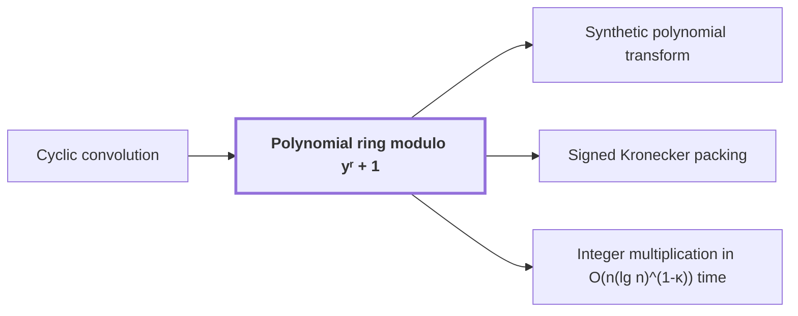

# Polynomial ring modulo $y^r + 1$

!!! info "Before this page"

    Polynomial ring modulo yʳ + 1 *computes products by* [Cyclic convolution](cyclic-convolution.md "Multiplication in this ring computes products by a signed form of Cyclic convolution: the coefficient lists are convolved, and any term that wraps past index $r-1$ returns with a minus sign."). Assumed known: Polynomials and Complex numbers.

!!! abstract "Where this fits"

    1. Two $n$-bit integers can be multiplied exactly in $O(n(\lg n)^{1-\kappa})$ worst-case time on a deterministic multitape Turing machine, for a fixed $\kappa=2^{-182}$. — how: reduce the product to a digit convolution, compute that convolution through transform layers whose tape cost saves a power, and recover the exact product by rounding ([Integer multiplication in O(n(lg n)^(1-κ)) time](integer-multiplication-target.md "A deterministic multitape Turing machine that multiplies two n-bit integers exactly in O(n(lg n)^(1-κ)) worst-case time for a fixed κ = 2^(-182) > 0, beating the n log n conjecture in this model."))
    2. **This page:** The last cyclic coordinate becomes a polynomial modulo $y^r+1$, so that its wrap is a signed shift.

??? note "Symbols from earlier pages"

    - $k$ — power exponent: An integer exponent of the root, marking which power of $\omega$ is meant. (on [Primitive roots of unity](glossary.md#roots-of-unity "A complex number ω is a primitive n-th root of unity when ω^n = 1 and no smaller positive power equals 1."))
    - $j$ — input position: The index of an input entry $a_j$, running from $0$ to $n-1$; on this page it is not the power exponent it denotes on the roots-of-unity page. (on [Discrete Fourier transform](fourier-transform.md "The map sending a length-n sequence to its values at the n-th roots of unity, i.e. the sums of the sequence weighted by powers of a root of unity."))
    - $x$ — formal variable: A formal variable, an indeterminate not evaluated at any number, used as the placeholder of the polynomials a(x) and b(x). (on [Cyclic convolution](cyclic-convolution.md "The product of two sequences in which indices are taken modulo a fixed length, so each coefficient of the result is a sum of products over residues."))

The polynomial ring modulo a power-of-two length is the ring in which one coordinate is stored after a phase twist, so that wrap-around becomes a sign change. The variable of the ring is $y$, an indeterminate that is not evaluated at any number. The number of complex coefficients in the list of one element is $r$, a power of two. The ring is the set of polynomials in $y$ in which $y^r$ is replaced by $-1$.

Each element is stored as its list of $r$ complex coefficients, from degree $0$ up to degree $r-1$, and adding two elements adds their lists entrywise. Multiplication in this ring computes products by a signed form of [Cyclic convolution](cyclic-convolution.md "The product of two sequences in which indices are taken modulo a fixed length, so each coefficient of the result is a sum of products over residues."): the coefficient lists are convolved, and any term that wraps past index $r-1$ returns with a minus sign.

Take $r=4$ and $1+2y+3y^2+4y^3$, stored as $(1,2,3,4)$. Multiplying by $y$ gives $y+2y^2+3y^3+4y^4$, and since $y^4=-1$ this equals $-4+y+2y^2+3y^3$, so $(1,2,3,4)$ becomes $(-4,1,2,3)$.

Multiplying by $y$ moves each entry up one place, and the entry at degree $r-1$ wraps to degree $0$ with a minus sign, as in the example. Since $y^k=-y^{k-r}$ for $r\le k<2r$ and $y^{2r}=1$, every power of $y$ acts this way some number of times. Hence multiplication by a power of $y$ is a signed cyclic shift of the list<cite class="exegenius-ref" data-source="paper" data-locator="§1.1 The two tape operations" data-quote="multiplication by such a root is a signed shift of the coefficient list" title="multiplication by such a root is a signed shift of the coefficient list"> (see §1.1 The two tape operations)</cite>.

The step applies a phase twist. The phase twist multiplies the $j$-th entry of a coefficient list by $\theta^j$, where $\theta$ is the twist factor, a complex $2r$-th [root of unity](glossary.md#roots-of-unity "A complex number ω is a primitive n-th root of unity when ω^n = 1 and no smaller positive power equals 1.") with $\theta^r=-1$. The twist is useful because it turns the wrap into a sign change, which the powers of $y$ then exhibit as signed shifts.

Cyclic convolution of length $r$ works modulo $x^r-1$, where $x$ is the formal variable and $x^r$ is replaced by $1$. Substituting $x=\theta y$ gives $(\theta y)^r-1=-(y^r+1)$, so the rule $x^r=1$ becomes $y^r=-1$. The substitution preserves sums and products and sends multiples of $x^r-1$ to multiples of $y^r+1$. So the product of two twisted lists is the twist of their cyclic convolution.

## Connections

Used by:

- [Synthetic polynomial transform](synthetic-transform.md "It works in the polynomial ring modulo yʳ + 1.") *works in* Polynomial ring modulo yʳ + 1
- [Signed Kronecker packing](kronecker-packing.md "Signed Kronecker packing maps each element of Polynomial ring modulo yʳ + 1 to a single integer, by evaluating it at a large power of two.") *maps each element of* Polynomial ring modulo yʳ + 1
- [Integer multiplication in O(n(lg n)^(1-κ)) time](integer-multiplication-target.md "It places its last cyclic coordinate in the Polynomial ring modulo yʳ + 1, where its wrap is a signed shift.") *places its last cyclic coordinate in* Polynomial ring modulo yʳ + 1

??? quote "From the sources"

    > one coordinate is stored as the coefficient list of a polynomial modulo $y^r+1$
    >
    > — [Integer multiplication below n log n (OpenAI, 2026)](https://github.com/openai/math/tree/fd4aeeb2ee4fc729c18d98444fed42fd0529eeeb/preprints/Integer-multiplication-below-n-log-n-September-23-2026)
