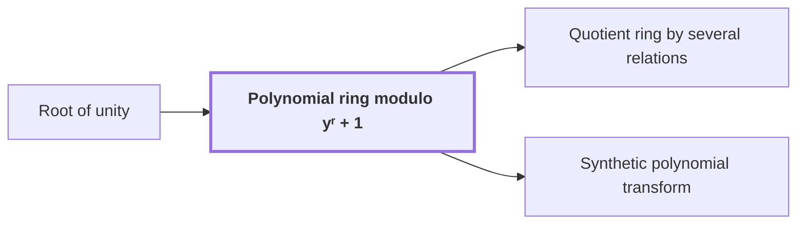

# Polynomial ring modulo $y^r + 1$

!!! info "Before this page"

    Polynomial ring modulo yʳ + 1 *has powers that act as* [Root of unity](roots-of-unity.md "The ring has powers that act as Root of unity, and their effect on coefficients is cheap."). Assumed known: Polynomials and Complex numbers.

!!! abstract "Where this fits"

    - Relied on to show: Normalized cyclic convolution on the power-of-two axes is computed over the polynomial ring $\mathbb C[y]/(y^r+1)$ by synthetic transforms and packed polynomial products. ([Synthetic polynomial transform](synthetic-transform.md "A discrete Fourier transform whose roots of unity are powers of y in the polynomial ring, so that each twiddle multiplication is a signed shift and the transform is computed by simultaneous butterfly layers."))
    - Relied on to show: A phase twist changes the last cyclic coordinate into a polynomial modulo $y^r+1$, and its negative wrap gives the original cyclic wrap.
    - Relied on to show: Polynomial products are computed by signed packing and the established $O(n\log n)$ multiplier used as a subroutine. ([Signed coefficient packing](signed-packing.md "Encoding a polynomial with signed integer coefficients as one integer by placing coefficients at fixed bit offsets, so that a polynomial product becomes an integer product."))

??? note "Symbols from earlier pages"

    - $y$ — polynomial variable: The formal variable of the polynomial ring modulo y^r+1, whose powers are the roots used here. (on [Root of unity](roots-of-unity.md "A number whose some positive integer power equals one; here powers of y in the polynomial ring play this role."))

The polynomial ring modulo a fixed binomial is the arithmetic in which this argument's transforms are computed: complex polynomials whose products are reduced modulo that binomial. One coordinate of the array is held as an element of this ring, and multiplying by a power of the variable needs no complex multiplication.

Here $y$ is the formal variable of the ring. Here $r$ is the number of complex coefficients in each polynomial record, which is a power of two. The binomial is $y^r+1$. The index $i$ runs from $0$ to $r-1$. An element $a_0+a_1y+\dots+a_{r-1}y^{r-1}$ is written as its coefficient list $(a_0,\dots,a_{r-1})$. The entry $a_i$ of this list is the coefficient of $y^i$, a complex number. The letters $i$ and $a_i$ have the meanings given here, not those of earlier pages.

Reduction replaces $y^r$ with $-1$, so $y^{2r}=1$. Here $h$, with $0\le h<r$, is the number of places a coefficient is shifted; the letter $h$ changes meaning here. Multiplying $a_i y^i$ by $y^h$ gives $a_i y^{i+h}$, which for $i+h\ge r$ equals $-a_i y^{i+h-r}$. So each coefficient moves $h$ places towards higher index, and a coefficient pushed past position $r-1$ returns at position $i+h-r$ with its sign reversed. For example, with $r=4$,
$$y\cdot(a_0+a_1y+a_2y^2+a_3y^3)=-a_3+a_0y+a_1y^2+a_2y^3,$$
since $y\cdot a_3y^3=a_3y^4=-a_3$.

The ring has powers that act as [Root of unity](roots-of-unity.md "A number whose some positive integer power equals one; here powers of y in the polynomial ring play this role."), and their effect on coefficients is cheap.

The argument's transforms run over axes whose lengths are powers of two. The source describes the conversion that produces the ring setting only in outline, so this page uses its outcome: one coordinate of the array is stored as an element of this ring, the coefficient list of a polynomial modulo $y^r+1$<cite class="exegenius-ref" data-source="paper" data-locator="§1.1 The two tape operations" data-quote="is stored as the coefficient list of a polynomial modulo $y^r+1$, with $r$ a power of two" title="is stored as the coefficient list of a polynomial modulo $y^r+1$, with $r$ a power of two"> (see §1.1 The two tape operations)</cite>. The other axes use powers of $y$ as roots of unity. A twiddle multiplication, which multiplies a transform entry by a root of unity, is then a signed shift of the coefficient list, with no complex multiplication<cite class="exegenius-ref" data-source="paper" data-locator="§1.1 The two tape operations" data-quote="Powers of $y$ then serve as roots of unity in the remaining axes, and multiplication by such a root is a signed shift of the coefficient list" title="Powers of $y$ then serve as roots of unity in the remaining axes, and multiplication by such a root is a signed shift of the coefficient list"> (see §1.1 The two tape operations)</cite>.

## Connections

Used by:

- [Quotient ring by several relations](quotient-ring.md "With one variable and the single relation $y^r+1$, the quotient ring is reduced to the Polynomial ring modulo yʳ + 1, whose elements are the polynomials of degree less than $r$.") *is reduced to* Polynomial ring modulo yʳ + 1
- [Synthetic polynomial transform](synthetic-transform.md "The transform is computed over the Polynomial ring modulo yʳ + 1.") *is computed over* Polynomial ring modulo yʳ + 1

??? quote "From the sources"

    > is stored as the coefficient list of a polynomial modulo $y^r+1$, with $r$ a power of two.
    >
    > — [Integer multiplication below n log n (OpenAI, 2026)](https://github.com/openai/math/tree/fd4aeeb2ee4fc729c18d98444fed42fd0529eeeb/preprints/Integer-multiplication-below-n-log-n-September-23-2026)
