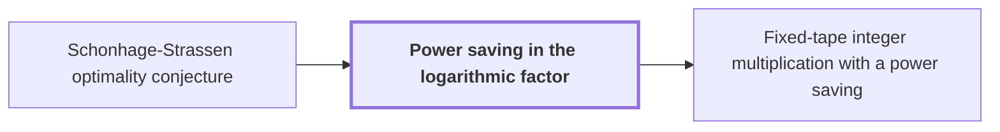

# Power saving in the logarithmic factor

!!! info "Before this page"

    Power saving in the logarithmic factor *undercuts* [Schonhage-Strassen optimality conjecture](schonhage-strassen-conjecture.md "A power saving therefore undercuts the Schonhage-Strassen optimality conjecture."). Assumed known: Big-O notation.

!!! abstract "Where this fits"

    - Relied on to show: The integer product is computed exactly on one fixed-tape machine in $O(n(\lg n)^{1-\kappa})$ worst-case time, for $\kappa=2^{-182}$. ([Fixed-tape integer multiplication with a power saving](fixed-tape-multiplication.md "A deterministic fixed-tape Turing machine that multiplies two n-bit integers exactly in O(n(lg n)^(1−κ)) worst-case time, for a fixed κ = 2^(−182), disproving the n log n optimality conjecture in this model."))
    - Relied on to show: Choosing compatible fixed rational parameters, with $\kappa=2^{-182}$, makes every term of the cost table fit the bound $O(n(\lg n)^{1-\kappa})$.

??? note "Symbols from earlier pages"

    - $n$ — input length: The number of bits in each of the two integers being multiplied, which is the length the worst-case time is measured against. (on [Schonhage-Strassen optimality conjecture](schonhage-strassen-conjecture.md "The conjecture that n log n is the optimal order of growth of the time needed to multiply two n-bit integers on a multitape Turing machine."))
    - $\kappa$ — power-saving constant: A fixed constant greater than 0 that does not depend on $n$. (on [Schonhage-Strassen optimality conjecture](schonhage-strassen-conjecture.md "The conjecture that n log n is the optimal order of growth of the time needed to multiply two n-bit integers on a multitape Turing machine."))

A power saving in the logarithmic factor is a worst-case time bound $n(\lg n)^{1-\kappa}$ for multiplying two $n$-bit integers, where $\kappa > 0$ is a fixed constant that sets the size of the saving. It is the form a result takes when it beats the $n\lg n$ rate.

The bound is smaller than $n\lg n$ by the factor $(\lg n)^{\kappa}$, which grows without bound as $n$ grows, so the bound is $o(n\lg n)$. Since $\kappa$ does not depend on $n$, the bound is a single function of $n$. For example, take $\kappa = 1/2$ and $n = 2^{16}$. Then $\lg n = 16$, so $n(\lg n)^{1/2} = 4n$ while $n\lg n = 16n$: a saving by a factor of $4$.

The paper reports such a machine in the fixed-tape model.<cite class="exegenius-ref" data-source="paper" data-locator="§1 Introduction" data-quote="We obtain a strict power saving in the logarithmic factor, in the same fixed finite-tape model." title="We obtain a strict power saving in the logarithmic factor, in the same fixed finite-tape model."> (see §1 Introduction)</cite> A fixed-tape machine is a multitape machine with a fixed number of tapes, so its time bound is a case of the claim the conjecture makes about multitape machines.

A power saving therefore undercuts the [Schonhage-Strassen optimality conjecture](schonhage-strassen-conjecture.md "The conjecture that n log n is the optimal order of growth of the time needed to multiply two n-bit integers on a multitape Turing machine."). That conjecture says $n\lg n$ is the optimal order of growth for multitape Turing machines, so one machine with worst-case time $o(n\lg n)$ is a counterexample to it.

## Connections

Used by:

- [Fixed-tape integer multiplication with a power saving](fixed-tape-multiplication.md "It achieves a Power saving in the logarithmic factor, which puts its time below $n\log n$ by a power of $\lg n$.") *achieves* Power saving in the logarithmic factor

??? quote "From the sources"

    > We obtain a strict power saving in the
    >
    > — [Integer multiplication below n log n (OpenAI, 2026)](https://github.com/openai/math/tree/fd4aeeb2ee4fc729c18d98444fed42fd0529eeeb/preprints/Integer-multiplication-below-n-log-n-September-23-2026)
