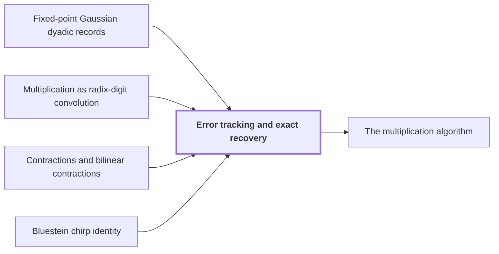

# Error tracking and exact recovery

!!! info "Before this page"

    Error tracking and exact recovery *runs on* [Fixed-point Gaussian dyadic records](fixed-point.md "The computation runs on Fixed-point Gaussian dyadic records with $p=6b$ fractional bits, where $b=\lceil\log_2n\rceil$ is the digit width."), *rebuilds the binary product from* [Multiplication as radix-digit convolution](radix-digit-reduction.md "Carry propagation rebuilds the binary product from the coefficients $c_j$ of the Multiplication as radix-digit convolution, indexed by $j$, with $c_j\le q(2^b-1)^2$ and $q\le2^b$."), *adds errors through* [Contractions and bilinear contractions](contraction-maps.md "Errors add through the Contractions and bilinear contractions making up each transform and product.") and *is built from* [Bluestein chirp identity](chirp.md "The computed chirp transform $\widetilde{\mathscr C}$ is built from the Bluestein chirp identity: a phase product, a complex convolution with the chirp kernel, and a last phase product.").

!!! abstract "Where this fits"

    1. A single deterministic Turing machine with a fixed finite alphabet and a fixed finite number of one-dimensional tapes multiplies two $n$-bit integers exactly in $O(n(\lg n)^{1-\kappa})$ worst-case time with $\kappa=2^{-182}$, disproving the $n\log n$ optimality conjecture of Sch\"onhage and Strassen in this model. — how: Build two power-saving tape procedures (chunk interchange and simultaneous butterfly layer) from fixed finite linear networks; use them to accelerate the synthetic polynomial transforms and ring convolution; use Gaussian resampling with retained permutations and chirps to reduce the prime-length cyclic convolution of the radix-digit coefficients to those power-of-two transforms; assemble the exact product with a proof that the error is below $1/2$; and total the cost to show a power of $\log n$ is saved. ([Power-saving integer multiplication](main-result.md "A deterministic fixed-tape Turing machine multiplying two n-bit integers exactly in O(n(lg n)^{1−κ}) time with κ = 2^{−182}, disproving the n log n optimality conjecture in this model."))
    2. The exact $2n$-bit product of the two inputs is obtained from the radix-digit convolution by the chain: radix digits, Chinese-remainder address map to a product of prime cyclic axes, two forward source transforms (resampling and chirps), pointwise product, opposite transform, rescaling, rounding, and carry propagation, with total error below $1/2$. — how: Reduce the integer product to a cyclic convolution of $S$ short coefficients and compute it through the chain of reductions (digits, CRT address map, Gaussian resampling with chirps, twist to the polynomial ring, synthetic-transform convolution); recover exact integers because the accumulated error is below $1/2$. ([The multiplication algorithm](multiplication-algorithm.md "Digits, then the CRT map, two forward transforms with resampling and chirps, a pointwise product, the opposite transform, rescaling, rounding and carry propagation yield the exact 2n-bit product."))
    3. **This page:** The error on the recovered integer coefficients is below $1/2$, so rounding gives the exact integer coefficients, and carry propagation yields the exact binary product.

??? note "Symbols from earlier pages"

    - $p$ — fractional bits: The number of fractional bits of the grid on which stored values lie. (on [Fixed-point Gaussian dyadic records](fixed-point.md "Complex values stored as signed two's-complement integers over a power-of-two denominator 2^{-p}; intermediate values are exact and one truncation Q_p rounds back to the p-bit grid."))
    - $b$ — digit bits: The number of bits in one radix-2^b digit. (on [Multiplication as radix-digit convolution](radix-digit-reduction.md "Splitting each integer into radix-2^b digits turns the product into a convolution of short integer coefficients, which carry propagation turns back into a binary number."))
    - $n$ — bit length: The number of bits in each of the two integers being multiplied. (on [Schönhage–Strassen optimality conjecture](conjecture.md "The 1971 proposal that n log n is the optimal order of growth for multiplying n-bit integers on a multitape Turing machine."))
    - $T$ — padded length: The number of coefficients of the padded array, a power of two between 4n/b and 8n/b. (on [Multiplication as radix-digit convolution](radix-digit-reduction.md "Splitting each integer into radix-2^b digits turns the product into a convolution of short integer coefficients, which carry propagation turns back into a binary number."))
    - $S$ — convolution length: The length of the cyclic convolution, between T/2 and T, a product of distinct odd primes. (on [Multiplication as radix-digit convolution](radix-digit-reduction.md "Splitting each integer into radix-2^b digits turns the product into a convolution of short integer coefficients, which carry propagation turns back into a binary number."))
    - $\mathcal M$ — bilinear map: A map linear in each of its two operands. (on [Contractions and bilinear contractions](contraction-maps.md "A linear map that never increases the norm of a vector, and a bilinear map whose output norm is at most the product of the input norms, so errors in the inputs do not grow beyond a controlled bound."))
    - $f$ — first operand: The first operand of the bilinear map. (on [Contractions and bilinear contractions](contraction-maps.md "A linear map that never increases the norm of a vector, and a bilinear map whose output norm is at most the product of the input norms, so errors in the inputs do not grow beyond a controlled bound."))
    - $g$ — second operand: The second operand of the bilinear map. (on [Contractions and bilinear contractions](contraction-maps.md "A linear map that never increases the norm of a vector, and a bilinear map whose output norm is at most the product of the input norms, so errors in the inputs do not grow beyond a controlled bound."))
    - $f'$ — computed first operand: The computed operand replacing f. (on [Contractions and bilinear contractions](contraction-maps.md "A linear map that never increases the norm of a vector, and a bilinear map whose output norm is at most the product of the input norms, so errors in the inputs do not grow beyond a controlled bound."))
    - $g'$ — computed second operand: The computed operand replacing g. (on [Contractions and bilinear contractions](contraction-maps.md "A linear map that never increases the norm of a vector, and a bilinear map whose output norm is at most the product of the input norms, so errors in the inputs do not grow beyond a controlled bound."))
    - $Q_p$ — truncation: The truncation that drops the bits below 2^{-p} in each real and imaginary part, returning a record to the p-bit grid. (on [Fixed-point Gaussian dyadic records](fixed-point.md "Complex values stored as signed two's-complement integers over a power-of-two denominator 2^{-p}; intermediate values are exact and one truncation Q_p rounds back to the p-bit grid."))
    - $\mathcal M_r$ — ring convolution: The normalized convolution of the first d-1 axes over R_r, dividing by T. (on [Phase twist](phase-twist.md "Multiplying coefficient k by e^{πik/r}, which converts the cyclic coordinate modulo x^r − 1 into the negacyclic ring modulo y^r + 1 and is removed afterwards."))
    - $r$ — record length: The number of complex coefficients in a polynomial of the ring, always a power of two. (on [Polynomial ring modulo y^r + 1](ring-y.md "Polynomials of degree below r over the complex numbers with y^r = −1, so multiplying by a power of y is a signed shift of the coefficient list."))
    - $\boldsymbol t$ — axis lengths: The tuple of the even axis lengths t_1,...,t_d. (on [Bluestein chirp identity](chirp.md "An identity that rewrites a (permuted) Fourier transform as a pointwise chirp phase, a cyclic convolution, and another chirp phase."))
    - $F_{\boldsymbol t}$ — normalized transform: The normalized multidimensional discrete Fourier transform with axis lengths t_1,...,t_d. (on [Bluestein chirp identity](chirp.md "An identity that rewrites a (permuted) Fourier transform as a pointwise chirp phase, a cyclic convolution, and another chirp phase."))
    - $Q$ — target permutation: The target permutation, a reordering of the output of a power-of-two transform. (on [Bluestein chirp identity](chirp.md "An identity that rewrites a (permuted) Fourier transform as a pointwise chirp phase, a cyclic convolution, and another chirp phase."))
    - $\mathcal B_0$ — output contraction: The tensor product of the axis output maps B_{0,i}. (on [Multidimensional transforms](multidim-transform.md "A transform over several axes at once, the tensor product of one-dimensional transforms, applied to an array one axis at a time."))
    - $\gamma$ — scalar exponent: The total exponent of the scalar power of two in the tensored identity. (on [Multidimensional transforms](multidim-transform.md "A transform over several axes at once, the tensor product of one-dimensional transforms, applied to an array one axis at a time."))
    - $d$ — axis count: The number of axes of the arrays f and g. (on [Phase twist](phase-twist.md "Multiplying coefficient k by e^{πik/r}, which converts the cyclic coordinate modulo x^r − 1 into the negacyclic ring modulo y^r + 1 and is removed afterwards."))
    - $R$ — source permutation tensor: The tensor product of the source index permutations P_{s_i} (not the scalar ring). (on [Multidimensional transforms](multidim-transform.md "A transform over several axes at once, the tensor product of one-dimensional transforms, applied to an array one axis at a time."))
    - $\boldsymbol s$ — source axis lengths: The tuple of source axis lengths. (on [Multidimensional transforms](multidim-transform.md "A transform over several axes at once, the tensor product of one-dimensional transforms, applied to an array one axis at a time."))
    - $c_j$ — product coefficient: The coefficient of x^j in the product of the two digit polynomials. (on [Multiplication as radix-digit convolution](radix-digit-reduction.md "Splitting each integer into radix-2^b digits turns the product into a convolution of short integer coefficients, which carry propagation turns back into a binary number."))
    - $q$ — digit count: The number of radix-2^b digits in each input. (on [Multiplication as radix-digit convolution](radix-digit-reduction.md "Splitting each integer into radix-2^b digits turns the product into a convolution of short integer coefficients, which carry propagation turns back into a binary number."))
    - $\|f\|$ — sup norm: The largest modulus of a scalar coefficient of f. (on [Phase twist](phase-twist.md "Multiplying coefficient k by e^{πik/r}, which converts the cyclic coordinate modulo x^r − 1 into the negacyclic ring modulo y^r + 1 and is removed afterwards."))

Error tracking and exact recovery shows that the computed convolution coefficients lie within $1/2$ of the true integers, so rounding recovers them.

The computation runs on [Fixed-point Gaussian dyadic records](fixed-point.md "Complex values stored as signed two's-complement integers over a power-of-two denominator 2^{-p}; intermediate values are exact and one truncation Q_p rounds back to the p-bit grid.") with $p=6b$ fractional bits, where $b=\lceil\log_2n\rceil$ is the digit width. Write $h_p=2^{-p}$ and $L=\log_2T$, the base-2 logarithm of the padded length $T$ (the letter $L$ here is not a linear map as on the contractions page). Norms are sup norms, an error of $a$ means error below $ah_p$ (here $a$ is an error size in grid spacings, not the chirp), and every array stays in the unit disk (norm $\le1$). For large $n$, $S\le T<2^b$ and $L<b$. Each [synthetic transform](synthetic-transform.md "A transform over the ring modulo y^r + 1 whose roots of unity are powers of y, so every twiddle multiplication is a signed shift of a coefficient list.") has error below $L$<cite class="exegenius-ref" data-source="paper" data-locator="§9.7 Precision and exact recovery" data-quote="$\sqrt2\ell\,2^{-p}&lt;L2^{-p}$" title="$\sqrt2\ell\,2^{-p}&lt;L2^{-p}$"> (see §9.7 Precision and exact recovery)</cite>.

Errors add through the [Contractions and bilinear contractions](contraction-maps.md "A linear map that never increases the norm of a vector, and a bilinear map whose output norm is at most the product of the input norms, so errors in the inputs do not grow beyond a controlled bound.") making up each transform and product. For a bilinear contraction $\mathcal M$, replacing operands $f,g$ by $f',g'$ gives
$$\|\mathcal M(f',g')-\mathcal M(f,g)\|=\|\mathcal M(f'-f,g')+\mathcal M(f,g'-g)\|\le\|f'-f\|\|g'\|+\|f\|\|g'-g\|,$$
so for disk operands the two input errors add.

For a unit phase $e$, an approximation $\widetilde e$ with $|\widetilde e-e|<2h_p$ and a disk operand $x$ (here $x$ is an array in the unit disk to which a phase or chirp transform is applied, not the polynomial variable), the product differs by under $2\|x\|h_p$ and truncation $Q_p$ adds under $\sqrt2h_p$, so $\|Q_p(\widetilde ex)-ex\|<(2\|x\|+\sqrt2)h_p<4h_p$. Also $\|Q_p(\widetilde ex)\|\le\|x\|$, since $|\widetilde e|\le1$.

The ring convolution $\mathcal M_r$ of [Phase twist](phase-twist.md "Multiplying coefficient k by e^{πik/r}, which converts the cyclic coordinate modulo x^r − 1 into the negacyclic ring modulo y^r + 1 and is removed afterwards.") applies two forward synthetic transforms, a pointwise polynomial product divided by $r$ (truncation under $2$) and one opposite transform. Together they err by under $3L+2$. An exact multiplication by $M=T/r$ then gives $(f*g)/T$ and
$$E_{\rm ring}:=M(3L+2)<5TL$$
<cite class="exegenius-ref" data-source="paper" data-locator="§9.7.1 Scales and disk margins" data-quote="E_{\rm ring}:=M(3L+2)&lt;5TL." title="E_{\rm ring}:=M(3L+2)&lt;5TL."> (see §9.7.1 Scales and disk margins)</cite> With an operand of norm at most $.7$, the output norm stays below $.701$. The complex convolution adds two input twists and one output untwist, each under $4$, so it errs by under
$$(E_{\rm ring}+4+4+4)h_p<6TLh_p.$$

The computed chirp transform $\widetilde{\mathscr C}$ is built from the [Bluestein chirp identity](chirp.md "An identity that rewrites a (permuted) Fourier transform as a pointwise chirp phase, a cyclic convolution, and another chirp phase."): a phase product, a complex convolution with the chirp kernel, and a last phase product. With $\boldsymbol t$ the axis lengths, $F_{\boldsymbol t}$ the exact transform and $Q$ the target permutation, the errors $2$ (kernel), $4$, $6TL$ and $4$ give
$$\|\widetilde{\mathscr C}(x)-QF_{\boldsymbol t}x\|<(6TL+2+4+4)h_p<8TLh_p.$$

The computed source transform $\widetilde{\mathscr F}$ applies the expansion map $\mathcal A$ of [Gaussian resampling](gaussian-resampling.md "Re-expressing a Fourier transform of prime length s through a transform of nearby power-of-two length t using Gaussian weights, so that only power-of-two transforms are needed."), then $\widetilde{\mathscr C}$, then the compression map $\mathcal B_0$, then an exact scaling by $2^\gamma$. Each of $\mathcal A,\mathcal B_0$ is a contraction implemented along $d$ axes with error under $p^2$ each, so under $dp^2$. The error before scaling is under $2dp^2+8TL$. As $2dp^2<TL$ eventually, scaling gives error under $E_sh_p$ with
$$E_s=9\cdot2^\gamma TL$$
<cite class="exegenius-ref" data-source="paper" data-locator="§9.7.1 Scales and disk margins" data-quote="E_s=9\,2^\gamma TL," title="E_s=9\,2^\gamma TL,"> (see §9.7.1 Scales and disk margins)</cite> where $b\ge2^{24}$ gives $\gamma\le b/4$<cite class="exegenius-ref" data-source="paper" data-locator="§9.2.1 The padded box and working precision" data-quote="$b\ge2^{24}$ implies $\gamma\le b/4$" title="$b\ge2^{24}$ implies $\gamma\le b/4$"> (see §9.2.1 The padded box and working precision)</cite> and keeps $E_sh_p<10^{-3}$.

Now $u,v$ are the scaled digit arrays of the two inputs, not the input integers of the radix-digit page: each digit is stored as its value times $2^{-b-2}$, so norms are below $1/4$. Let $U=RF_{\boldsymbol s}u$ and $V_1=RF_{\boldsymbol s}v$ be the exact source transforms and $\widetilde U,\widetilde V_1$ the computed ones, of norm under $1/4+E_sh_p<.26$. Then $z=Q_p(\widetilde U\cdot\widetilde V_1)$ has norm under $.26^2<.5$, and
$$\widetilde U\cdot\widetilde V_1-U\cdot V_1=(\widetilde U-U)\cdot\widetilde V_1+U\cdot(\widetilde V_1-V_1)$$
has two terms under $E_sh_p$; truncation adds under $2h_p$. So $\|z-U\cdot V_1\|<(2E_s+2)h_p$.

With $F_{\boldsymbol s}$ the transform with factor $1/S$ and $F_{\boldsymbol s}^+$ its opposite-sign version, the retained permutation cancels ([Retained permutation cancellation](retained-permutations.md "Leaving the coordinate permutations of resampling inside the transform identity, so the source permutation cancels across the two forward transforms and the opposite one and none is executed as a sort.")) and the exact opposite transform $G=RF_{\boldsymbol s}^+$ gives $G(U\cdot V_1)=(u*v)/S^2$<cite class="exegenius-ref" data-source="paper" data-locator="§8.3 The middle transform and the final permutation" data-quote="=\frac{u*v}{S^2}." title="=\frac{u*v}{S^2}."> (see §8.3 The middle transform and the final permutation)</cite> The computed opposite transform is within $E_sh_p$ of $Gz$ and $G$ is a contraction, so
$$\|\widetilde{\mathscr F}^{+}(z)-G(U\cdot V_1)\|\le\|\widetilde{\mathscr F}^{+}(z)-Gz\|+\|G(z-U\cdot V_1)\|<(3E_s+2)h_p.$$
Exact multiplication by $S$ makes $\widetilde w$ approximate $w=(u*v)/S$ with error under $E_wh_p$, where
$$E_w:=S(3E_s+2)<28\cdot2^\gamma T^2L.$$

The integer coefficients are $2^{2b+4}Sw$: $2^{2b+4}$ undoes the two digit scales and $S$ the remaining $1/S$. With $h_p=2^{-6b}$, $S\le T<2^b$, $L<b$ and $\gamma\le b/4$, the absolute error is under
$$2^{2b+4}S\cdot28\cdot2^\gamma T^2L\cdot2^{-6b}<448b\,2^{-b+\gamma}\le448b\,2^{-3b/4}<\tfrac12$$
<cite class="exegenius-ref" data-source="paper" data-locator="§9.7.2 The final integer coefficients" data-quote="\le448b\,2^{-3b/4}&lt;\frac12." title="\le448b\,2^{-3b/4}&lt;\frac12."> (see §9.7.2 The final integer coefficients)</cite> Here $2^{2b+4}ST^2<2^{5b+4}$ uses about $5b$ of the $6b$ fractional bits. The true coefficients are integers, so error strictly below $1/2$ makes the nearest integer the unique correct coefficient.

Carry propagation rebuilds the binary product from the coefficients $c_j$ of the [Multiplication as radix-digit convolution](radix-digit-reduction.md "Splitting each integer into radix-2^b digits turns the product into a convolution of short integer coefficients, which carry propagation turns back into a binary number."), indexed by $j$, with $c_j\le q(2^b-1)^2$ and $q\le2^b$. Put $Q_0=2^b$ and $k_0=0$; $k_j$ is the carry into position $j$ and $d_j$ the $j$-th output digit:
$$d_j=(c_j+k_j)\bmod Q_0,\qquad k_{j+1}=\lfloor(c_j+k_j)/Q_0\rfloor.$$
Then $0\le k_j\le q(Q_0-1)<Q_0^2$: if this holds at $j$, then $c_j+k_j\le q(Q_0-1)^2+q(Q_0-1)=qQ_0(Q_0-1)$. Since $c_j+k_j=d_j+Q_0k_{j+1}$, adding $c_jQ_0^j$ carries the invariant
$$\sum_{h<j}c_hQ_0^h=\sum_{h<j}d_hQ_0^h+k_jQ_0^j$$
from $j$ to $j+1$ (it holds at $j=0$). Unprocessed terms are multiples of $Q_0^j$, so the first $j$ radix digits are fixed. The product is below $2^{2n}$, so all bits above position $2n-1$ are zero and exactly $2n$ bits are output.

## Connections

Used by:

- [The multiplication algorithm](multiplication-algorithm.md "The error on the recovered coefficients is below $1/2$, as shown by Error tracking and exact recovery from each normalized transform and product being a contraction.") *is shown exact by* Error tracking and exact recovery

??? quote "From the sources"

    > proves that the recovered coefficient error is strictly below $1/2$
    >
    > — [Integer multiplication below n log n (OpenAI, 2026)](https://github.com/openai/math/tree/fd4aeeb2ee4fc729c18d98444fed42fd0529eeeb/preprints/Integer-multiplication-below-n-log-n-September-23-2026)

    > Precision and exact recovery
    >
    > — [Integer multiplication below n log n (OpenAI, 2026)](https://github.com/openai/math/tree/fd4aeeb2ee4fc729c18d98444fed42fd0529eeeb/preprints/Integer-multiplication-below-n-log-n-September-23-2026)
