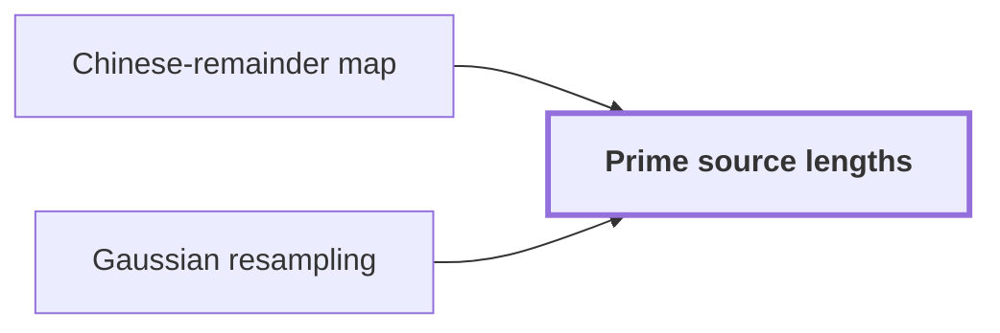

# Prime source lengths

!!! info "Before this page"

    Prime source lengths *are the moduli of* [Chinese-remainder map](chinese-remainder-map.md "The lengths $s_a$ are the moduli of the Chinese-remainder map, which turns one cyclic convolution of length $S$ into a multidimensional one over the $s_a$.") and *are sized for* [Gaussian resampling](gaussian-resampling.md "The primes are sized for Gaussian resampling, which needs each ratio $t_a/s_a$ to leave separation.").

A prime source length is an odd prime chosen just below the padded length of one axis, so that the product of these primes fills a fixed fraction of the padded box.

Let $r$ be the number of axes, indexed by $a=1,\dots,r$, and let $t_a$ be the padded length of axis $a$, a power of two. The source length $s_a$ of axis $a$ is an odd prime, and $S=\prod_a s_a$ is the product of the source lengths, which is the length of the cyclic convolution. Write $T=\prod_a t_a$ for the padded box.

The primes are sized for [Gaussian resampling](gaussian-resampling.md "A technique that replaces a Fourier transform of arbitrary length by transforms whose axis lengths are powers of two, using Gaussian weights to move between the two sets of frequencies."), which needs each ratio $t_a/s_a$ to leave separation. The lengths $s_a$ are the moduli of the [Chinese-remainder map](chinese-remainder-map.md "A relabeling of coefficient positions by mixed-radix digits for pairwise coprime lengths, which turns one cyclic convolution into a multidimensional cyclic convolution."), which turns one cyclic convolution of length $S$ into a multidimensional one over the $s_a$. Distinct primes are pairwise coprime, as that map requires.

The construction meets both requirements, as the sources require.<cite class="exegenius-ref" data-source="paper" data-locator="§1 X -πα-2 (j-sk/t)2, p. 55" data-quote="their product must occupy a fixed fraction of the padded box, while each ratio ti /si must leave enough separation for resampling." title="their product must occupy a fixed fraction of the padded box, while each ratio ti /si must leave enough separation for resampling."> (see §1 X -πα-2 (j-sk/t)2, p. 55)</cite>

Let $\eta$ be a window-width parameter with $0<\eta<1/4$. Let $\ell$ denote a prime number; this page uses $\ell$ for primes, not the position $q$ of the map page. Take a large power of two $X$, so that each $t_a$ is $X$ or $2X$.

For $0<\eta<1/4$ and $X>e^2/\eta$, the window $(1-2\eta)X<\ell\le(1-\eta)X$ holds many primes<cite class="exegenius-ref" data-source="paper" data-locator="§1 X -πα-2 (j-sk/t)2, p. 55" data-quote="the interval (1 − 2η)x &lt; q ≤ (1 − η)x contains at least ηx/(2 log x) primes" title="the interval (1 − 2η)x &lt; q ≤ (1 − η)x contains at least ηx/(2 log x) primes"> (see §1 X -πα-2 (j-sk/t)2, p. 55)</cite>, where $\log$ is the natural logarithm.

Choose $\eta=1/(4r)$, which gives $0<\eta<1/4$ for $r\ge2$. Then each window holds at least $X/(8r\log X)$ primes, which exceeds $r$ for large $X$. The same bound applies to the window $(1-2\eta)2X<\ell\le(1-\eta)2X$. The windows for $X$ and $2X$ are disjoint, since $(1-\eta)X<(1-2\eta)2X$ when $\eta<1/3$. Axes of length $X$ take distinct primes from one window, one at a time, and axes of length $2X$ take them from the other. Each $s_a$ is odd because the windows lie above $2$, and $\gcd(s_a,t_a)=1$ because $t_a$ is a power of two.

The claim follows by bounding the product of the ratios. Let $S/T=\prod_a s_a/t_a$. Each factor exceeds $1-2\eta$, so $S/T>(1-2\eta)^r$. For $r\ge2$ the strict Bernoulli inequality gives $(1-2\eta)^r>1-2r\eta=1/2$. Each factor is at most $1-\eta$, so $S/T\le(1-\eta)^r<1$. Hence $T/2<S<T$. The primes are chosen independently, yet each ratio is pinned in a window just below one, so the product lands in this range.

For example, take $r=2$, $t_1=8$, $t_2=16$, so $X=8$ and $\eta=1/8$. The windows are $(6,7]$ and $(12,14]$, which hold $s_1=7$ and $s_2=13$. Then $S=91$, $T=128$, and $64<91<128$. This $X$ is too small for the counting bound, but it shows the windows.

## Connections

??? quote "From the sources"

    > The distinct prime lengths si must be close to the powers of two ti
    >
    > — Integer multiplication below n log n (OpenAI, 2026)
