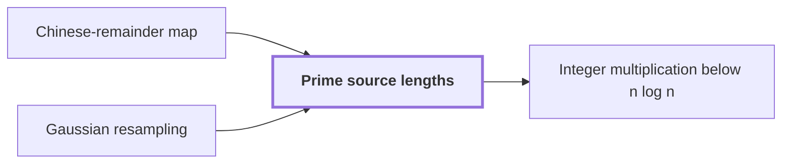

# Prime source lengths

!!! info "Before this page"

    Prime source lengths *supply axis lengths to* [Chinese-remainder map](chinese-remainder-map.md "Distinct primes are pairwise coprime, so the $s_\nu$ supply axis lengths to the Chinese-remainder map, which turns one cyclic convolution into a multidimensional one.") and *leave enough separation for* [Gaussian resampling](gaussian-resampling.md "Second, the ratio $T_\nu/s_\nu$ must leave enough separation for Gaussian resampling, which moves between transforms of length $s_\nu$ and of length $T_\nu$.").

!!! abstract "Where this fits"

    - Relied on to show: A compatible choice of rational parameters makes every term of the cost table fit the bound of Theorem 1.

Prime source lengths are distinct odd primes $s_\nu$, one for each axis $\nu$, chosen so that their product fills a fixed fraction of the padded box. Here $T_\nu$, a power of two, is the $\nu$-th padded axis length, and the padded box is the box whose axis lengths are the $T_\nu$. Each $s_\nu$ is chosen near $T_\nu$. The letters $s$ and $T$ change meaning here.

Two requirements fix how close $s_\nu$ must be to $T_\nu$. First, the product of the $s_\nu$ must fill a fixed fraction of the padded box<cite class="exegenius-ref" data-source="paper" data-locator="§1 X -πα-2 (j-sk/t)2, p. 55" data-quote="their product must occupy a fixed fraction of the padded box" title="their product must occupy a fixed fraction of the padded box"> (see §1 X -πα-2 (j-sk/t)2, p. 55)</cite>. Second, the ratio $T_\nu/s_\nu$ must leave enough separation for [Gaussian resampling](gaussian-resampling.md "A technique that replaces a Fourier transform of arbitrary length by transforms whose axis lengths are powers of two, using Gaussian weights to move between the two sets of frequencies."), which moves between transforms of length $s_\nu$ and of length $T_\nu$.

We use the window
$$(1-2\eta)\,T_\nu < s_\nu \le (1-\eta)\,T_\nu,$$
where $\eta$, a fixed constant with $0<\eta<1/4$, sets the width of the window.

For large $T_\nu$, a prime-interval result, based on explicit estimates of Rosser and Schoenfeld, shows that the window holds many primes<cite class="exegenius-ref" data-source="paper" data-locator="§1 X -πα-2 (j-sk/t)2, p. 55" data-quote="contains at least ηx/(2 log x) primes" title="contains at least ηx/(2 log x) primes"> (see §1 X -πα-2 (j-sk/t)2, p. 55)</cite>. Taking $\eta=1/(4K)$ gives at least $T_\nu/(8K\log T_\nu)$ primes in each window, which exceeds $K$ for large $T_\nu$<cite class="exegenius-ref" data-source="paper" data-locator="§1 X -πα-2 (j-sk/t)2, p. 55" data-quote="the stated lower bound for the number of primes is x/(8d log x) and exceeds d" title="the stated lower bound for the number of primes is x/(8d log x) and exceeds d"> (see §1 X -πα-2 (j-sk/t)2, p. 55)</cite>, so one distinct prime per axis can be chosen.

For example, take $T_\nu=16$ and $\eta=1/5$. The window is $9.6 < s_\nu \le 12.8$, which contains only the prime $11$, so at this small size the window cannot supply many axes. Also $\gcd(11,16)=1$, since $11$ is odd and $16$ is a power of two.

Distinct primes are pairwise coprime, so the $s_\nu$ supply axis lengths to the [Chinese-remainder map](chinese-remainder-map.md "A relabeling of coefficient positions by mixed-radix digits for pairwise coprime lengths, which turns one cyclic convolution into a multidimensional cyclic convolution."), which turns one [cyclic convolution](glossary.md#cyclic-convolution "The product of two sequences in which indices wrap around modulo the sequence length.") into a multidimensional one.

## Connections

Used by:

- [Integer multiplication below n log n](main-theorem.md "It chooses its source lengths as prime source lengths.") *chooses its source lengths as* Prime source lengths

??? quote "From the sources"

    > The distinct prime lengths si must be close to the powers of two ti
    >
    > — Integer multiplication below n log n (OpenAI, 2026)
