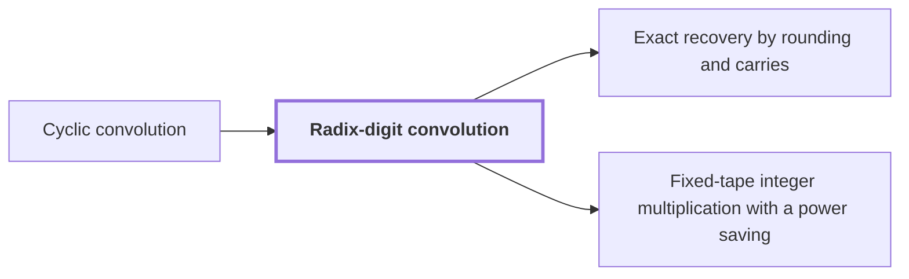

# Radix-digit convolution

!!! info "Before this page"

    Radix-digit convolution *is reduced to* [Cyclic convolution](cyclic-convolution.md "Computing $W$ from the digit lists is a Cyclic convolution of length $S$, so the integer product is reduced to a cyclic convolution."). Assumed known: Polynomials.

!!! abstract "Where this fits"

    1. The integer product is computed exactly on one fixed-tape machine in $O(n(\lg n)^{1-\kappa})$ worst-case time, for $\kappa=2^{-182}$. — how: reduce exact multiplication to convolution of radix digits on distinct prime axes, compute the convolution by synthetic transforms on tape layouts, and bound the total tape cost with a power saving ([Fixed-tape integer multiplication with a power saving](fixed-tape-multiplication.md "A deterministic fixed-tape Turing machine that multiplies two n-bit integers exactly in O(n(lg n)^(1−κ)) worst-case time, for a fixed κ = 2^(−182), disproving the n log n optimality conjecture in this model."))
    2. **This page:** Splitting the inputs into radix digits reduces multiplication to convolution of short integer coefficients.

??? note "Symbols from earlier pages"

    - $n$ — input length in bits: The count of bits in each input of the machine, the length in bits of each input. (on [Fixed-tape machine model](fixed-tape-model.md "A multitape Turing machine with one fixed finite alphabet and a fixed finite number of one-dimensional tapes, the same for every input length."))

Radix-digit convolution is a way of writing the product of two $n$-bit integers as a product of two polynomials with small nonnegative coefficients, the first step toward integer products on a fixed-tape machine.

Fix a digit width $\beta$, the number of bits in each radix digit. The exact-recovery page calls this width $b$, but this page writes $\beta$ throughout. Let $m = \lceil n/\beta \rceil$ be the number of digits in each input. The digit $u_i$, for $0 \le i \le m-1$, is the $i$-th radix digit of the first input, and $v_i$ is the $i$-th radix digit of the second input, each in $\{0,\dots,2^\beta-1\}$. Let $t$ be a formal variable marking coefficient positions. The polynomial $U(t)$ has the digits of the first input as coefficients, and $V(t)$ has those of the second: $U(t) = \sum_{i=0}^{m-1} u_i t^i$ and $V(t) = \sum_{i=0}^{m-1} v_i t^i$.

Evaluating at $t = 2^\beta$ gives back each input, and evaluation turns a product of polynomials into a product of values. Let $W(t) = U(t)V(t)$ be the product polynomial, so the integer product is $U(2^\beta)V(2^\beta) = W(2^\beta)$. Its $k$-th coefficient $w_k$ is the sum of $u_i v_j$ over $i+j=k$, a convolution of the two digit lists.

Each $w_k$ sums at most $m$ products, each below $2^{2\beta}$, so $0 \le w_k < m\,2^{2\beta}$.

Zero padding, which extends each list with zeros to length $S \ge 2m-1$, keeps every index $i+j \le 2m-2$ below the length, so no term wraps around. Computing $W$ from the digit lists is a [Cyclic convolution](cyclic-convolution.md "The product of two coefficient lists in the ring of polynomials modulo x^S − 1, in which exponents wrap around modulo S.") of length $S$, so the integer product is reduced to a cyclic convolution.

For example, take $\beta = 4$ and $n = 8$, so $m = 2$. The integers $75 = 11 + 4\cdot 16$ and $38 = 6 + 2\cdot 16$ have digits $u_0 = 11$, $u_1 = 4$, $v_0 = 6$, $v_1 = 2$, so $W(t) = 66 + 46t + 8t^2$, and at $t = 16$ this equals $2850 = 75 \cdot 38$.

The carries are handled afterwards by [Exact recovery by rounding and carries](exact-recovery.md "Recovering the exact integer coefficients of a convolution by rounding the computed values, whose error is below one half, and then propagating carries in radix 2^b.").

## Connections

Used by:

- [Exact recovery by rounding and carries](exact-recovery.md "Exact recovery by rounding and carries recovers the exact coefficients of a Radix-digit convolution, then turns them into the exact binary product by rounding and carrying.") *recovers the exact coefficients of* Radix-digit convolution
- [Fixed-tape integer multiplication with a power saving](fixed-tape-multiplication.md "It reduces multiplication to convolution through Radix-digit convolution, with $\lceil n/b\rceil$ digits per input.") *reduces multiplication to convolution through* Radix-digit convolution

??? quote "From the sources"

    > Splitting the inputs into radix digits reduces multiplication to
    >
    > — [Integer multiplication below n log n (OpenAI, 2026)](https://github.com/openai/math/tree/fd4aeeb2ee4fc729c18d98444fed42fd0529eeeb/preprints/Integer-multiplication-below-n-log-n-September-23-2026)
