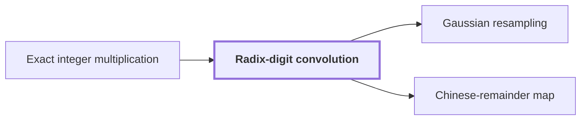

# Radix-digit convolution

!!! info "Before this page"

    Radix-digit convolution *reduces* [Exact integer multiplication](exact-integer-multiplication.md "Radix-digit convolution reduces exact integer multiplication to a convolution of short integer coefficients, which fast convolution methods can evaluate."). Assumed known: Polynomials.

!!! abstract "Where this fits"

    - Relied on to show: Distinct odd primes $s_1,\dots,s_d$ exist with $(1-2\eta)t_i<s_i\le(1-\eta)t_i$ for every axis $i$, and their product $S=\prod_i s_i$ satisfies $T/2<S<T$. ([Prime source lengths](prime-source-lengths.md "Distinct odd primes chosen close to the powers of two that are the padded axis lengths, so that their product fills a fixed fraction of the padded box."))

Radix-digit convolution reduces [exact integer multiplication](exact-integer-multiplication.md "Given binary strings x and y of length n, output the 2n-bit binary representation of their product.") to a convolution of short integer coefficients, which fast convolution methods can evaluate.<cite class="exegenius-ref" data-source="paper" data-locator="§11 A consequence for matrix transposition, p. 3" data-quote="Splitting the inputs into radix digits reduces multiplication to convolution of short integer coefficients" title="Splitting the inputs into radix digits reduces multiplication to convolution of short integer coefficients"> (see §11 A consequence for matrix transposition, p. 3)</cite>.

Fix a digit width $w$, the number of bits in one digit, and let $B = 2^w$ be the radix. Pad both inputs to $d$ digits, where $d$ is the number of digit positions in each input. Here $l$ is a second digit position over $0,\dots,d-1$, and $p$, running over $0,\dots,2d-2$, is a coefficient position. Let $x$ and $y$ be the input strings, and write $\mathrm{val}(x)$ and $\mathrm{val}(y)$ for the integers they represent.

Let $x_j$ and $y_j$ be the $j$th base-$B$ digits of $\mathrm{val}(x)$ and $\mathrm{val}(y)$, each in $\{0,\dots,B-1\}$, where $j$ runs over the digit positions $0,\dots,d-1$. Then
$$\mathrm{val}(x)=\sum_{j=0}^{d-1}x_jB^j,\qquad \mathrm{val}(y)=\sum_{j=0}^{d-1}y_jB^j.$$
The coefficient $c_p$ at position $p$ is the convolution of the two digit sequences:
$$c_p=\sum_{j+l=p} x_j y_l,\qquad \mathrm{val}(x)\,\mathrm{val}(y)=\sum_p c_p B^p.$$

Fast transform methods compute this convolution. The coefficients are short: each term $x_j y_l$ is at most $(B-1)^2 < 2^{2w}$, and $c_p$ has at most $d$ terms, so $c_p < d\,2^{2w}$, about $2w + \lg d$ bits.

Carry propagation then recovers the product from the $c_p$. Take $w=2$, so $B=4$, with $\mathrm{val}(x)=11$ and $\mathrm{val}(y)=6$, and $d=2$. The digits are $x_0=3$, $x_1=2$, $y_0=2$, $y_1=1$, giving $c_0=6$, $c_1=7$, $c_2=2$. From the lowest position, $6=1\cdot 4+2$ writes $2$ and carries $1$; $7+1=8=2\cdot 4$ writes $0$ and carries $2$; $2+2=4=1\cdot 4$ writes $0$ and carries $1$, which is the top digit. The digits $2,0,0,1$ give $66=11\cdot 6$.

## Connections

Used by:

- [Gaussian resampling](gaussian-resampling.md "Gaussian resampling is applied to the Radix-digit convolution of two integers, which needs transforms of lengths that are not powers of two.") *is applied to* Radix-digit convolution
- [Chinese-remainder map](chinese-remainder-map.md "The map is applied to the coefficients of Radix-digit convolution.") *is applied to the coefficients of* Radix-digit convolution

??? quote "From the sources"

    > Splitting the inputs into radix digits reduces multiplication to convolution of short integer coefficients
    >
    > — Integer multiplication below n log n (OpenAI, 2026)
