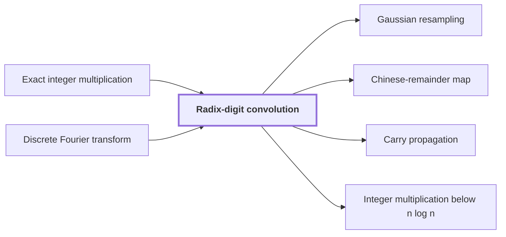

# Radix-digit convolution

!!! info "Before this page"

    Radix-digit convolution *reduces* [Exact integer multiplication](exact-integer-multiplication.md "Radix-digit convolution reduces exact integer multiplication to a convolution of short integer digit lists, which is the first step toward a fast product.") and *is computed by* [Discrete Fourier transform](discrete-fourier-transform.md "The convolution is computed by transforms quickly on a fixed layout, which is why the reduction stops at this form rather than at the integer product."). Assumed known: Polynomials.

!!! abstract "Where this fits"

    1. A deterministic fixed-tape machine multiplies two $n$-bit integers exactly in $O(n(\lg n)^{1-\kappa})$ time, with $\kappa=2^{-182}$, below the $n\lg n$ conjecture in this model. — how: bound the cost of an exact multiplication whose transform layers are made cheap by two tape procedures, then fix parameters so every cost term fits ([Integer multiplication below n log n](main-theorem.md "A deterministic fixed-tape machine that multiplies two n-bit integers exactly in O(n (lg n)^(1−κ)) time with κ = 2^−182, which disproves the n log n optimality conjecture in this model."))
    2. **This page:** The exact product of two $n$-bit integers is obtained from the convolution of their radix-digit coefficients, computed by transforms on a fixed tape layout and then recovered and carried.

??? note "Symbols from earlier pages"

    - $n$ — input length: The number of bits in each of the two inputs, the common length of x and y. (on [Exact integer multiplication](exact-integer-multiplication.md "Given binary strings x and y of length n, output the 2n-bit binary representation of their product."))
    - $\mathrm{val}$ — binary value function: The function mapping a binary string to the nonnegative integer whose binary digits it is, leftmost bit most significant. (on [Exact integer multiplication](exact-integer-multiplication.md "Given binary strings x and y of length n, output the 2n-bit binary representation of their product."))

Radix-digit convolution reduces [exact integer multiplication](exact-integer-multiplication.md "Given binary strings x and y of length n, output the 2n-bit binary representation of their product.") to a convolution of short integer digit lists, which is the first step toward a fast product.

Fix a digit width $d$, the number of bits in each digit, and a digit count $N$, the number of digits in each input, with $Nd \ge n$ so that both inputs fit. The letters $i$, $j$ and $l$ index digits on this page, not the transform entries or the imaginary unit they denote elsewhere. Write $\mathrm{val}(x)$ and $\mathrm{val}(y)$ for the two integers, in radix $2^d$, that is, as sums of powers of $2^d$:

$$\mathrm{val}(x) = \sum_{j=0}^{N-1} x_j 2^{dj}, \qquad \mathrm{val}(y) = \sum_{j=0}^{N-1} y_j 2^{dj}.$$

The digit $x_j$ is an integer in $[0, 2^d)$, the $j$-th radix-$2^d$ digit of $\mathrm{val}(x)$, with $x_0$ the least significant; $y_j$ is defined the same way from $\mathrm{val}(y)$.

Digits become the coefficients of polynomials in a formal variable $T$: $P(T) = \sum_{j} x_j T^j$ and $Q(T) = \sum_{j} y_j T^j$, so that $P(2^d) = \mathrm{val}(x)$ and $Q(2^d) = \mathrm{val}(y)$. Here $P$ and $Q$ are polynomials, not the vector spaces of those names.

Evaluating at $2^d$ preserves products. The product $P(T)Q(T) = \sum_j e_j T^j$ has coefficients $e_j = \sum_{i+l=j} x_i y_l$, the ordinary (non-cyclic) convolution of the two digit lists, and so $\mathrm{val}(x)\,\mathrm{val}(y) = P(2^d)Q(2^d) = \sum_j e_j 2^{dj}$. Here $e_j$ is a coefficient of the product, not a basis vector.

Each $e_j$ is a sum of at most $N$ products, each below $2^{2d}$, so it may exceed a digit, and $\sum_j e_j 2^{dj}$ is not yet a binary string. [Carry propagation](carry-propagation.md "Converting the recovered integer radix-digit coefficients into a binary string by adding each coefficient to a carry from the previous position.") adds each coefficient to the carry from the previous position to give the binary product.

Take $\mathrm{val}(x) = 11$ and $\mathrm{val}(y) = 6$ with $d = 2$ and $N = 2$. The digits are $x_0 = 3$, $x_1 = 2$, $y_0 = 2$ and $y_1 = 1$, so $e_0 = 3 \cdot 2 = 6$, $e_1 = 3 \cdot 1 + 2 \cdot 2 = 7$ and $e_2 = 2 \cdot 1 = 2$. Then $6 + 7 \cdot 4 + 2 \cdot 16 = 66 = 11 \cdot 6$. The coefficient $e_1 = 7$ exceeds the largest digit $2^d - 1 = 3$, so it must be carried.

The convolution is computed by [transforms](discrete-fourier-transform.md "The map sending a vector of q values to its q values weighted by powers of a q-th root of unity, normalized by 1/q.") quickly on a fixed layout, which is why the reduction stops at this form rather than at the integer product. The reduction is the starting point of the paper's method<cite class="exegenius-ref" data-source="paper" data-locator="§11 A consequence for matrix transposition, p. 3" data-quote="Splitting the inputs into radix digits reduces multiplication to convolution of short integer coefficients" title="Splitting the inputs into radix digits reduces multiplication to convolution of short integer coefficients"> (see §11 A consequence for matrix transposition, p. 3)</cite>.

## Connections

Used by:

- [Gaussian resampling](gaussian-resampling.md "Gaussian resampling is applied to the Radix-digit convolution of the two integers' digit coefficients, so the Fourier transforms it replaces are those of that convolution.") *is applied to* Radix-digit convolution
- [Chinese-remainder map](chinese-remainder-map.md "It acts on the coefficients of a radix-digit convolution before any transform is computed, turning one cyclic convolution into a convolution over several cyclic axes at once.") *acts on the coefficients of* Radix-digit convolution
- [Carry propagation](carry-propagation.md "It is applied to the coefficients of the Radix-digit convolution once they are recovered.") *is applied to* Radix-digit convolution
- [Integer multiplication below n log n](main-theorem.md "Multiplication is reduced to the radix-digit convolution of the two integers' digit coefficients.") *is reduced to* Radix-digit convolution

??? quote "From the sources"

    > Splitting the inputs into radix digits reduces multiplication to convolution of short integer coefficients
    >
    > — Integer multiplication below n log n (OpenAI, 2026)
