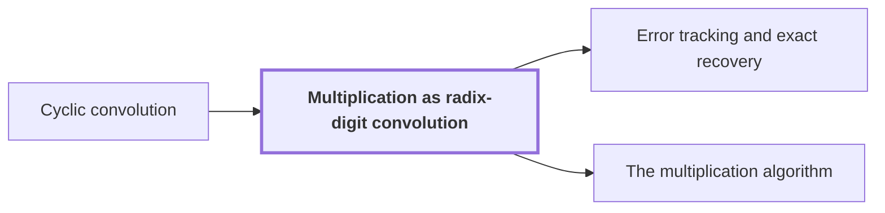

# Multiplication as radix-digit convolution

!!! info "Before this page"

    Multiplication as radix-digit convolution *is reduced to* [Cyclic convolution](convolution.md "Multiplication therefore reduces to a Cyclic convolution of length $S$ on short integer coefficients.").

!!! abstract "Where this fits"

    1. A single deterministic Turing machine with a fixed finite alphabet and a fixed finite number of one-dimensional tapes multiplies two $n$-bit integers exactly in $O(n(\lg n)^{1-\kappa})$ worst-case time with $\kappa=2^{-182}$, disproving the $n\log n$ optimality conjecture of Sch\"onhage and Strassen in this model. — how: Build two power-saving tape procedures (chunk interchange and simultaneous butterfly layer) from fixed finite linear networks; use them to accelerate the synthetic polynomial transforms and ring convolution; use Gaussian resampling with retained permutations and chirps to reduce the prime-length cyclic convolution of the radix-digit coefficients to those power-of-two transforms; assemble the exact product with a proof that the error is below $1/2$; and total the cost to show a power of $\log n$ is saved. ([Power-saving integer multiplication](main-result.md "A deterministic fixed-tape Turing machine multiplying two n-bit integers exactly in O(n(lg n)^{1−κ}) time with κ = 2^{−182}, disproving the n log n optimality conjecture in this model."))
    2. The exact $2n$-bit product of the two inputs is obtained from the radix-digit convolution by the chain: radix digits, Chinese-remainder address map to a product of prime cyclic axes, two forward source transforms (resampling and chirps), pointwise product, opposite transform, rescaling, rounding, and carry propagation, with total error below $1/2$. — how: Reduce the integer product to a cyclic convolution of $S$ short coefficients and compute it through the chain of reductions (digits, CRT address map, Gaussian resampling with chirps, twist to the polynomial ring, synthetic-transform convolution); recover exact integers because the accumulated error is below $1/2$. ([The multiplication algorithm](multiplication-algorithm.md "Digits, then the CRT map, two forward transforms with resampling and chirps, a pointwise product, the opposite transform, rescaling, rounding and carry propagation yield the exact 2n-bit product."))
    3. **This page:** Writing the two inputs in radix $2^b$ with $q=\lceil n/b\rceil$ digits each, the product polynomial has degree at most $2q-2<2n/b\le T/2<S$, so convolution modulo $x^S-1$ has no wraparound, and every coefficient $c_j\le q(2^b-1)^2<2^{3b}$.

??? note "Symbols from earlier pages"

    - $n$ — bit length: The number of bits in each of the two integers being multiplied. (on [Schönhage–Strassen optimality conjecture](conjecture.md "The 1971 proposal that n log n is the optimal order of growth for multiplying n-bit integers on a multitape Turing machine."))

Splitting each input into digits in a large power-of-two radix turns the integer product into a convolution of short integer sequences, and the sizes chosen here make a [Cyclic convolution](convolution.md "The product of two sequences (or elements of a polynomial quotient ring) where indices wrap around: (f∗g)_k = Σ f_j g_{k−j}.") agree exactly with the ordinary product.

Call the two inputs $u$ and $u'$, each with $n$ bits. Let $b=\lceil\log_2 n\rceil$ be the number of bits in one digit, so $n\le 2^b$. Two lengths come from [parameter and prime-length choice](parameter-choice.md "Fixed rational exponents and sizes (precision p = 6b, d axes, K = d^c, T and r powers of two, prime lengths s_i just below t_i) making every hypothesis of the lemmas hold."). $T$ is a power of two with $4n/b\le T<8n/b$, the size of the padded array on which the later power-of-two transforms act. $S$ is the length of the cyclic convolution, with $T/2<S<T$. It is a product of distinct odd primes, each slightly below a power of two, because the later [Chinese-remainder address map](crt-map.md "An isomorphism that places a cyclic convolution of length S = s₁⋯s_d on pairwise coprime prime axes, implemented as triangular controlled shifts.") splits a length-$S$ convolution into prime-length axes only if the lengths are coprime, and [Gaussian resampling](gaussian-resampling.md "Re-expressing a Fourier transform of prime length s through a transform of nearby power-of-two length t using Gaussian weights, so that only power-of-two transforms are needed.") then moves each prime length to a nearby power of two. This page needs only $T/2<S$.

Let $q=\lceil n/b\rceil$ be the number of digits in each input, padding with leading zeros. Write $u=\sum_{i=0}^{q-1}u_i2^{bi}$ and $u'=\sum_{k=0}^{q-1}u'_k2^{bk}$, where the digits $u_i$ and $u'_k$ are integers with $0\le u_i,u'_k<2^b$. Let $x$ be a polynomial variable, and form the polynomials in $x$ with the $u_i$ and with the $u'_k$ as coefficients. Evaluating them at $x=2^b$ returns $u$ and $u'$, so $uu'$ is the value at $2^b$ of their product. Let $c_j=\sum_{i+k=j}u_iu'_k$ be the coefficient of $x^j$ in that product. The $c_j$ can exceed $2^b$, so the last step is to evaluate at $2^b$ with carries, which gives the binary number.

## No wraparound

Each digit polynomial has degree at most $q-1$, so the product polynomial has degree at most $2q-2$. Since a ceiling is less than its argument plus 1, $q<n/b+1$ and so $2q-2<2n/b$. Also $2n/b\le T/2$ because $T\ge 4n/b$, and $T/2<S$. Hence $2q-2<2n/b\le T/2<S$<cite class="exegenius-ref" data-source="paper" data-locator="§9.2.3 The radix-digit polynomials" data-quote="2q-2&lt;2n/b\le T/2&lt;S." title="2q-2&lt;2n/b\le T/2&lt;S."> (see §9.2.3 The radix-digit polynomials)</cite>

The cyclic convolution of length $S$ is the product modulo $x^S-1$, where $x^S=1$ folds the term $x^j$ onto $x^{j \bmod S}$. Every exponent $j$ is at most $2q-2<S$, so nothing folds. The cyclic convolution of the two zero-padded digit sequences therefore equals $c_0,\dots,c_{S-1}$, with zeros after $c_{2q-2}$. For example, with $q=3$ the product has degree 4. Length $S=5$ is safe, but $S=4$ would fold $c_4$ onto $c_0$.

## Size of the coefficients

Each $c_j$ is a sum of at most $q$ products $u_iu'_k$, each between $0$ and $(2^b-1)^2$. Hence $0\le c_j\le q(2^b-1)^2$. Since $q\le n\le 2^b$, this is below $2^b\cdot 2^{2b}=2^{3b}$<cite class="exegenius-ref" data-source="paper" data-locator="§9.2.3 The radix-digit polynomials" data-quote="0\le c_j\le q(2^b-1)^2&lt;2^{3b}," title="0\le c_j\le q(2^b-1)^2&lt;2^{3b},"> (see §9.2.3 The radix-digit polynomials)</cite>.

So every coefficient is a nonnegative integer of at most $3b$ bits. Any approximation of $c_j$ with error below $1/2$ rounds to $c_j$, which is how [error tracking](precision-recovery.md "Each normalized transform and product is a contraction with a bounded rounding error, and the total error on the recovered convolution coefficients is below 1/2, so rounding gives exact integers.") recovers exact integers after the approximate transforms.

Multiplication therefore reduces to a [Cyclic convolution](convolution.md "The product of two sequences (or elements of a polynomial quotient ring) where indices wrap around: (f∗g)_k = Σ f_j g_{k−j}.") of length $S$ on short integer coefficients.

## Connections

Used by:

- [Error tracking and exact recovery](precision-recovery.md "Carry propagation rebuilds the binary product from the coefficients $c_j$ of the Multiplication as radix-digit convolution, indexed by $j$, with $c_j\le q(2^b-1)^2$ and $q\le2^b$.") *rebuilds the binary product from* Multiplication as radix-digit convolution
- [The multiplication algorithm](multiplication-algorithm.md "Their product polynomial has degree below $S$, so the product is reduced to a cyclic convolution modulo $x^S-1$ of digit arrays with integer coefficients below $2^{3b}$, by Multiplication as radix-digit convolution.") *is reduced to* Multiplication as radix-digit convolution

??? quote "From the sources"

    > Splitting the inputs into radix digits reduces multiplication to
    >
    > — [Integer multiplication below n log n (OpenAI, 2026)](https://github.com/openai/math/tree/fd4aeeb2ee4fc729c18d98444fed42fd0529eeeb/preprints/Integer-multiplication-below-n-log-n-September-23-2026)

    > Propagate radix-$2^b$ carries in increasing coefficient order.
    >
    > — [Integer multiplication below n log n (OpenAI, 2026)](https://github.com/openai/math/tree/fd4aeeb2ee4fc729c18d98444fed42fd0529eeeb/preprints/Integer-multiplication-below-n-log-n-September-23-2026)
