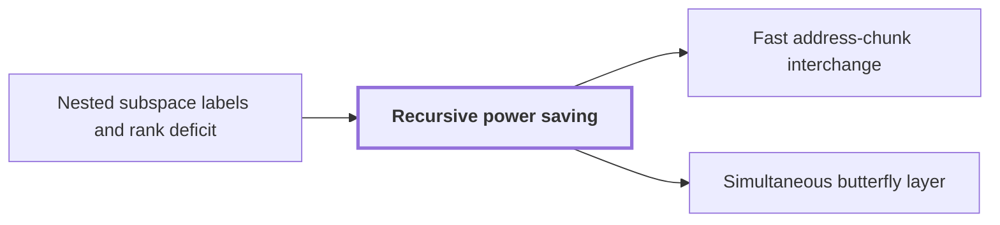

# Recursive power saving

!!! info "Before this page"

    Recursive power saving *gets the strict inequality from* [Nested subspace labels and rank deficit](subspace-labels.md "The recursion gets the strict inequality $s<Wm$ from Nested subspace labels and rank deficit, which gives each vertex a subspace of the label space, nested along each edge, and charges an edge its dimension change.").

!!! abstract "Where this fits"

    1. A single deterministic Turing machine with a fixed finite alphabet and a fixed finite number of one-dimensional tapes multiplies two $n$-bit integers exactly in $O(n(\lg n)^{1-\kappa})$ worst-case time with $\kappa=2^{-182}$, disproving the $n\log n$ optimality conjecture of Sch\"onhage and Strassen in this model. — how: Build two power-saving tape procedures (chunk interchange and simultaneous butterfly layer) from fixed finite linear networks; use them to accelerate the synthetic polynomial transforms and ring convolution; use Gaussian resampling with retained permutations and chirps to reduce the prime-length cyclic convolution of the radix-digit coefficients to those power-of-two transforms; assemble the exact product with a proof that the error is below $1/2$; and total the cost to show a power of $\log n$ is saved. ([Power-saving integer multiplication](main-result.md "A deterministic fixed-tape Turing machine multiplying two n-bit integers exactly in O(n(lg n)^{1−κ}) time with κ = 2^{−182}, disproving the n log n optimality conjecture in this model."))
    2. **This page:** Both tape primitives (the interchange of two address chunks of $u$ digits and the simultaneous butterfly layer on up to $d$ axes) cost the volume times a power below one of their width, because a call at parameter $mf$ makes $s$ calls at parameter $f$ on streams of volume $V/W$ with $s<Wm$, so the cost per unit volume grows by $s/W<m$ per factor $m$ of the parameter.

??? note "Symbols from earlier pages"

    - $W$ — stream count: The fixed number of streams that rows are dealt into. (on [Elementary stream operations](stream-ops.md "Linear-time scans on arrays stored in lexicographic order: swapping two digits, moving a digit, splitting into streams, applying a pointwise map and merging back."))
    - $N$ — bank size: The number of values in each data bank. (on [Linear exchange network with restored scratch wires](exchange-network.md "A fixed network of linear gates on wires holding values that swaps two banks with a prescribed sign while undoing the effect of arbitrary initial scratch values, built from three-element subsets."))
    - $L$ — total loss: The total dimension lost on the decreasing edges of the network under consideration. (on [Nested subspace labels and rank deficit](subspace-labels.md "Assigning nondegenerate subspaces of an m-dimensional space to gates so adjacent labels are nested; the total dimension change over edges, the number s of smaller calls, is strictly less than W·m."))
    - $\tau$ — interchange exponent: The exponent in the cost of a chunk interchange. (on [Parameter and prime-length choice](parameter-choice.md "Fixed rational exponents and sizes (precision p = 6b, d axes, K = d^c, T and r powers of two, prime lengths s_i just below t_i) making every hypothesis of the lemmas hold."))
    - $\sigma$ — recursion growth exponent: The bound on the growth exponent of recursive calls. (on [Parameter and prime-length choice](parameter-choice.md "Fixed rational exponents and sizes (precision p = 6b, d axes, K = d^c, T and r powers of two, prime lengths s_i just below t_i) making every hypothesis of the lemmas hold."))
    - $\beta$ — threshold exponent: The exponent of the threshold d^beta below which active chunks are handled singly. (on [Parameter and prime-length choice](parameter-choice.md "Fixed rational exponents and sizes (precision p = 6b, d axes, K = d^c, T and r powers of two, prime lengths s_i just below t_i) making every hypothesis of the lemmas hold."))
    - $K$ — chunk width: The width in bits of an address chunk. (on [Parameter and prime-length choice](parameter-choice.md "Fixed rational exponents and sizes (precision p = 6b, d axes, K = d^c, T and r powers of two, prime lengths s_i just below t_i) making every hypothesis of the lemmas hold."))
    - $\lambda'$ — layer exponent: The final exponent of the layer cost V d^{lambda'}. (on [Parameter and prime-length choice](parameter-choice.md "Fixed rational exponents and sizes (precision p = 6b, d axes, K = d^c, T and r powers of two, prime lengths s_i just below t_i) making every hypothesis of the lemmas hold."))
    - $d$ — axis count: The number of axes of the underlying cyclic convolution. (on [Cyclic convolution](convolution.md "The product of two sequences (or elements of a polynomial quotient ring) where indices wrap around: (f∗g)_k = Σ f_j g_{k−j}."))

Recursive power saving is the recurrence that makes both tape procedures, the interchange of two address chunks and the simultaneous butterfly layer, cost the stream volume times a power below one of their parameter.

A call acts on a stream of volume $V$ and has a parameter $f$ (a number here, not an array): the digits per interchanged chunk, or the selected axes of a layer. The branching factor is the fixed label-space dimension $m=h^3=10^6$ of the [exchange network](exchange-network.md "A fixed network of linear gates on wires holding values that swaps two banks with a prescribed sign while undoing the effect of arbitrary initial scratch values, built from three-element subsets."); the argument needs only $s/W<m$. A call at parameter $mf$ cuts each chunk into $m$ slots of parameter $f$, one per coordinate of the label space. The call deals its rows into $W$ streams of volume $V/W$, one per wire of the bit or complex network, and runs each gate pointwise. Each vertex carries a [frame](array-frames.md "Replacing each wire scalar by an array and assigning an invertible operator D_v (a frame) at each gate so the pointwise gate commutes with the frame and only the endpoint frames matter."), a reversible re-encoding of a wire's array; since a route applies only its two endpoint frames, the network applies the intended operation to every row, and the only recursive work is changing frame along each edge. An edge's frame change costs one call at parameter $f$ on that wire's stream per unit of rank: in the bit network, via a [matrix shear](matrix-shear.md "Factoring a rational matrix as A = E₁ΠE₂ with lower triangular E₁, E₂ and partial permutation Π lets the shear (H,D)→(H+AD,D) be done with exactly rank(A) field interchanges."), one interchange of a pair of slots; in the complex network, one layer of [two-point kernels](phase-kernel.md "The matrix C = aI + bX with a = (1+i)/2, b = (1−i)/2, a square root of the bit flip, linked to the butterfly by H₀ = b·S·C·S with S = diag(1, i).") on a slot. Summing over edges, the call makes $s$ calls at parameter $f$, each on volume $V/W$, where $s$ is the total rank of the edge changes.

## Why $s<Wm$

The recursion gets the strict inequality $s<Wm$ from [Nested subspace labels and rank deficit](subspace-labels.md "Assigning nondegenerate subspaces of an m-dimensional space to gates so adjacent labels are nested; the total dimension change over edges, the number s of smaller calls, is strictly less than W·m."), which gives each vertex a subspace of the label space, nested along each edge, and charges an edge its dimension change. Every route must change frame in all $m$ dimensions, so if every wire climbed from dimension $0$ to $m$ the total would be exactly $Wm$, which, as shown below, saves nothing. The bank wires escape: $X_a$ starts on a line and $Y_a$ stops on a subspace of dimension $m-1$, saving $2N$ in all. Against this, the $L$ dimensions lost on shrinking edges must be regained, costing $2L$, and a sign at each bit-network source $X_a$ adds one rank. Hence $s_{\rm b}=W_{\rm b}m-(N-2L_{\rm b})$ and $s_{\rm c}=W_{\rm c}m-(2N-2L_{\rm c})$, both below $Wm$ because $L_{\rm b}/N=100/539$ and $L_{\rm c}/N=101/539$ are below $1/2$<cite class="exegenius-ref" data-source="paper" data-locator="§3.3 Subspaces attached to the gates" data-quote="\frac{L_{\rm b}}{N}=\frac{100}{539}" title="\frac{L_{\rm b}}{N}=\frac{100}{539}"> (see §3.3 Subspaces attached to the gates)</cite>.

## The recurrence

Let $\mathcal C(f)$ be the time per unit volume of a call at parameter $f$: its running time divided by its stream's volume. The children cost $s(V/W)\mathcal C(f)$, which per unit of the parent's volume is $(s/W)\mathcal C(f)$<cite class="exegenius-ref" data-source="paper" data-locator="§1.2 Linear networks and the recursive saving" data-quote="After dividing cost by volume, multiplying the parameter by $m$ increases the recursive contribution by $s/W&lt;m$." title="After dividing cost by volume, multiplying the parameter by $m$ increases the recursive contribution by $s/W&lt;m$."> (see §1.2 Linear networks and the recursive saving)</cite> For interchange, the node's other work (splitting, merging, gates, triangular updates, parking idle streams on a stack tape) is a fixed number of linear passes ([stream operations](stream-ops.md "Linear-time scans on arrays stored in lexicographic order: swapping two digits, moving a digit, splitting into streams, applying a pointwise map and merging back.")), and a single digit swaps in linear time:

$$\mathcal C(mf)\le\frac{s}{W}\mathcal C(f)+O(1),\qquad \mathcal C(1)=O(1)$$

Unrolling $\log_m f$ levels, depth $j$ (the number of levels below the top call, not a stage number) contributes $(s/W)^j$, so $\mathcal C(f)=O\big(\sum_{j=0}^{\log_m f}(s/W)^j\big)$.

The deepest term is $(s/W)^{\log_m f}=f^{\log_m(s/W)}$; for $s/W>1$ the geometric sum is a constant times it, and for $s/W\le1$ it is $O(\log f)$. If $s=Wm$, depth $j$ contributes $m^j$, the sum is about $f$, and the cost is proportional to $Vf$: no saving. Write $s/W=m(1-\eta)$, with $\eta$ here the relative deficit $(Wm-s)/(Wm)$, not the prime distance of [Parameter and prime-length choice](parameter-choice.md "Fixed rational exponents and sizes (precision p = 6b, d axes, K = d^c, T and r powers of two, prime lengths s_i just below t_i) making every hypothesis of the lemmas hold."). The exponent $\log_m(s/W)=1+\log_m(1-\eta)$ is below $1$ exactly when $\eta>0$, and $\eta$ is fixed with the network. So any fixed $\tau<1$ with $s/W<m^\tau$ gives $\mathcal C(f)=O(f^\tau)$, and an interchange costs $O(Vf^\tau)$<cite class="exegenius-ref" data-source="paper" data-locator="§4.2 Transferring a finite circuit to address permutations" data-quote="The chunks can be interchanged in $O(Ve^\tau)$ time" title="The chunks can be interchanged in $O(Ve^\tau)$ time"> (see §4.2 Transferring a finite circuit to address permutations)</cite>.

The layer's recurrence differs in two ways: its frame changes are binary changes of basis, done by chunk interchanges at cost $O(V((fK)^\tau+1))$ per node, with $K$ the bits per address chunk, and recursion stops below $d^\beta$ axes, applying the remaining kernels singly:

$$\mathcal C(f)\le\frac{s}{W}\mathcal C(f/m)+O((fK)^\tau+1),\qquad \mathcal C(f)=O(f)\quad(f<d^\beta)$$

With $s/W<m^\sigma$ for a fixed $\sigma<1$, the overheads again sum geometrically, and the [simultaneous butterfly layer](simultaneous-layer.md "The second tape procedure: applying H₀ coefficientwise on the same bit of up to d address chunks in time O(V·d^λ′) for a fixed λ′ < 1, instead of d passes.") costs $O(Vd^{\lambda'})$ for a fixed $\lambda'<1$<cite class="exegenius-ref" data-source="paper" data-locator="§5.3 Batching a common layer on a fixed number of tapes" data-quote="\max\{\lambda,\sigma+\beta(1-\sigma)\}&lt;\lambda'&lt;1." title="\max\{\lambda,\sigma+\beta(1-\sigma)\}&lt;\lambda'&lt;1."> (see §5.3 Batching a common layer on a fixed number of tapes)</cite>

## An explicit exponent

Later pages need an explicit rational exponent in place of $\log_m(s/W)$. By the rank counts, the bit network's $\eta$ is $(N-2L_{\rm b})/(W_{\rm b}m)$, which with $W_{\rm b}=\frac{22587335}{539}N$ wires is $339/22587335000000\approx1.5\cdot10^{-11}$; the complex network's, $(2N-2L_{\rm c})/(W_{\rm c}m)$, is $73/19906842167500\approx3.7\cdot10^{-12}$<cite class="exegenius-ref" data-source="paper" data-locator="§3.6 Explicit rational bounds for the two recurrences" data-quote="=\frac{73}{19906842167500}" title="=\frac{73}{19906842167500}"> (see §3.6 Explicit rational bounds for the two recurrences)</cite>. Both exceed $20\cdot2^{-50}\approx1.8\cdot10^{-14}$, by a factor over $200$. Since $m=10^6<2^{20}$ and $\ln 2<1$, $\ln m<20$; as the exponential lies above its tangent at $0$, $m^{1-2^{-50}}=m\exp(-2^{-50}\ln m)>m(1-2^{-50}\ln m)>m(1-20\cdot2^{-50})>m(1-\eta)=s/W$ for either network. Hence $\tau=\sigma=1-2^{-50}$ gives $s_{\rm b}/W_{\rm b}<m^\tau$ and $s_{\rm c}/W_{\rm c}<m^\sigma$, with $0<\tau=\sigma<1$. The gap $2^{-50}$ is a choice: the chain needs only $20\cdot2^{-50}<\eta$, and a power of two keeps the exponent simple.

The saving is tiny because only the $2N$ bank wires save, among about $41906N$ bit-network wires each charged about $m$; yet any positive deficit gives a power saving.

## Connections

Used by:

- [Fast address-chunk interchange](address-interchange.md "The interchange takes its power saving from the recurrence of Recursive power saving.") *takes its power saving from* Recursive power saving
- [Simultaneous butterfly layer](simultaneous-layer.md "The cost of the layer follows the recursion of Recursive power saving: since $s<Wm$, $s/W\le m^\sigma$ for a fixed $\sigma<1$, so each factor $m$ in $e$ multiplies the cost per unit volume by at most $m^\sigma$, not $m$.") *follows the recursion of* Recursive power saving

??? quote "From the sources"

    > This strict inequality
    >
    > — [Integer multiplication below n log n (OpenAI, 2026)](https://github.com/openai/math/tree/fd4aeeb2ee4fc729c18d98444fed42fd0529eeeb/preprints/Integer-multiplication-below-n-log-n-September-23-2026)

    > A recursive call at parameter $mf$ therefore uses $s$ calls at parameter
    >
    > — [Integer multiplication below n log n (OpenAI, 2026)](https://github.com/openai/math/tree/fd4aeeb2ee4fc729c18d98444fed42fd0529eeeb/preprints/Integer-multiplication-below-n-log-n-September-23-2026)
