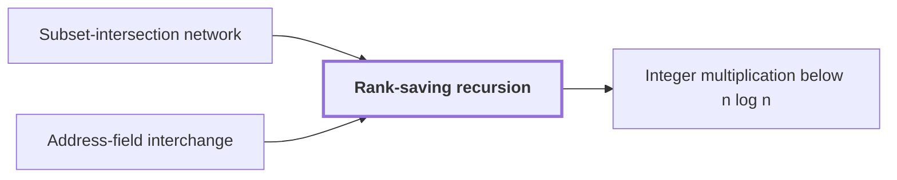

# Rank-saving recursion

!!! info "Before this page"

    Rank-saving recursion *is realized by* [Subset-intersection network](subset-intersection-network.md "Rank-saving recursion is realized by a subset-intersection network on three-element subsets.") and *is instantiated by* [Address-field interchange](address-interchange.md "Rank-saving recursion is instantiated by address-field interchange, where the parameter $f$ counts field digits.").

!!! abstract "Where this fits"

    1. A deterministic fixed-tape machine multiplies two $n$-bit integers exactly in $O(n(\lg n)^{1-\kappa})$ time, with $\kappa=2^{-182}$, below the $n\lg n$ conjecture in this model. — how: bound the cost of an exact multiplication whose transform layers are made cheap by two tape procedures, then fix parameters so every cost term fits ([Integer multiplication below n log n](main-theorem.md "A deterministic fixed-tape machine that multiplies two n-bit integers exactly in O(n (lg n)^(1−κ)) time with κ = 2^−182, which disproves the n log n optimality conjecture in this model."))
    2. Two disjoint equal address fields of $u$ bits in an array of stored volume $V$ can be interchanged in $O(V u^{\tau})$ time. — how: apply a fixed linear network that exchanges two banks while restoring scratch values, recursively on streams of $1/W$ of the volume, so each level costs a strictly smaller power ([Address-field interchange](address-interchange.md "A tape procedure that swaps two disjoint contiguous address fields of an array in time that grows like a power of the field width, rather than linearly."))
    3. A fixed linear network on three-element subsets exchanges two banks of scalars and restores every scratch wire. — how: gather and scatter coefficients by intersection size, and cancel the unwanted coefficients with auxiliary wires carrying subspace labels ([Subset-intersection network](subset-intersection-network.md "A linear network on the three-element subsets of a ground set, whose wires carry scalars and whose gates combine them by intersection size, so that it swaps two banks while cancelling arbitrary scratch values."))
    4. **This page:** The total number $s$ of smaller calls satisfies $s<Wm$.

??? note "Symbols from earlier pages"

    - $V$ — stored volume: The number of bits the array stores. (on [Address-field interchange](address-interchange.md "A tape procedure that swaps two disjoint contiguous address fields of an array in time that grows like a power of the field width, rather than linearly."))
    - $s$ — smaller call count: The total number of smaller calls made by one call. (on [Subset-intersection network](subset-intersection-network.md "A linear network on the three-element subsets of a ground set, whose wires carry scalars and whose gates combine them by intersection size, so that it swaps two banks while cancelling arbitrary scratch values."))
    - $m$ — label space dimension: The dimension of the fixed space from which the subspace labels are drawn. (on [Subset-intersection network](subset-intersection-network.md "A linear network on the three-element subsets of a ground set, whose wires carry scalars and whose gates combine them by intersection size, so that it swaps two banks while cancelling arbitrary scratch values."))

Rank-saving recursion is the recursion in which one call on a stored volume $V$ splits into $s$ smaller calls, each on a stream holding $1/W$ of that volume, so that the cost grows by a strictly smaller factor per level. It is what turns the per-level cost into a power saving.

Here the letter $f$ changes meaning: it is the recursion parameter, the number of field digits for address interchange or of selected axes for a numerical layer, a stage of the arithmetic that works along chosen axes of the data.

Rank-saving recursion is realized by a [subset-intersection network](subset-intersection-network.md "A linear network on the three-element subsets of a ground set, whose wires carry scalars and whose gates combine them by intersection size, so that it swaps two banks while cancelling arbitrary scratch values.") on three-element subsets. Rank-saving recursion is instantiated by [address-field interchange](address-interchange.md "A tape procedure that swaps two disjoint contiguous address fields of an array in time that grows like a power of the field width, rather than linearly."), where the parameter $f$ counts field digits.

A call at parameter $mf$ on volume $V$ makes $s$ calls at parameter $f$, each on a stream of volume $V/W$.<cite class="exegenius-ref" data-source="paper" data-locator="§11 A consequence for matrix transposition, p. 4" data-quote="A recursive call at parameter mf therefore uses s calls at parameter f" title="A recursive call at parameter mf therefore uses s calls at parameter f"> (see §11 A consequence for matrix transposition, p. 4)</cite> A call at $f$ costs a fixed amount per unit of volume, because its cost scales with the volume it acts on. The $s$ calls at $f$ therefore cost $s \cdot (V/W)$ times that unit cost. Dividing by $V$, the recursive contribution at $mf$ is $s/W$ times that at $f$.

The construction guarantees $s<Wm$<cite class="exegenius-ref" data-source="paper" data-locator="§11 A consequence for matrix transposition, p. 4" data-quote="the total number s of smaller calls satisfies s &lt; W m" title="the total number s of smaller calls satisfies s &lt; W m"> (see §11 A consequence for matrix transposition, p. 4)</cite>, so $s/W<m$. Each level multiplies the parameter by $m$ and the per-volume cost by $s/W$, a smaller factor. The strict inequality is what gives the saving: if $s=Wm$, each level would multiply the cost by $m$ too, and there would be no gain.

For example, take $m=2$, $W=3$ and $s=5$, so $s<Wm=6$. Each level doubles the parameter and multiplies the per-volume cost by $5/3$. Over ten levels the parameter grows by $2^{10}=1024$, while the per-volume cost grows by only $(5/3)^{10}\approx 165$. In general the per-volume cost grows like $f^{\log_m(s/W)}$ as the parameter grows to $f$, and the exponent is below $1$ because $s/W<m$.

## Connections

Used by:

- [Integer multiplication below n log n](main-theorem.md "Its movement is organized by rank-saving recursion.") *is organized by* Rank-saving recursion

??? quote "From the sources"

    > the total number s of smaller calls satisfies s < W m
    >
    > — Integer multiplication below n log n (OpenAI, 2026)
