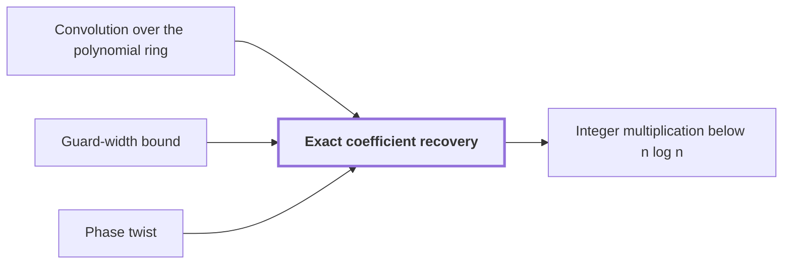

# Exact coefficient recovery

!!! info "Before this page"

    Exact coefficient recovery *is applied to the output of* [Convolution over the polynomial ring](polynomial-ring-convolution.md "Recovery is applied to the output of the Convolution over the polynomial ring, after the known normalizations and digit scales are removed."), *is secured by* [Guard-width bound](guard-width-bound.md "Exact recovery is secured by the Guard-width bound, which fixes enough extra bits that a single final truncation, discarding those bits, suffices.") and *undoes* [Phase twist](phase-twist.md "Recovery undoes the phase twist before the coefficients are read, which restores the original cyclic wrap-around.").

!!! abstract "Where this fits"

    1. A deterministic fixed-tape machine multiplies two $n$-bit integers exactly in $O(n(\lg n)^{1-\kappa})$ time, with $\kappa=2^{-182}$, below the $n\lg n$ conjecture in this model. — how: bound the cost of an exact multiplication whose transform layers are made cheap by two tape procedures, then fix parameters so every cost term fits ([Integer multiplication below n log n](main-theorem.md "A deterministic fixed-tape machine that multiplies two n-bit integers exactly in O(n (lg n)^(1−κ)) time with κ = 2^−182, which disproves the n log n optimality conjecture in this model."))
    2. The exact product of two $n$-bit integers is obtained from the convolution of their radix-digit coefficients, computed by transforms on a fixed tape layout and then recovered and carried. — how: reduce the convolution by a Chinese-remainder map, Gaussian resampling, Bluestein's identity and a phase twist to a convolution over a polynomial ring, then recover coefficients and propagate carries ([Radix-digit convolution](radix-digit-convolution.md "Writing both integers as polynomials in a power of two whose coefficients are their digits, so that their product is a polynomial convolution of short coefficients."))
    3. **This page:** The recovered coefficient error is strictly below $1/2$, so rounding recovers the integer coefficients exactly.

Exact coefficient recovery is the step that turns the computed convolution back into the exact integer coefficients it approximates, so that the product can be carried into binary without error.

Let $\nu$ be the index of a coefficient of the convolution. Write $c_\nu$ for the true integer coefficient at index $\nu$, and $\hat c_\nu$ for the value the machine computes for it. The transforms are carried out with finitely many bits, so $\hat c_\nu$ is only approximately an integer.

Recovery is applied to the output of the [Convolution over the polynomial ring](polynomial-ring-convolution.md "The normalized product of two arrays of records in the polynomial ring, computed by two forward synthetic transforms, a pointwise product, and an opposite transform."), after the known normalizations and digit scales are removed. Recovery undoes the [phase twist](phase-twist.md "A coefficientwise multiplication by roots of unity that converts the last cyclic coordinate into a polynomial ring, so its wrap-around becomes the negative wrap of that ring.") before the coefficients are read, which restores the original cyclic wrap-around. Exact recovery is secured by the [Guard-width bound](guard-width-bound.md "An explicit number of extra fractional and integer bits that makes every intermediate coefficient of a butterfly layer exact, so that a single final truncation suffices."), which fixes enough extra bits that a single final truncation, discarding those bits, suffices.

The error analysis<cite class="exegenius-ref" data-source="paper" data-locator="§11 A consequence for matrix transposition, p. 5" data-quote="proves that the recovered coefficient error is strictly below 1/2" title="proves that the recovered coefficient error is strictly below 1/2"> (see §11 A consequence for matrix transposition, p. 5)</cite>, so $|\hat c_\nu - c_\nu| < 1/2$ for every $\nu$. Without such a bound, a computed value could lie across a half-integer and round to the wrong coefficient.

Given that bound, the nearest integer to $\hat c_\nu$ is $c_\nu$, so rounding recovers the coefficient exactly. For example, if $c_\nu = 7$ and $\hat c_\nu = 6.8$, the error is $0.2 < 1/2$ and rounding gives $7$.

## Connections

Used by:

- [Integer multiplication below n log n](main-theorem.md "It recovers its coefficients by exact coefficient recovery, which rounds them to integers.") *recovers its coefficients by* Exact coefficient recovery

??? quote "From the sources"

    > proves that the recovered coefficient error is strictly below 1/2
    >
    > — Integer multiplication below n log n (OpenAI, 2026)
