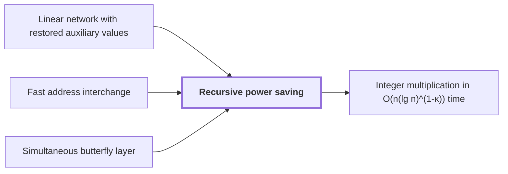

# Recursive power saving

!!! info "Before this page"

    Recursive power saving *is built from* [Linear network with restored auxiliary values](linear-network-exchange.md "It is built from a Linear network with restored auxiliary values, a fixed network that exchanges two banks of values and restores every auxiliary value."), *bounds the cost of* [Fast address interchange](address-interchange.md "Applied to the Fast address interchange with field width $u$ as the parameter, this recursion bounds the cost of the interchange by $O(Vu^\tau)$ for a fixed $\tau$ with $e\le\tau<1$. The top parameter is $m^\ell=u$, and since $u\ge 1$, $u^e\le u^\tau$ whenever $e\le\tau$, so the bound $O\big(V(m^\ell)^e\big)$ gives the claim.") and *is applied to* [Simultaneous butterfly layer](simultaneous-butterfly-layer.md "The same mechanism is applied to the Simultaneous butterfly layer, with chunk count $d$ as the parameter.").

!!! abstract "Where this fits"

    1. Two $n$-bit integers can be multiplied exactly in $O(n(\lg n)^{1-\kappa})$ worst-case time on a deterministic multitape Turing machine, for a fixed $\kappa=2^{-182}$. — how: reduce the product to a digit convolution, compute that convolution through transform layers whose tape cost saves a power, and recover the exact product by rounding ([Integer multiplication in O(n(lg n)^(1-κ)) time](integer-multiplication-target.md "A deterministic multitape Turing machine that multiplies two n-bit integers exactly in O(n(lg n)^(1-κ)) worst-case time for a fixed κ = 2^(-182) > 0, beating the n log n conjecture in this model."))
    2. **This page:** Both tape procedures cost $O(V)$ times a power of their parameter whose exponent is strictly below one.

??? note "Symbols from earlier pages"

    - $\tau$ — width exponent: A fixed exponent with 0 < tau < 1 in the cost bound O(V u^tau). (on [Fast address interchange](address-interchange.md "A tape procedure that swaps two disjoint contiguous address fields of an array in time O(V u^τ) for width u, computed through XOR combinations of intermediate data."))
    - $d$ — chunk bound: The largest number of equal-width address chunks that one layer acts on, a count. (on [Simultaneous butterfly layer](simultaneous-butterfly-layer.md "A butterfly operation applied at once on one selected address bit of every record, with exact Gaussian dyadic intermediates and a single truncation after the layer."))

Recursive power saving is the mechanism that gives a tape procedure, a procedure that rearranges stored data on the tapes of a Turing machine, a cost that is a fixed power of its parameter, with exponent below one. It is built from a [Linear network with restored auxiliary values](linear-network-exchange.md "A fixed linear network that exchanges banks of values with prescribed signs and restores every auxiliary value, with each gate acting on the stored array through a frame operator that cancels between edges."), a fixed network that exchanges two banks of values and restores every auxiliary value.

A call moves a volume $V$ of data. Let $W$ be the number of input roles of the network, the places where it takes in values, not counting scratch wires. Let $s$ be the number of smaller calls that one call makes. On earlier pages $W$ is a wire count and $s$ a field index, so these letters change meaning here. Each smaller call works on a stream of volume $V/W$, and the call also does linear work on its own volume.

Let $P$ be the parameter of a call, which counts field digits for the interchange and selected axes for a numerical layer. Let $m>1$ be the factor by which the parameter grows: a call at parameter $mP$ makes $s$ calls at parameter $P$. Here $m$ is not the row count of earlier pages.

Let $\ell$ be the number of levels, so the top call has parameter $m^\ell$ and the base calls have parameter $1$. Base calls cost time linear in their volume. Let $\nu$ be the level index, counted from the top with $\nu=0$. After $\nu$ levels there are $s^\nu$ calls, each on volume $V/W^\nu$. Each call costs time linear in its volume, so level $\nu$ costs $V(s/W)^\nu$ up to a constant. Put $e=\log_m(s/W)$, the exponent of the saving, so $s/W=m^e$ and level $\nu$ costs $Vm^{e\nu}$. If $s>W$, then $e>0$ and the sum over $\nu=0,\dots,\ell$ is a geometric sum with ratio $m^e>1$, dominated by its last term. The total is therefore $O\big(V(m^\ell)^e\big)$.

The exponent is uniform. Each level multiplies the call count by $s$ and divides each volume by $W$, so $s/W$ is the same at every level, and $e$ depends only on $s$, $W$ and $m$, not on $V$ or on the width. The saving is strict exactly when $s<Wm$, that is $e<1$, since then $m^e<m$.<cite class="exegenius-ref" data-source="paper" data-locator="§1.2 Linear networks and the recursive saving" data-quote="This strict inequality is the source of the power saving" title="This strict inequality is the source of the power saving"> (see §1.2 Linear networks and the recursive saving)</cite>. If $s=Wm$, the cost is linear in the parameter and nothing is saved.

Applied to the [Fast address interchange](address-interchange.md "A tape procedure that swaps two disjoint contiguous address fields of an array in time O(V u^τ) for width u, computed through XOR combinations of intermediate data.") with field width $u$ as the parameter, this recursion bounds the cost of the interchange by $O(Vu^\tau)$ for a fixed $\tau$ with $e\le\tau<1$. The top parameter is $m^\ell=u$, and since $u\ge 1$, $u^e\le u^\tau$ whenever $e\le\tau$, so the bound $O\big(V(m^\ell)^e\big)$ gives the claim.

The same mechanism is applied to the [Simultaneous butterfly layer](simultaneous-butterfly-layer.md "A butterfly operation applied at once on one selected address bit of every record, with exact Gaussian dyadic intermediates and a single truncation after the layer."), with chunk count $d$ as the parameter.

## Connections

Used by:

- [Integer multiplication in O(n(lg n)^(1-κ)) time](integer-multiplication-target.md "The power saving follows from Recursive power saving.") *follows from* Recursive power saving

??? quote "From the sources"

    > The decisive property is that the total number $s$ of smaller calls satisfies $s<Wm$.
    >
    > — [Integer multiplication below n log n (OpenAI, 2026)](https://github.com/openai/math/tree/fd4aeeb2ee4fc729c18d98444fed42fd0529eeeb/preprints/Integer-multiplication-below-n-log-n-September-23-2026)

    > This strict inequality is the source of the power saving
    >
    > — [Integer multiplication below n log n (OpenAI, 2026)](https://github.com/openai/math/tree/fd4aeeb2ee4fc729c18d98444fed42fd0529eeeb/preprints/Integer-multiplication-below-n-log-n-September-23-2026)
