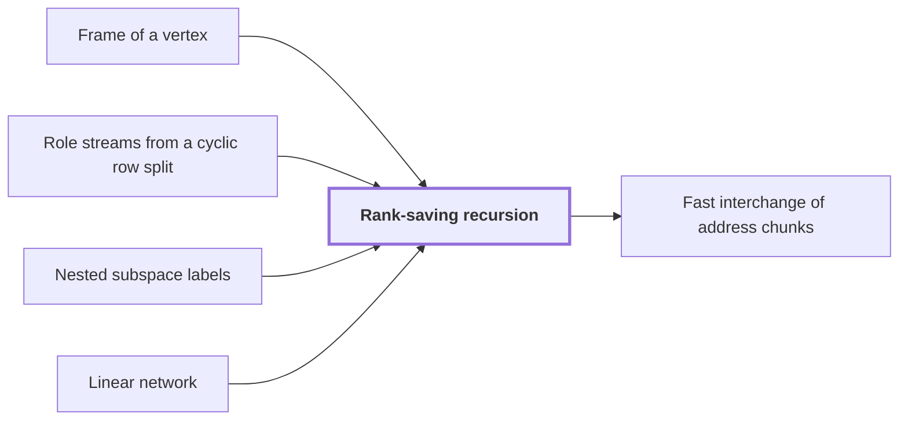

# Rank-saving recursion

!!! info "Before this page"

    Rank-saving recursion *is stated in* [Frame of a vertex](frame.md "The recursion is stated in the frame of a vertex at each end of an edge, where the frame is the invertible linear operator that fixes how the array on that vertex's wires is stored."), *splits its array into* [Role streams from a cyclic row split](role-streams.md "The recursion splits its array into role streams from a cyclic row split across the $W$ roles, the fixed wire places of the network."), *is measured by* [Nested subspace labels](subspace-labels.md "The cost is measured by nested subspace labels on the edges.") and *runs on* [Linear network](linear-network.md "Rank-saving recursion is a recursive scheme that runs on a linear network.").

!!! abstract "Where this fits"

    - Relied on to show: Interchanging two equal address fields of width $u$ costs less than linear in $u$ per unit volume. ([Fast interchange of address chunks](tape-interchange.md "A fixed-tape procedure that swaps two disjoint equal-width address fields of an array in time O(V u^τ) for a fixed τ < 1, where V is the stored volume and u the field width, using XOR combinations of intermediate data."))

??? note "Symbols from earlier pages"

    - $V$ — node volume: The number of bits the node holds once its rows are padded, summed over all prefixes. (on [Role streams from a cyclic row split](role-streams.md "Splitting the rows of an array cyclically among the W fixed wire roles of a network, so that each role carries an equal share of the volume and gates act pointwise on matching addresses."))
    - $m$ — label space dimension: The dimension of the space E, a count of the vectors in a basis of E. (on [Nested subspace labels](subspace-labels.md "Assignments of subspaces of a fixed space to the gates and terminals of a network, nested along edges, whose dimension drops measure the smaller operations needed on each edge."))

Rank-saving recursion is a recursive scheme that runs on a [linear network](linear-network.md "A fixed network of wires with gates that apply fixed linear maps to the values on their wires, used here to exchange two banks of values while restoring all auxiliary values."). It pays for each edge of the network with smaller calls, and it keeps the total number of those calls below a fixed bound, which is what gives [fast interchange of address chunks](tape-interchange.md "A fixed-tape procedure that swaps two disjoint equal-width address fields of an array in time O(V u^τ) for a fixed τ < 1, where V is the stored volume and u the field width, using XOR combinations of intermediate data.") its saving.

An edge matrix is the matrix that says what one edge of the network does to the values it carries. Write $\operatorname{rk}(e)$ for the rank of the edge matrix of an edge $e$. Summing $\operatorname{rk}(e)$ over all edges $e$ gives the total number of smaller calls, $s$.<cite class="exegenius-ref" data-source="paper" data-locator="§4.2 Transferring a finite circuit to address permutations" data-quote="The number of recursive calls is the sum of the edge ranks, exactly $s$." title="The number of recursive calls is the sum of the edge ranks, exactly $s$."> (see §4.2 Transferring a finite circuit to address permutations)</cite>

The recursion is stated in the [frame of a vertex](frame.md "An invertible linear operator attached to a gate or terminal that sets how the array on each wire there is stored; changing frames along an edge cancels between the two ends of a route.") at each end of an edge, where the frame is the invertible linear operator that fixes how the array on that vertex's wires is stored. The recursion splits its array into [role streams from a cyclic row split](role-streams.md "Splitting the rows of an array cyclically among the W fixed wire roles of a network, so that each role carries an equal share of the volume and gates act pointwise on matching addresses.") across the $W$ roles, the fixed wire places of the network. Each role therefore holds an equal share $V/W$ of the padded volume $V$, and each smaller call acts on one such share.

The cost is measured by [nested subspace labels](subspace-labels.md "Assignments of subspaces of a fixed space to the gates and terminals of a network, nested along edges, whose dimension drops measure the smaller operations needed on each edge.") on the edges. Each vertex gets a subspace of a fixed $m$-dimensional space, adjacent subspaces are nested, and the drop in dimension across an edge measures the smaller calls that edge needs.

The finite construction of the paper uses three-element subsets, with [gather and scatter wires](subset-network.md "A linear network over three-element subsets of a fixed ground set, whose gather, scatter, copy and side wires implement the scalar exchange of two banks by intersection-size coefficients over F_2 or Z[i,1/2]."), and it has the property that the total satisfies $s<Wm$.<cite class="exegenius-ref" data-source="paper" data-locator="§1.2 Linear networks and the recursive saving" data-quote="The decisive property is that the total number $s$ of smaller calls satisfies $s&lt;Wm$." title="The decisive property is that the total number $s$ of smaller calls satisfies $s&lt;Wm$."> (see §1.2 Linear networks and the recursive saving)</cite> So on average each role makes fewer than $m$ smaller calls.

The paper uses this bound for interchange.<cite class="exegenius-ref" data-source="paper" data-locator="§4 Faster interchange of address chunks" data-quote="Because the sum of these ranks is less than the number of wires times $m$, the resulting recurrence saves a power of the chunk width." title="Because the sum of these ranks is less than the number of wires times $m$, the resulting recurrence saves a power of the chunk width."> (see §4 Faster interchange of address chunks)</cite>

## Connections

Used by:

- [Fast interchange of address chunks](tape-interchange.md "The shear is computed by a Rank-saving recursion on that network.") *is computed by* Rank-saving recursion

??? quote "From the sources"

    > The decisive property is that the total
    >
    > — [Integer multiplication below n log n (OpenAI, 2026)](https://github.com/openai/math/tree/fd4aeeb2ee4fc729c18d98444fed42fd0529eeeb/preprints/Integer-multiplication-below-n-log-n-September-23-2026)
