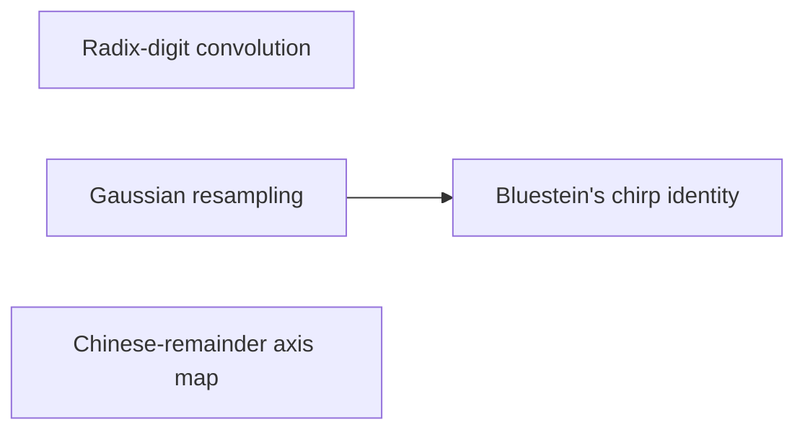

# Reduction to cyclic convolution

Each $n$-bit input is split into [radix digits](../radix-digit-convolution.md "Writing each n-bit input as a polynomial in 2^b with about n/b nonnegative digits, so that integer multiplication becomes a convolution whose coefficients are bounded by a fixed power of two."), so that multiplication becomes a convolution with small coefficients. The [Chinese-remainder axis map](../crt-axis-map.md "The bijection sending a coefficient index written in mixed radix with pairwise coprime lengths to coordinates on a product of cyclic axes, which turns one cyclic convolution into a multidimensional one.") places these coefficients on pairwise coprime cyclic axes, turning one cyclic convolution into a multidimensional one. [Gaussian resampling](../gaussian-resampling.md "A rewriting of a Fourier transform of prime length as a transform with power-of-two axis lengths, with source and target coordinate permutations kept inside the transform identity.") and [Bluestein's identity](../bluestein.md "An identity writing a Fourier transform as a cyclic convolution sandwiched between pointwise multiplications by chirp sequences exp(−πi s j² / t).") then rewrite the prime-length transforms as normalized cyclic convolutions.

## Pages

1. [Radix-digit convolution](../radix-digit-convolution.md "Writing each n-bit input as a polynomial in 2^b with about n/b nonnegative digits, so that integer multiplication becomes a convolution whose coefficients are bounded by a fixed power of two.") — Writing each n-bit input as a polynomial in 2^b with about n/b nonnegative digits, so that integer multiplication becomes a convolution whose coefficients are bounded by a fixed power of two.
2. [Gaussian resampling](../gaussian-resampling.md "A rewriting of a Fourier transform of prime length as a transform with power-of-two axis lengths, with source and target coordinate permutations kept inside the transform identity.") — A rewriting of a Fourier transform of prime length as a transform with power-of-two axis lengths, with source and target coordinate permutations kept inside the transform identity.
3. [Bluestein's chirp identity](../bluestein.md "An identity writing a Fourier transform as a cyclic convolution sandwiched between pointwise multiplications by chirp sequences exp(−πi s j² / t).") — An identity writing a Fourier transform as a cyclic convolution sandwiched between pointwise multiplications by chirp sequences exp(−πi s j² / t).
4. [Chinese-remainder axis map](../crt-axis-map.md "The bijection sending a coefficient index written in mixed radix with pairwise coprime lengths to coordinates on a product of cyclic axes, which turns one cyclic convolution into a multidimensional one.") — The bijection sending a coefficient index written in mixed radix with pairwise coprime lengths to coordinates on a product of cyclic axes, which turns one cyclic convolution into a multidimensional one.

## Map

Arrows point from a page to the pages that build on it.

