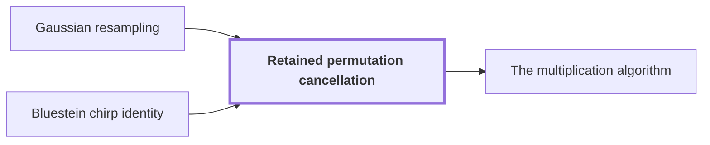

# Retained permutation cancellation

!!! info "Before this page"

    Retained permutation cancellation *computes prime-length transforms through* [Gaussian resampling](gaussian-resampling.md "Each prime-length transform is computed through a power-of-two one by Gaussian resampling.") and *is absorbed by* [Bluestein chirp identity](chirp.md "The target permutation $Q$ sits between $\mathcal A$ and $\mathcal B_0$ and is absorbed by the Bluestein chirp identity.").

!!! abstract "Where this fits"

    1. A single deterministic Turing machine with a fixed finite alphabet and a fixed finite number of one-dimensional tapes multiplies two $n$-bit integers exactly in $O(n(\lg n)^{1-\kappa})$ worst-case time with $\kappa=2^{-182}$, disproving the $n\log n$ optimality conjecture of Sch\"onhage and Strassen in this model. — how: Build two power-saving tape procedures (chunk interchange and simultaneous butterfly layer) from fixed finite linear networks; use them to accelerate the synthetic polynomial transforms and ring convolution; use Gaussian resampling with retained permutations and chirps to reduce the prime-length cyclic convolution of the radix-digit coefficients to those power-of-two transforms; assemble the exact product with a proof that the error is below $1/2$; and total the cost to show a power of $\log n$ is saved. ([Power-saving integer multiplication](main-result.md "A deterministic fixed-tape Turing machine multiplying two n-bit integers exactly in O(n(lg n)^{1−κ}) time with κ = 2^{−182}, disproving the n log n optimality conjecture in this model."))
    2. **This page:** The Fourier transforms of pairwise coprime prime lengths $s_i$ that the integer product needs are computed through power-of-two lengths $t_i$ by Gaussian resampling and Bluestein chirps, with the source and target coordinate permutations left inside the transform identities, so that none is executed as a sort.

??? note "Symbols from earlier pages"

    - $i$ — axis index: An index of one axis of the array, between 1 and d. (on [Multidimensional transforms](multidim-transform.md "A transform over several axes at once, the tensor product of one-dimensional transforms, applied to an array one axis at a time."))
    - $F_q$ — normalized transform: The normalized discrete Fourier transform on sequences of q entries. (on [Contractions and bilinear contractions](contraction-maps.md "A linear map that never increases the norm of a vector, and a bilinear map whose output norm is at most the product of the input norms, so errors in the inputs do not grow beyond a controlled bound."))
    - $p$ — fractional bits: The number of fractional bits of the grid on which stored values lie. (on [Fixed-point Gaussian dyadic records](fixed-point.md "Complex values stored as signed two's-complement integers over a power-of-two denominator 2^{-p}; intermediate values are exact and one truncation Q_p rounds back to the p-bit grid."))
    - $\alpha$ — resampling parameter: An integer resampling parameter with 2 <= alpha < sqrt p. (on [Multidimensional transforms](multidim-transform.md "A transform over several axes at once, the tensor product of one-dimensional transforms, applied to an array one axis at a time."))
    - $s$ — source length: The number of entries of the sequence whose transform is re-expressed. (on [Gaussian resampling](gaussian-resampling.md "Re-expressing a Fourier transform of prime length s through a transform of nearby power-of-two length t using Gaussian weights, so that only power-of-two transforms are needed."))
    - $t$ — padded length: The nearby larger power-of-two length through which the transform is computed. (on [Gaussian resampling](gaussian-resampling.md "Re-expressing a Fourier transform of prime length s through a transform of nearby power-of-two length t using Gaussian weights, so that only power-of-two transforms are needed."))
    - $\gamma$ — scalar exponent: The total exponent of the scalar power of two in the tensored identity. (on [Multidimensional transforms](multidim-transform.md "A transform over several axes at once, the tensor product of one-dimensional transforms, applied to an array one axis at a time."))
    - $\ell$ — address bits: The number of address bits of an axis of length r. (on [Chinese-remainder address map](crt-map.md "An isomorphism that places a cyclic convolution of length S = s₁⋯s_d on pairwise coprime prime axes, implemented as triangular controlled shifts."))
    - $\tau$ — interchange exponent: A fixed exponent below 1 in the cost of the chunk interchange. (on [Chinese-remainder address map](crt-map.md "An isomorphism that places a cyclic convolution of length S = s₁⋯s_d on pairwise coprime prime axes, implemented as triangular controlled shifts."))
    - $a$ — chirp: The array of phases a_j = exp(-pi i sum s_i j_i^2 / t_i), not a bank index. (on [Bluestein chirp identity](chirp.md "An identity that rewrites a (permuted) Fourier transform as a pointwise chirp phase, a cyclic convolution, and another chirp phase."))
    - $\boldsymbol j$ — position: A position in a d-axis array, the tuple (j_1,...,j_d) of one index per axis. (on [Bluestein chirp identity](chirp.md "An identity that rewrites a (permuted) Fourier transform as a pointwise chirp phase, a cyclic convolution, and another chirp phase."))

Retained permutation cancellation computes the prime-length Fourier transforms of the integer product through power-of-two ones without executing any coordinate permutation as a sort: the permutations of Gaussian resampling stay inside the transform identity, where one is absorbed by a convolution and the other cancels.

Each prime-length transform is computed through a power-of-two one by [Gaussian resampling](gaussian-resampling.md "Re-expressing a Fourier transform of prime length s through a transform of nearby power-of-two length t using Gaussian weights, so that only power-of-two transforms are needed."). Its usual implementation sorts twice on each coordinate. A tape machine cannot jump to an arbitrary position, so it carries out a permutation of records by labelling each with its destination and sorting, which costs a $\log$ factor beyond a linear pass: each sort costs $O(tp\log t)$<cite class="exegenius-ref" data-source="paper" data-locator="§8.1 The one-dimensional interface" data-quote="each costing $O(tp\log t)$" title="each costing $O(tp\log t)$"> (see §8.1 The one-dimensional interface)</cite> per line. A sort on every line would undo the saving of a power of $\log n$, so the permutations stay inside the formula.

## One axis, then all axes

Take $d$ axes with pairwise coprime prime lengths $s_i$ and power-of-two lengths $t_i>s_i$. Write $\boldsymbol s=(s_1,\dots,s_d)$, $\boldsymbol t=(t_1,\dots,t_d)$, $S=\prod_is_i$ (the number of entries of the source array) and $T=\prod_it_i$ (the number of entries of the padded box). For the normalized [discrete Fourier transform](dft.md "The normalized transform (F_q u)_k = (1/q) Σ u_j e^{−2πi jk/q}, which turns convolution into pointwise multiplication."), $(F_qz)_k=\frac1q\sum_{j=0}^{q-1}z_je^{-2\pi ijk/q}$; $F_q^+$, the opposite transform, reverses the sign of the exponent, and $F_q^+F_q=I/q$. For axis lengths $\boldsymbol q$, $F_{\boldsymbol q}=\bigotimes_iF_{q_i}$ applies $F_{q_i}$ along every line of axis $i$, as in [multidimensional transforms](multidim-transform.md "A transform over several axes at once, the tensor product of one-dimensional transforms, applied to an array one axis at a time."), and likewise $F_{\boldsymbol q}^+$. Hence $F_{\boldsymbol s}^+F_{\boldsymbol s}=I/S$.

For one axis, with $\alpha$ and $\delta$ as on the resampling page, let $(P_su)_j=u_{tj}$ and $(P_tv)_k=v_{-sk}$, where $u$ and $v$ are complex arrays here, not the integers being multiplied. The resampling page gives linear contractions $A$ and $B_0$, the input and output maps ($B_0$ is unrelated to the packing base of [signed packing](signed-packing.md "A signed Kronecker substitution that evaluates polynomials with signed coefficients at 2^{4p} to form large integers, multiplies them with the O(n log n) multiplier, and recovers the product coefficients.")), with $P_sF_s=2^{2\alpha^2}B_0P_tF_tA$, computed in time $O(tp^{3/2+\delta}\alpha)$ without executing $P_s$ or $P_t$.

Operators on different axes touch different indices, so $\bigl(\bigotimes_iX_i\bigr)\bigl(\bigotimes_iY_i\bigr)=\bigotimes_iX_iY_i$. Put $R=\bigotimes_iP_{s_i}$ (the source permutation, not a ring), $Q=\bigotimes_iP_{t_i}$, $\mathcal A=\bigotimes_iA_i$, $\mathcal B_0=\bigotimes_iB_{0,i}$. Tensoring the one-axis identity gives $RF_{\boldsymbol s}=2^\gamma\mathcal B_0QF_{\boldsymbol t}\mathcal A$ with $\gamma=2d\alpha^2$<cite class="exegenius-ref" data-source="paper" data-locator="§8.2 Growing dimension and the padded array" data-quote="=2^\gamma\mathcal B_0QF_{\boldsymbol t}\mathcal A," title="=2^\gamma\mathcal B_0QF_{\boldsymbol t}\mathcal A,"> (see §8.2 Growing dimension and the padded array)</cite>. Both maps are applied one line at a time, so errors and times add over the $d$ axes: error below $dp^2$, total time $O(dTp^{3/2+\delta}\alpha)$ with a constant independent of $d$<cite class="exegenius-ref" data-source="paper" data-locator="§8.2 Growing dimension and the padded array" data-quote="$O(dTp^{3/2+\delta}\alpha)$, with a constant independent of $d$." title="$O(dTp^{3/2+\delta}\alpha)$, with a constant independent of $d$."> (see §8.2 Growing dimension and the padded array)</cite>

The [fast address-chunk interchange](address-interchange.md "The first tape procedure: exchanging two disjoint equal-width address fields of u digits in time O(V·u^τ) for a fixed τ < 1, using XOR combinations of intermediate data.") makes each axis the innermost field before its lines are processed. With $\ell$ the number of address bits of an axis of length $r=2^\ell$, $\tau<1$ the interchange exponent, each $t_i\in\{r/2,r\}$ and each entry of $O(p)$ bits, exposing and restoring all lines costs $O\bigl(Tp\,d^2(1+\ell^\tau)\bigr)$<cite class="exegenius-ref" data-source="paper" data-locator="§8.2 Growing dimension and the padded array" data-quote="then exposing and restoring all the lines costs" title="then exposing and restoring all the lines costs"> (see §8.2 Growing dimension and the padded array)</cite>. Since $t_i\ge r/2$, each tensor map invokes at most $\sum_iT/t_i\le 2dT/r$ lines, so a setup of $O(p^\nu)$ per line, with $\nu$ a fixed exponent, totals $O(dTp^\nu/r)$. Divided by $Tp$ this is $O(dp^{\nu-1}/r)\to0$ when $r$ outgrows every power of $p$ and $d$ is polynomially bounded in $p$, so setup is $o(Tp)$.

## Absorbing $Q$

The target permutation $Q$ sits between $\mathcal A$ and $\mathcal B_0$ and is absorbed by the [Bluestein chirp identity](chirp.md "An identity that rewrites a (permuted) Fourier transform as a pointwise chirp phase, a cyclic convolution, and another chirp phase."). $Q$ becomes part of a convolution formula, so no step reorders the array. For even $t_i$ and $a_{\boldsymbol j}=\exp(-\pi i\sum_is_ij_i^2/t_i)$ one has $QF_{\boldsymbol t}u=\overline a\cdot\bigl(a*(\overline a\cdot u)\bigr)/T$, where $*$ is the [cyclic convolution](convolution.md "The product of two sequences (or elements of a polynomial quotient ring) where indices wrap around: (f∗g)_k = Σ f_j g_{k−j}.") of length $T$ and a dot is coordinatewise multiplication.

## Cancelling $R$

Conjugating input and output turns a routine for $RF_{\boldsymbol s}$ into one for $RF_{\boldsymbol s}^+$, since conjugation flips the exponent's sign and commutes with the real permutation $R$. So both the forward and the opposite transform are available only in the form with $R$ in front. The product then reads $(RF_{\boldsymbol s}^+)[(RF_{\boldsymbol s}u)\cdot(RF_{\boldsymbol s}v)]=u*v/S^2$, with no $R$ left to execute.

For a unit $\beta$ modulo $q$ let $(R_\beta z)_j=z_{\beta j}$. Then $(F_q^+R_\beta z)_j=\frac1q\sum_w z_{\beta w}e^{2\pi i wj/q}$, with $w$ the summation index. Substituting $w'=\beta w$ gives $\frac1q\sum_{w'}z_{w'}e^{2\pi i w'\beta^{-1}j/q}=(R_\beta^{-1}F_q^+z)_j$, so $F_q^+R_\beta=R_\beta^{-1}F_q^+$. Each $t_i$ is a unit modulo $s_i$ and $R$ applies $R_{t_i}$ on axis $i$, so tensoring gives $RF_{\boldsymbol s}^+R=F_{\boldsymbol s}^+$. A permutation commutes with pointwise products, so the left side of the product identity equals $F_{\boldsymbol s}^+(F_{\boldsymbol s}u\cdot F_{\boldsymbol s}v)$. The normalized convolution rule is $F_{\boldsymbol s}(u*v)=S(F_{\boldsymbol s}u)\cdot(F_{\boldsymbol s}v)$, and $F_{\boldsymbol s}^+F_{\boldsymbol s}=I/S$, so this equals $\frac1SF_{\boldsymbol s}^+F_{\boldsymbol s}(u*v)=u*v/S^2$.

## Connections

Used by:

- [The multiplication algorithm](multiplication-algorithm.md "Permuting both factors commutes with pointwise products, and $RF_{\boldsymbol s}^{+}R=F_{\boldsymbol s}^{+}$ by Retained permutation cancellation, so $R$ drops out.") *drops its permutation by* Retained permutation cancellation

??? quote "From the sources"

    > retains the source and target coordinate permutations in the transform identity
    >
    > — [Integer multiplication below n log n (OpenAI, 2026)](https://github.com/openai/math/tree/fd4aeeb2ee4fc729c18d98444fed42fd0529eeeb/preprints/Integer-multiplication-below-n-log-n-September-23-2026)

    > The second identity shows how the retained source permutation $R$ cancels when computing a convolution.
    >
    > — [Integer multiplication below n log n (OpenAI, 2026)](https://github.com/openai/math/tree/fd4aeeb2ee4fc729c18d98444fed42fd0529eeeb/preprints/Integer-multiplication-below-n-log-n-September-23-2026)
