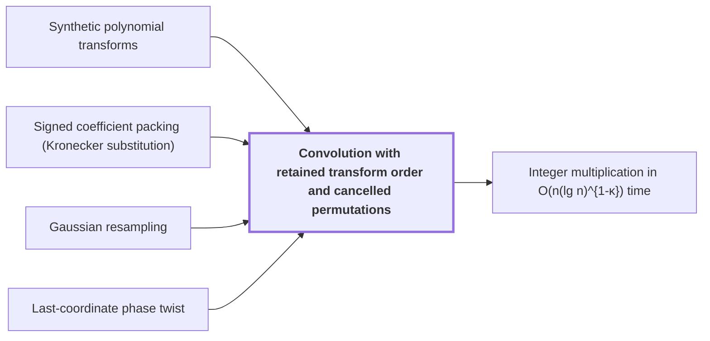

# Convolution with retained transform order and cancelled permutations

!!! info "Before this page"

    Convolution with retained transform order and cancelled permutations *computes its transforms by* [Synthetic polynomial transforms](synthetic-transforms.md "This convolution computes its transforms by Synthetic polynomial transforms, which need only signed shifts, address rearrangements and butterflies."), *computes its products through* [Signed coefficient packing (Kronecker substitution)](signed-packing.md "This convolution computes its products through Signed coefficient packing (Kronecker substitution): polynomial products are packed into integers and multiplied by the ordinary $O(n\log n)$ multiplier as a subroutine."), *is applied after* [Gaussian resampling](gaussian-resampling.md "This convolution is applied after Gaussian resampling, which writes each source transform through a power-of-two tensor transform.") and *is taken over the ring from* [Last-coordinate phase twist](phase-twist-convolution.md "This convolution is taken over the ring from the Last-coordinate phase twist, in which the negative wrap gives the original cyclic wrap.").

!!! abstract "Where this fits"

    1. An $n$-bit integer product is computed by a fixed-tape machine in $O(n(\lg n)^{1-\kappa})$ time, $\kappa=2^{-182}$. — how: reduce multiplication to ring convolution and speed up its address moves and butterfly layers ([Integer multiplication in O(n(lg n)^{1-κ}) time](main-theorem.md "Deterministic fixed-tape Turing machine multiplying n-bit integers in O(n(lg n)^{1-κ}), κ=2^{-182}, by reducing to ring convolution with fast address interchanges and simultaneous butterfly layers, disproving the n log n conjecture in this model."))
    2. **This page:** Convolution over $\mathbb C[y]/(y^r+1)$ on the remaining axes is computed by synthetic transforms and packed polynomial products.

??? note "Symbols from earlier pages"

    - $y$ — ring variable: The polynomial variable of the ring, whose powers act as roots of unity. (on [Polynomial ring modulo $y^r+1$](poly-ring-y-r.md "Complex-coefficient polynomials in y reduced by y^r = -1, so multiplying by a power of y is a signed shift of the coefficient list and powers of y serve as roots of unity."))
    - $r$ — ring degree: The number of complex coefficients in each element of the ring, a power of two. (on [Polynomial ring modulo $y^r+1$](poly-ring-y-r.md "Complex-coefficient polynomials in y reduced by y^r = -1, so multiplying by a power of y is a signed shift of the coefficient list and powers of y serve as roots of unity."))
    - $k$ — output index: An index into the entries of the output list $c$. (on [Convolution](convolution.md "Product of polynomials / combination of coefficient lists where entries sum by index (cyclic if indices wrap)."))
    - $i$ — index i: An index into the entries of the input list $a$. (on [Convolution](convolution.md "Product of polynomials / combination of coefficient lists where entries sum by index (cyclic if indices wrap)."))
    - $j$ — index j: An index into the entries of the input list $b$. (on [Convolution](convolution.md "Product of polynomials / combination of coefficient lists where entries sum by index (cyclic if indices wrap)."))
    - $\omega$ — primitive root of unity: A primitive $n$-th root of unity, whose powers are the frequencies of the transform. (on [Discrete Fourier transform and butterflies](dft-fft.md "Evaluation of a coefficient list at roots of unity, computed in log-many levels of two-point butterfly operations; turns convolution into pointwise product."))
    - $m$ — frequency index: The index of an entry of the transform, with $0\le m<n$; it means something else on the earlier address-fields page. (on [Discrete Fourier transform and butterflies](dft-fft.md "Evaluation of a coefficient list at roots of unity, computed in log-many levels of two-point butterfly operations; turns convolution into pointwise product."))
    - $I$ — identity operator: The identity operator, which leaves every array unchanged. (on [Finite linear network with roles and frames](linear-network-roles.md "Fixed linear network exchanging two banks of values with prescribed signs and restoring auxiliary values; wires have roles, rows are distributed cyclically among roles, and invertible frame operators cancel along routes leaving an endpoint operator."))

Convolution with retained transform order convolves two arrays over $\mathbb C[y]/(y^r+1)$ by transforming each one, multiplying the transforms entry by entry, and transforming back, without sorting the frequency entries in between. It is the convolution that the fast tape layouts of the main result run on the remaining axes. This convolution computes its transforms by [Synthetic polynomial transforms](synthetic-transforms.md "Nussbaumer-style transforms over the polynomial ring where root multiplications are signed shifts, leaving address rearrangements, shifts and butterflies."), which need only signed shifts, address rearrangements and butterflies.

Let $\phi$ and $\psi$ be the two input arrays. Let $\ast$ denote their cyclic convolution on one axis of length $t$, with products taken in the ring:

$$(\phi\ast\psi)_k=\sum_{i+j\equiv k \pmod t}\phi_i\psi_j.$$

The forward transform $\mathcal D$ sends an array to $(\mathcal D\phi)_m=\sum_i\omega^{mi}\phi_i$, where $\omega$ is the primitive $t$th root of unity of the ring and $m$ is the frequency index. Let $\mathcal D^{+}$ be the opposite transform. Let $M$ be the known scalar fixed by the normalization of the transforms. Let $\odot$ be the entrywise product of ring elements at the same address.

Expanding the sums gives the first identity up to the normalization: $\sum_k\omega^{mk}(\phi\ast\psi)_k=\sum_{i,j}\omega^{m(i+j)}\phi_i\psi_j=(\mathcal D\phi)_m(\mathcal D\psi)_m$, because $\omega^{mk}$ depends only on $k$ mod $t$. With the normalization of the source,

$$\mathcal{D}(\phi\ast\psi)=M\,(\mathcal{D}\phi)\odot(\mathcal{D}\psi), \qquad \mathcal{D}^{+}\mathcal{D}=\tfrac{1}{M}\,I.$$

The second identity is the inverse relation that the normalization fixes, and the source checks it by expanding the finite sums<cite class="exegenius-ref" data-source="paper" data-locator="§7.1 The normalized convolution interface" data-quote="To check normalization, expansion of the finite sums gives" title="To check normalization, expansion of the finite sums gives"> (see §7.1 The normalized convolution interface)</cite>.

Let $\chi$ be the permutation of addresses that the layout of the forward transforms fixes: the entry for frequency $m$ is stored at address $\chi(m)$, so the stored arrays are $\chi\mathcal{D}\phi$ and $\chi\mathcal{D}\psi$. The source also composes $\chi$ with a fixed relabelling of frequencies; the argument needs only that both forward transforms use the same $\chi$. Both forward transforms therefore use $\chi$, so the two forward transforms keep the same frequency order through the pointwise product<cite class="exegenius-ref" data-source="paper" data-locator="§1.3 From transforms to the exact product" data-quote="retain the same frequency order through their pointwise product, and" title="retain the same frequency order through their pointwise product, and"> (see §1.3 From transforms to the exact product)</cite>. Without this, the entry at frequency $m$ of $\mathcal D\phi$ would meet an entry of $\mathcal D\psi$ at a different frequency, and a sort would be needed to align them.

Since $\chi$ moves entries by address and each product entry uses only the two entries at its address, the product of the stored arrays equals $\chi$ applied to the product of the transforms:

$(\chi\mathcal{D}\phi)\odot(\chi\mathcal{D}\psi)=\chi\big((\mathcal{D}\phi)\odot(\mathcal{D}\psi)\big)$.

The opposite transform takes the stored product and first applies $\chi^{-1}$, so the $\chi$ cancels and no sort is run. This is the step the source describes as the<cite class="exegenius-ref" data-source="paper" data-locator="§1.3 From transforms to the exact product" data-quote="opposite transform consumes that order" title="opposite transform consumes that order"> (see §1.3 From transforms to the exact product)</cite>:

$\mathcal{D}^{+}\chi^{-1}\big((\chi\mathcal{D}\phi)\odot(\chi\mathcal{D}\psi)\big)=\mathcal{D}^{+}\big((\mathcal{D}\phi)\odot(\mathcal{D}\psi)\big)$.

By the first identity and the second, the right side is $\frac{1}{M^{2}}\,(\phi\ast\psi)$, a known scalar multiple of the convolution. For example, if $\chi$ swaps two records, $\chi^{-1}$ swaps them back before $\mathcal{D}^{+}$ acts.

This convolution computes its products through [Signed coefficient packing (Kronecker substitution)](signed-packing.md "Packs polynomial coefficients into one integer so polynomial products are done by an ordinary n log n integer multiplier."): polynomial products are packed into integers and multiplied by the ordinary $O(n\log n)$ multiplier as a subroutine.

This convolution is applied after [Gaussian resampling](gaussian-resampling.md "Harvey–van der Hoeven reduction expressing each Fourier transform of prime-length axes through a multidimensional transform with power-of-two axis lengths."), which writes each source transform through a power-of-two tensor transform. This convolution is taken over the ring from the [Last-coordinate phase twist](phase-twist-convolution.md "Twisting the last cyclic coordinate into a polynomial modulo y^r+1 whose negative wrap equals the original cyclic wrap after untwisting."), in which the negative wrap gives the original cyclic wrap.

## Connections

Used by:

- [Integer multiplication in O(n(lg n)^{1-κ}) time](main-theorem.md "The machine computes its convolution by Convolution with retained transform order and cancelled permutations.") *computes its convolution by* Convolution with retained transform order and cancelled permutations

??? quote "From the sources"

    > The two forward synthetic transforms
    >
    > — [Integer multiplication below n log n (OpenAI, 2026)](https://github.com/openai/math/tree/fd4aeeb2ee4fc729c18d98444fed42fd0529eeeb/preprints/Integer-multiplication-below-n-log-n-September-23-2026)
