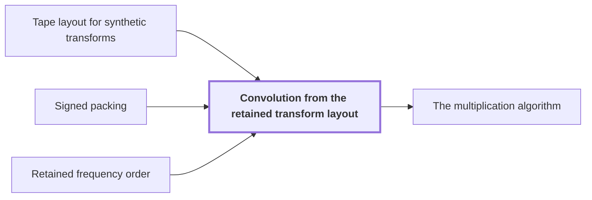

# Convolution from the retained transform layout

!!! info "Before this page"

    Convolution from the retained transform layout *transforms laid out as in* [Tape layout for synthetic transforms](transform-layout.md "The transforms are laid out as in Tape layout for synthetic transforms, which makes each round one simultaneous layer."), *forms each record product by* [Signed packing](signed-packing.md "Each record product is formed by Signed packing in $O(rp\log(rp))$ time and truncated by $Q_p$ to the $2^{-p}$ grid, which keeps it in the disk.") and *keeps the retained order of* [Retained frequency order](frequency-order.md "The procedure keeps the retained order of Retained frequency order, passing the product to the opposite transform without reordering.").

!!! abstract "Where this fits"

    1. A single deterministic Turing machine with a fixed finite alphabet and a fixed finite number of one-dimensional tapes multiplies two $n$-bit integers exactly in $O(n(\lg n)^{1-\kappa})$ worst-case time with $\kappa=2^{-182}$, disproving the $n\log n$ optimality conjecture of Sch\"onhage and Strassen in this model. — how: Build two power-saving tape procedures (chunk interchange and simultaneous butterfly layer) from fixed finite linear networks; use them to accelerate the synthetic polynomial transforms and ring convolution; use Gaussian resampling with retained permutations and chirps to reduce the prime-length cyclic convolution of the radix-digit coefficients to those power-of-two transforms; assemble the exact product with a proof that the error is below $1/2$; and total the cost to show a power of $\log n$ is saved. ([Power-saving integer multiplication](main-result.md "A deterministic fixed-tape Turing machine multiplying two n-bit integers exactly in O(n(lg n)^{1−κ}) time with κ = 2^{−182}, disproving the n log n optimality conjecture in this model."))
    2. **This page:** Normalized cyclic convolution over the polynomial ring $\mathbb C[y]/(y^r+1)$ on the remaining $d-1$ axes is computed from two forward synthetic transforms in retained order, $M$ pointwise polynomial products and the opposite transform, in $O(Tp[dK+pK^{\tau-1}+\ell d^{\lambda'}+\log(rp)])$ time with error less than $\sqrt2\,M(3\ell+1)2^{-p}$.

??? note "Symbols from earlier pages"

    - $\mathcal R_r$ — negacyclic ring: The ring of polynomials in y modulo y^r+1 over the complex numbers. (on [Phase twist](phase-twist.md "Multiplying coefficient k by e^{πik/r}, which converts the cyclic coordinate modulo x^r − 1 into the negacyclic ring modulo y^r + 1 and is removed afterwards."))
    - $r$ — record length: The number of complex coefficients in a polynomial of the ring, always a power of two. (on [Polynomial ring modulo y^r + 1](ring-y.md "Polynomials of degree below r over the complex numbers with y^r = −1, so multiplying by a power of y is a signed shift of the coefficient list."))
    - $y$ — ring variable: The indeterminate of the polynomials; it satisfies y^r = -1 in the ring. (on [Polynomial ring modulo y^r + 1](ring-y.md "Polynomials of degree below r over the complex numbers with y^r = −1, so multiplying by a power of y is a signed shift of the coefficient list."))
    - $i$ — axis index: An index of one axis of the array, between 1 and d. (on [Multidimensional transforms](multidim-transform.md "A transform over several axes at once, the tensor product of one-dimensional transforms, applied to an array one axis at a time."))
    - $t_i$ — axis length: The number of addresses along cyclic axis i. (on [Cyclic convolution](convolution.md "The product of two sequences (or elements of a polynomial quotient ring) where indices wrap around: (f∗g)_k = Σ f_j g_{k−j}."))
    - $d$ — axis count: The number of axes of the underlying cyclic convolution. (on [Cyclic convolution](convolution.md "The product of two sequences (or elements of a polynomial quotient ring) where indices wrap around: (f∗g)_k = Σ f_j g_{k−j}."))
    - $T$ — coefficient count: The number of complex coefficients in an array. (on [Cyclic convolution](convolution.md "The product of two sequences (or elements of a polynomial quotient ring) where indices wrap around: (f∗g)_k = Σ f_j g_{k−j}."))
    - $p$ — fractional bits: The number of fractional bits of the grid on which stored values lie. (on [Fixed-point Gaussian dyadic records](fixed-point.md "Complex values stored as signed two's-complement integers over a power-of-two denominator 2^{-p}; intermediate values are exact and one truncation Q_p rounds back to the p-bit grid."))
    - $\mathcal M_r$ — ring convolution: The normalized convolution of the first d-1 axes over R_r, dividing by T. (on [Phase twist](phase-twist.md "Multiplying coefficient k by e^{πik/r}, which converts the cyclic coordinate modulo x^r − 1 into the negacyclic ring modulo y^r + 1 and is removed afterwards."))
    - $f$ — first array: A complex array with d axes, the last of length r. (on [Phase twist](phase-twist.md "Multiplying coefficient k by e^{πik/r}, which converts the cyclic coordinate modulo x^r − 1 into the negacyclic ring modulo y^r + 1 and is removed afterwards."))
    - $g$ — second array: The second complex array, with the same shape as f. (on [Phase twist](phase-twist.md "Multiplying coefficient k by e^{πik/r}, which converts the cyclic coordinate modulo x^r − 1 into the negacyclic ring modulo y^r + 1 and is removed afterwards."))
    - $u$ — first array: A complex array, not an integer being multiplied. (on [Retained permutation cancellation](retained-permutations.md "Leaving the coordinate permutations of resampling inside the transform identity, so the source permutation cancels across the two forward transforms and the opposite one and none is executed as a sort."))
    - $v$ — second array: A complex array, not an integer being multiplied. (on [Retained permutation cancellation](retained-permutations.md "Leaving the coordinate permutations of resampling inside the transform identity, so the source permutation cancels across the two forward transforms and the opposite one and none is executed as a sort."))
    - $L$ — record permutation: The record permutation that moves the selected bits together. (on [Tape layout for synthetic transforms](transform-layout.md "Placing the selected bits of the participating axes at a common offset in K-bit chunks so each round of the synthetic transform is one simultaneous layer, costing less than log t passes."))
    - $B$ — bit-reversal permutation: The bit-reversal permutation on all axes. (on [Tape layout for synthetic transforms](transform-layout.md "Placing the selected bits of the participating axes at a common offset in K-bit chunks so each round of the synthetic transform is one simultaneous layer, costing less than log t passes."))
    - $Q_p$ — truncation: The truncation that drops the bits below 2^{-p} in each real and imaginary part, returning a record to the p-bit grid. (on [Fixed-point Gaussian dyadic records](fixed-point.md "Complex values stored as signed two's-complement integers over a power-of-two denominator 2^{-p}; intermediate values are exact and one truncation Q_p rounds back to the p-bit grid."))
    - $\tau$ — interchange exponent: The exponent below 1 in the chunk interchange cost. (on [Tape layout for synthetic transforms](transform-layout.md "Placing the selected bits of the participating axes at a common offset in K-bit chunks so each round of the synthetic transform is one simultaneous layer, costing less than log t passes."))
    - $\lambda'$ — layer exponent: The exponent below 1 in the layer cost. (on [Tape layout for synthetic transforms](transform-layout.md "Placing the selected bits of the participating axes at a common offset in K-bit chunks so each round of the synthetic transform is one simultaneous layer, costing less than log t passes."))

Convolution from the retained transform layout computes the normalized convolution over $\mathcal R_r=\mathbb C[y]/(y^r+1)$ on the remaining axes: transform both operands, multiply records pointwise, transform back. It supplies the ring convolution that the multiplication algorithm needs, using three synthetic transforms and short polynomial products.

Arrays are indexed by $\prod_i\mathbb Z/t_i\mathbb Z$ over the $d-1$ remaining axes, where $t_i$ is the length of axis $i$, with values in $\mathcal R_r$; each value is a record of $r$ coefficients. Let $M=\prod_i t_i$ be the number of records and $T=rM$ the number of complex coefficients. $\|\cdot\|_\infty$ is the largest coefficient modulus in an array. A disk array has norm at most $1$; a disk grid array also has real and imaginary parts that are multiples of $2^{-p}$. Tuples $\boldsymbol j,\boldsymbol k,\boldsymbol l$ are positions in the cyclic axes, with components $j_i,k_i,l_i$. The convolution $f*g$ of [Cyclic convolution](convolution.md "The product of two sequences (or elements of a polynomial quotient ring) where indices wrap around: (f∗g)_k = Σ f_j g_{k−j}.") adds the ring product $f(\boldsymbol k)g(\boldsymbol l)$ into position $\boldsymbol k+\boldsymbol l$, each coordinate taken modulo $t_i$.

## The normalized convolution

For arrays over $\mathcal R_r$ define $\mathcal M_r(f,g)=\frac{f*g}{rM}=\frac{f*g}{T}$. A fixed output coefficient averages $rM$ signed scalar products<cite class="exegenius-ref" data-source="paper" data-locator="§7.1 The normalized convolution interface" data-quote="$rM$ signed scalar products, and $\mathcal M_r$ is a bilinear" title="$rM$ signed scalar products, and $\mathcal M_r$ is a bilinear"> (see §7.1 The normalized convolution interface)</cite>, so $\mathcal M_r$ is a [bilinear contraction](contraction-maps.md "A linear map that never increases the norm of a vector, and a bilinear map whose output norm is at most the product of the input norms, so errors in the inputs do not grow beyond a controlled bound."): $\|\mathcal M_r(f,g)\|_\infty\le\|f\|_\infty\|g\|_\infty$.

Let $F^-$ and $F^+$ be the forward and opposite synthetic transforms on all $d-1$ axes ([Synthetic polynomial transform](synthetic-transform.md "A transform over the ring modulo y^r + 1 whose roots of unity are powers of y, so every twiddle multiplication is a signed shift of a coefficient list.")). Put $\omega_t=y^{2r/t}$, a power of $y$ that plays a $t$-th root of unity, and $\chi_{\boldsymbol j}(\boldsymbol k)=\prod_i\omega_{t_i}^{-j_ik_i}$. Then
$$(F^-f)(\boldsymbol j)=\frac1M\sum_{\boldsymbol k}\chi_{\boldsymbol j}(\boldsymbol k)f(\boldsymbol k),$$
and $F^+$ is the same with the exponent signs reversed. Since $\omega_{t_i}^{t_i}=1$, $\chi_{\boldsymbol j}(\boldsymbol k+\boldsymbol l)=\chi_{\boldsymbol j}(\boldsymbol k)\chi_{\boldsymbol j}(\boldsymbol l)$. Expanding $f*g$ as the sum of its products $f(\boldsymbol k)g(\boldsymbol l)$ placed at $\boldsymbol k+\boldsymbol l$, and using that the ring is commutative,
$$(F^-(f*g))(\boldsymbol j)=\frac1M\sum_{\boldsymbol k,\boldsymbol l}\chi_{\boldsymbol j}(\boldsymbol k)f(\boldsymbol k)\,\chi_{\boldsymbol j}(\boldsymbol l)g(\boldsymbol l)=\frac1M\bigl(M(F^-f)(\boldsymbol j)\bigr)\bigl(M(F^-g)(\boldsymbol j)\bigr).$$
So $F^-(f*g)=M(F^-f)(F^-g)$, the product taken record by record. The per-axis identity $F_t^+F_t^-=I/t$ of the synthetic-transform page, tensored over the axes, gives $F^+F^-=I/M$. Hence $F^+$ applied to both sides gives $\frac{f*g}{M}=MF^+\bigl((F^-f)(F^-g)\bigr)$, and dividing by $r$,
$$MF^+\Bigl(\frac{(F^-f)(F^-g)}r\Bigr)=\frac{f*g}{rM}=\mathcal M_r(f,g).$$
Write $P(u,v)=uv/r$ for the record-by-record product. Each coefficient of $uv$ is a signed sum of $r$ products of coefficients, so $P$ is bilinear and $\|P(u,v)\|_\infty\le\|u\|_\infty\|v\|_\infty$. Here $P$, $u$, $v$ denote arrays, which differs from their meanings on earlier pages.

## Keeping the stored order

The forward procedure does not store $F^-f$ in natural order. Let $B$ be the bit-reversal order in which the butterflies produce frequencies ([Retained frequency order](frequency-order.md "The forward synthetic transform writes its outputs in bit-reversed order, the pointwise product keeps that order, and the opposite transform consumes it, so no reordering is executed.")), and $L$ the layout permutation of records that the tape layout imposes. Both move whole records and leave each record's polynomial intact. The stored output is $LBF^-f$, with frequency $\boldsymbol j$ at position $LB\boldsymbol j$. The opposite procedure consumes that order; its exact counterpart is $\mathcal T_+=F^+B^{-1}L^{-1}$. The transforms are laid out as in [Tape layout for synthetic transforms](transform-layout.md "Placing the selected bits of the participating axes at a common offset in K-bit chunks so each round of the synthetic transform is one simultaneous layer, costing less than log t passes."), which makes each round one simultaneous layer. Perform both forward transforms and retain their common $LB$ order.

Since $P$ acts on each record separately, $P(LBu,LBv)=LBP(u,v)$. Because $\mathcal T_+LB=F^+$, applying $\mathcal T_+$ to the pointwise product of the stored forward outputs equals $F^+P(F^-f,F^-g)$, and scaling it by $M$ gives $\mathcal M_r(f,g)$. The procedure keeps the retained order of [Retained frequency order](frequency-order.md "The forward synthetic transform writes its outputs in bit-reversed order, the pointwise product keeps that order, and the opposite transform consumes it, so no reordering is executed."), passing the product to the opposite transform without reordering. Also $F^+$ averages signed shifts and $B^{-1}L^{-1}$ only permutes records, so $\mathcal T_+$ is a contraction.

## Cost

Each record product is formed by [Signed packing](signed-packing.md "A signed Kronecker substitution that evaluates polynomials with signed coefficients at 2^{4p} to form large integers, multiplies them with the O(n log n) multiplier, and recovers the product coefficients.") in $O(rp\log(rp))$ time and truncated by $Q_p$ to the $2^{-p}$ grid, which keeps it in the disk. Each of the three transforms costs $O(Tp[dK+pK^{\tau-1}+\ell d^{\lambda'}])$, with $\ell=\log_2r$, $K$ the chunk width of the layout, and $\tau,\lambda'<1$ the exponents of the interchange and layer costs; the final scaling by $M$ is linear in $Tp$, and the $M=T/r$ pointwise products cost $O(Tp\log(rp))$ in total<cite class="exegenius-ref" data-source="paper" data-locator="§7.1 The normalized convolution interface" data-quote="Their total cost is $O(Tp\log(rp))$" title="Their total cost is $O(Tp\log(rp))$"> (see §7.1 The normalized convolution interface)</cite>. The sum is $O(Tp[dK+pK^{\tau-1}+\ell d^{\lambda'}+\log(rp)])$.

## Error

Put $\delta=\sqrt2\ell\,2^{-p}$ for the error of each transform procedure and $\eta=\sqrt2\,2^{-p}$ for one truncation $Q_p$. Each transform procedure maps disk grid arrays to disk grid arrays with error less than $\delta$<cite class="exegenius-ref" data-source="paper" data-locator="§6.2 A layout on which the parallel layers apply" data-quote="$\sqrt2\ell\,2^{-p}$, returns disk grid coefficients in the same" title="$\sqrt2\ell\,2^{-p}$, returns disk grid coefficients in the same"> (see §6.2 A layout on which the parallel layers apply)</cite>. Let $u,v$ be the exact stored forward outputs and $\widetilde u,\widetilde v$ the returned ones, all disk arrays. By bilinearity, $P(\widetilde u,\widetilde v)-P(u,v)=P(\widetilde u-u,\widetilde v)+P(u,\widetilde v-v)$. Each term is less than $\delta$ by the bound on $P$ and norm at most $1$ of $\widetilde v$ and $u$, so $\|P(\widetilde u,\widetilde v)-P(u,v)\|_\infty<2\delta$. With $\widetilde z=Q_p(P(\widetilde u,\widetilde v))$ and $z_*=P(u,v)$, truncation gives $\|\widetilde z-z_*\|_\infty<2\delta+\eta$. The opposite procedure returns $\widetilde h$ with $\|\widetilde h-\mathcal T_+\widetilde z\|_\infty<\delta$, and $\mathcal T_+$ is a contraction, so the triangle inequality gives
$$\|\widetilde h-\mathcal T_+z_*\|_\infty\le\|\widetilde h-\mathcal T_+\widetilde z\|_\infty+\|\mathcal T_+(\widetilde z-z_*)\|_\infty<3\delta+\eta.$$
The exact multiplication by $M$ gives total error less than $M(3\delta+\eta)=\sqrt2\,M(3\ell+1)2^{-p}$<cite class="exegenius-ref" data-source="paper" data-locator="§7.1 The normalized convolution interface" data-quote="$M(3\delta+\eta)=\sqrt2\,M(3\ell+1)2^{-p}$, as claimed." title="$M(3\delta+\eta)=\sqrt2\,M(3\ell+1)2^{-p}$, as claimed."> (see §7.1 The normalized convolution interface)</cite>

## Connections

Used by:

- [The multiplication algorithm](multiplication-algorithm.md "Here $\mathcal M_{\mathbb C}(f,g)=f*g/T$ is normalized cyclic convolution, computed through the Phase twist and Convolution from the retained transform layout.") *computes convolution through* Convolution from the retained transform layout

??? quote "From the sources"

    > Convolution from the retained transform layout
    >
    > — [Integer multiplication below n log n (OpenAI, 2026)](https://github.com/openai/math/tree/fd4aeeb2ee4fc729c18d98444fed42fd0529eeeb/preprints/Integer-multiplication-below-n-log-n-September-23-2026)

    > The normalized convolution interface
    >
    > — [Integer multiplication below n log n (OpenAI, 2026)](https://github.com/openai/math/tree/fd4aeeb2ee4fc729c18d98444fed42fd0529eeeb/preprints/Integer-multiplication-below-n-log-n-September-23-2026)
