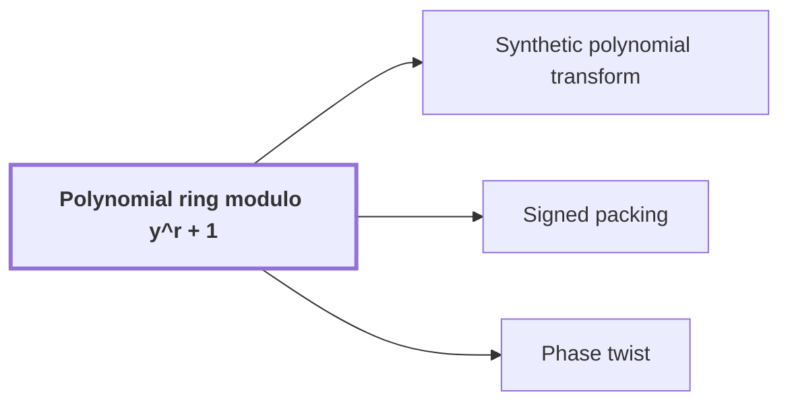

# Polynomial ring modulo $y^r + 1$

!!! info "Before this page"

    Assumed known: Polynomials and Complex numbers.

!!! abstract "Where this fits"

    - Relied on to show: Synthetic transforms over $\mathcal R_r$ on $d-1$ axes of lengths $t_i\in\{2^{\ell-1},2^\ell\}$ with outputs kept in a retained layout $LB$ cost $O(Tp[dK+pK^{\tau-1}+\ell d^{\lambda'}])$ with error less than $\sqrt2\ell\,2^{-p}$. ([Tape layout for synthetic transforms](transform-layout.md "Placing the selected bits of the participating axes at a common offset in K-bit chunks so each round of the synthetic transform is one simultaneous layer, costing less than log t passes."))
    - Relied on to show: The synthetic transform $F_t^-$ over $\mathcal R_r=\mathbb C[y]/(y^r+1)$, with roots of unity $\omega_t=y^{2r/t}$, is computed by decimation in frequency with outputs written in bit-reversed order, $B_tF_t^-$; the pointwise product keeps this order and the reverse procedure computes $F_t^+B_t^{-1}$, so no reordering is executed. ([Retained frequency order](frequency-order.md "The forward synthetic transform writes its outputs in bit-reversed order, the pointwise product keeps that order, and the opposite transform consumes it, so no reordering is executed."))
    - Relied on to show: Normalized cyclic convolution over the polynomial ring $\mathbb C[y]/(y^r+1)$ on the remaining $d-1$ axes is computed from two forward synthetic transforms in retained order, $M$ pointwise polynomial products and the opposite transform, in $O(Tp[dK+pK^{\tau-1}+\ell d^{\lambda'}+\log(rp)])$ time with error less than $\sqrt2\,M(3\ell+1)2^{-p}$. ([Convolution from the retained transform layout](ring-convolution.md "Convolution over the ring modulo y^r + 1 on the remaining axes by two forward synthetic transforms, pointwise polynomial products and the opposite transform, normalized by 1/(rM)."))
    - Relied on to show: For disk-grid polynomials $f,g\in\mathcal R_r$ the exact Gaussian-integer numerators of $fg$, and then $Q_p(fg/r)$, are computed in $O(rp\log(rp))$ time using four integer products by the established multiplier at packing base $B_0=2^{4p}$. ([Signed packing](signed-packing.md "A signed Kronecker substitution that evaluates polynomials with signed coefficients at 2^{4p} to form large integers, multiplies them with the O(n log n) multiplier, and recovers the product coefficients."))
    - Relied on to show: With $\zeta=e^{\pi i/r}$ the map $\Theta:\mathbb C[x_d]/(x_d^r-1)\to\mathcal R_r$, $x_d\mapsto\zeta y$, is an isomorphism multiplying coefficient $k$ by $\zeta^k$; hence normalized complex cyclic convolution is $\mathcal M_{\mathbb C}(f,g)=D_-\iota^{-1}\mathcal M_r(\iota D_+f,\iota D_+g)=f*g/T$. ([Phase twist](phase-twist.md "Multiplying coefficient k by e^{πik/r}, which converts the cyclic coordinate modulo x^r − 1 into the negacyclic ring modulo y^r + 1 and is removed afterwards."))

The negacyclic ring is a way of storing a list of complex numbers so that multiplying by a root of unity costs only a signed rotation of the list, with no arithmetic; this is what lets the later transforms avoid complex multiplications.

Write $\mathcal R_r=\mathbb C[y]/(y^r+1)$ for it, where $y$ is the ring variable, the indeterminate of the polynomials, and $r$ is the record length, the number of complex coefficients in a polynomial of the ring, always a power of two with $r\geq 2$. An element is
$$z=\sum_{k=0}^{r-1}z_k y^k,\qquad z_k\in\mathbb C,$$
so it is just a record of $r$ complex numbers. Addition is coefficientwise. Multiplication is ordinary polynomial multiplication followed by reduction modulo $y^r+1$, which means imposing $y^r=-1$. Consider a term of degree $r+j$ with $j\geq 0$, so that $j$ is the amount by which its degree exceeds $r$. Then
$$y^{r+j}=y^{r}y^{j}=-y^{j},$$
so the term lands at position $j$ with its sign flipped: it wraps around to the front. A product of two records has degree at most $2r-2$, so one such wrap suffices. For this sign flip the ring is also called the negacyclic ring. We always keep the representative of degree below $r$<cite class="exegenius-ref" data-source="paper" data-locator="§6 Synthetic transforms and their tape layout" data-quote="We always use representatives of degree less than $r$." title="We always use representatives of degree less than $r$."> (see §6 Synthetic transforms and their tape layout)</cite>

## Powers of $y$ are signed shifts

Multiplying by $y$ moves each coefficient up one place and sends the top coefficient $z_{r-1}$ to the bottom as $-z_{r-1}$. For $r=4$:
$$y\,(z_0+z_1y+z_2y^2+z_3y^3)=-z_3+z_0y+z_1y^2+z_2y^3 .$$
Since $y^r=-1$, we get $y^{2r}=1$, so $y$ is a $2r$-th root of unity. Let $a$ be any integer exponent. Multiplying by $y^a$ applies the one-place move $a$ times (for negative $a$, the inverse move). It sends coefficient $z_k$ to position $(k+a)\bmod r$, with its sign multiplied by $(-1)^{\lfloor (k+a)/r\rfloor}$, one flip for each time it wraps past the end. It permutes the coefficients and changes some signs, so it is a linear-time pass over the list.

The size of an element is measured by the largest coefficient modulus,
$$\|z\|_\infty=\max_{0\leq k<r}|z_k|.$$
A signed permutation of coefficients leaves this maximum unchanged, so multiplication by $y^a$ is an isometry for this norm<cite class="exegenius-ref" data-source="paper" data-locator="§6 Synthetic transforms and their tape layout" data-quote="some signs; consequently it is an isometry for this norm." title="some signs; consequently it is an isometry for this norm."> (see §6 Synthetic transforms and their tape layout)</cite> Shifts therefore add no rounding error when coefficients are stored at fixed precision.

## Why this ring

Taking one coordinate of a multidimensional array to be a record in $\mathcal R_r$ makes powers of $y$ available as roots of unity in the remaining axes, where a multiplication by such a root is a signed shift of the coefficient list<cite class="exegenius-ref" data-source="paper" data-locator="§1.1 The two tape operations" data-quote="multiplication by such a root is a signed shift of the coefficient list" title="multiplication by such a root is a signed shift of the coefficient list"> (see §1.1 The two tape operations)</cite>. Transforms built this way are described on [Synthetic polynomial transform](synthetic-transform.md "A transform over the ring modulo y^r + 1 whose roots of unity are powers of y, so every twiddle multiplication is a signed shift of a coefficient list."). The ring also receives ordinary cyclic data once its coefficients are twisted by phases, as explained on [Phase twist](phase-twist.md "Multiplying coefficient k by e^{πik/r}, which converts the cyclic coordinate modulo x^r − 1 into the negacyclic ring modulo y^r + 1 and is removed afterwards.").

In such a transform each stage pairs up entries and multiplies one entry of each pair by a power of the root, which here is a signed shift. In the variant called decimation in frequency, each stage pairs the first-half entries with the second-half entries, and the outputs come out in bit-reversed order: the output whose frequency index is $110$ in binary is stored at the position whose index is $011$. [Retained frequency order](frequency-order.md "The forward synthetic transform writes its outputs in bit-reversed order, the pointwise product keeps that order, and the opposite transform consumes it, so no reordering is executed.") explains why that order need not be undone.

## Connections

Used by:

- [Synthetic polynomial transform](synthetic-transform.md "A synthetic polynomial transform is a transform over the Polynomial ring modulo y^r + 1 whose roots of unity are powers of $y$, so every twiddle multiplication (multiplication by a root of unity) is a signed shift of a coefficient list.") *is a transform over* Polynomial ring modulo y^r + 1
- [Signed packing](signed-packing.md "It multiplies in the Polynomial ring modulo y^r + 1 in $O(rp\log(rp))$ time, where $p$ is the number of fractional bits of each coefficient.") *multiplies in* Polynomial ring modulo y^r + 1
- [Phase twist](phase-twist.md "The twist converts the last cyclic axis into the coordinate of the Polynomial ring modulo y^r + 1, and the sign is repaired by a phase.") *converts the last cyclic axis into* Polynomial ring modulo y^r + 1

??? quote "From the sources"

    > one coordinate is stored as the coefficient list of a polynomial modulo $y^r+1$
    >
    > — [Integer multiplication below n log n (OpenAI, 2026)](https://github.com/openai/math/tree/fd4aeeb2ee4fc729c18d98444fed42fd0529eeeb/preprints/Integer-multiplication-below-n-log-n-September-23-2026)

    > \mathcal R_r=\mathbb C[y]/(y^r+1)
    >
    > — [Integer multiplication below n log n (OpenAI, 2026)](https://github.com/openai/math/tree/fd4aeeb2ee4fc729c18d98444fed42fd0529eeeb/preprints/Integer-multiplication-below-n-log-n-September-23-2026)
