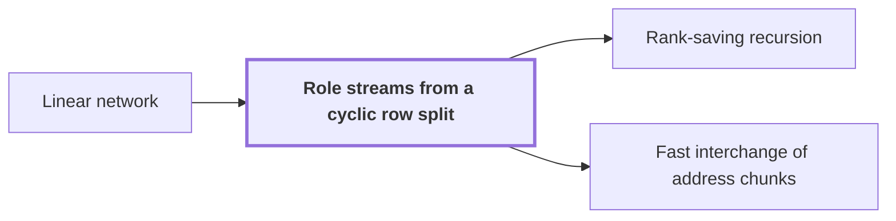

# Role streams from a cyclic row split

!!! info "Before this page"

    Role streams from a cyclic row split *are carried by* [Linear network](linear-network.md "Role streams are carried by the wires of a Linear network: each role is one wire place of it.").

!!! abstract "Where this fits"

    - Relied on to show: Interchanging two equal address fields of width $u$ costs less than linear in $u$ per unit volume. ([Fast interchange of address chunks](tape-interchange.md "A fixed-tape procedure that swaps two disjoint equal-width address fields of an array in time O(V u^τ) for a fixed τ < 1, where V is the stored volume and u the field width, using XOR combinations of intermediate data."))

A role stream is the share of an array's rows that one role of a fixed network carries, obtained by dealing the rows out cyclically. The [Fast interchange of address chunks](tape-interchange.md "A fixed-tape procedure that swaps two disjoint equal-width address fields of an array in time O(V u^τ) for a fixed τ < 1, where V is the stored volume and u the field width, using XOR combinations of intermediate data.") step needs each wire to hold an equal share of the data.

A prefix is the fixed leading part of an array's address. A row is the complete ordered suffix of the active address fields (the fields that the procedure exchanges), taken at a fixed prefix and row index $i$, its position among the rows that share that prefix, counted from 0.

Let $W$ denote the number of roles, that is, the number of fixed wire places in the network. For each prefix, let $R$ denote the padded row count: the row count padded up to a multiple of $W$. Row $i$ goes to role $i \bmod W$. For example, with $W = 4$ and six rows, padding gives eight rows, and role 0 receives rows 0 and 4.

Role streams are carried by the wires of a [Linear network](linear-network.md "A fixed network of wires with gates that apply fixed linear maps to the values on their wires, used here to exchange two banks of values while restoring all auxiliary values."): each role is one wire place of it.

Let $V$ denote the node volume after padding, the number of bits the node holds once its rows are padded. This is the sum over all prefixes of $R$ times the bit length of a row. On [Fast interchange of address chunks](tape-interchange.md "A fixed-tape procedure that swaps two disjoint equal-width address fields of an array in time O(V u^τ) for a fixed τ < 1, where V is the stored volume and u the field width, using XOR combinations of intermediate data."), the letter $V$ denotes a different quantity, the stored volume in data units.

Fix one prefix with padded row count $R$. Since $R$ is a multiple of $W$, each role receives exactly $R/W$ rows of this prefix. All rows of a prefix have the same bit length, since they take the same active fields. So each role gets $1/W$ of the prefix's bits, and summing over prefixes gives $V/W$ bits per role. Every role stream also covers the same local address set. Each role stream therefore holds $V/W$ bits of the node.<cite class="exegenius-ref" data-source="paper" data-locator="§1.2 Linear networks and the recursive saving" data-quote="each contains $V/W$ bits" title="each contains $V/W$ bits"> (see §1.2 Linear networks and the recursive saving)</cite>

A scalar gate, an operation on single values, is applied pointwise: it acts on the values at matching local addresses of the roles it touches.

## Connections

Used by:

- [Rank-saving recursion](recursive-saving.md "The recursion splits its array into role streams from a cyclic row split across the $W$ roles, the fixed wire places of the network.") *splits its array into* Role streams from a cyclic row split
- [Fast interchange of address chunks](tape-interchange.md "Each smaller call acts on one of the $W$ wire streams, each of volume $V/W$.") *acts on* Role streams from a cyclic row split

??? quote "From the sources"

    > Distribute rows cyclically among the $W$ roles
    >
    > — [Integer multiplication below n log n (OpenAI, 2026)](https://github.com/openai/math/tree/fd4aeeb2ee4fc729c18d98444fed42fd0529eeeb/preprints/Integer-multiplication-below-n-log-n-September-23-2026)
