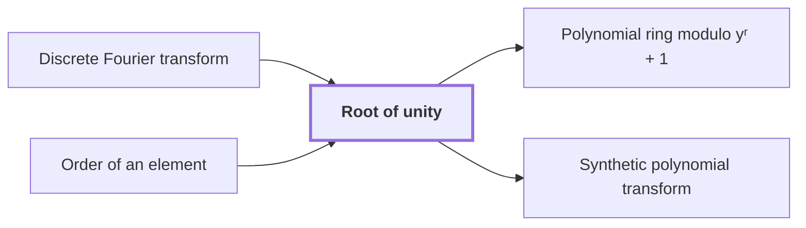

# Root of unity

!!! info "Before this page"

    Root of unity *supplies the twiddle factors of* [Discrete Fourier transform](fourier-transform.md "A root of unity supplies the twiddle factors of a discrete Fourier transform of length $q$.") and *is characterised by* [Order of an element](glossary.md#order-of-element "A root of unity is characterised by the order of an element it has, the least positive power that equals one."). Assumed known: Complex numbers.

!!! abstract "Where this fits"

    - Relied on to show: Normalized cyclic convolution on the power-of-two axes is computed over the polynomial ring $\mathbb C[y]/(y^r+1)$ by synthetic transforms and packed polynomial products. ([Synthetic polynomial transform](synthetic-transform.md "A discrete Fourier transform whose roots of unity are powers of y in the polynomial ring, so that each twiddle multiplication is a signed shift and the transform is computed by simultaneous butterfly layers."))
    - Relied on to show: A phase twist changes the last cyclic coordinate into a polynomial modulo $y^r+1$, and its negative wrap gives the original cyclic wrap.

??? note "Symbols from earlier pages"

    - $q$ — vector length: The number of entries of the vector $u$, which is the length the transform is taken at. (on [Discrete Fourier transform](fourier-transform.md "The map sending a vector u of length q to the vector whose k-th entry is (1/q) times the sum over j of u_j times exp(−2πijk/q)."))
    - $k$ — output index: The index of an entry of $\hat u$, running from $0$ to $q-1$. (on [Discrete Fourier transform](fourier-transform.md "The map sending a vector u of length q to the vector whose k-th entry is (1/q) times the sum over j of u_j times exp(−2πijk/q)."))

A root of unity is a number some positive integer power of which equals one. Here $r$ is the number of complex coefficients of a reduced polynomial, a power of two. Here $y$ is the formal variable of the [polynomial ring modulo $y^r+1$](polynomial-ring.md "The ring of complex polynomials of degree less than r, with multiplication reduced modulo y^r + 1; multiplication by a power of y permutes and sign-changes the coefficient list."), changing meaning from the neighbouring vertex of earlier pages.

A root of unity is characterised by the [order of an element](glossary.md#order-of-element "The order of an element x of a multiplicative group is the least positive integer k with x^k equal to the identity, when such k exists.") it has, the least positive power that equals one. A *primitive* root of unity is one whose powers are all distinct until the first one equals one.

A reduced polynomial is one of degree less than $r$, the remainder on division by $y^r+1$. Every polynomial has one such remainder, so $1, y, \dots, y^{r-1}$ span the ring. They are independent, because a nonzero combination of them has degree less than $r$ and so is not a multiple of $y^r+1$.

In this ring $y^r=-1$, so $y^{2r}=1$. For $0<k<2r$, $y^k$ is plus or minus a basis element, so by uniqueness of expansion it is not $1=y^0$. Hence $y$ has order $2r$ and is a primitive root of unity.

For a power of two $q$ dividing $2r$, let $\zeta$ denote $y^{2r/q}$. Then $\zeta^q=1$, and $\zeta^k=y^{2rk/q}$ is not $1$ for $0<k<q$, because $0<2rk/q<2r$. So $\zeta$ is a primitive $q$-th root of unity, and $\zeta^{q/2}=y^r=-1$.

Here $p$ is an exponent with $0\le p<r$, the letter $p$ changing meaning from the fractional bit count. Every power of $y$ is $\pm y^p$ for a unique $p$. Multiplying by $y^p$ moves each coefficient up $p$ places, and a coefficient passing position $r-1$ re-enters negated. So each such multiplication is a signed shift of the coefficient list.<cite class="exegenius-ref" data-source="paper" data-locator="§1.1 The two tape operations" data-quote="multiplication by such a root is a signed shift of the coefficient list" title="multiplication by such a root is a signed shift of the coefficient list"> (see §1.1 The two tape operations)</cite>

A root of unity supplies the twiddle factors of a [discrete Fourier transform](fourier-transform.md "The map sending a vector u of length q to the vector whose k-th entry is (1/q) times the sum over j of u_j times exp(−2πijk/q).") of length $q$. Its fast form splits the input into even and odd entries; that split, for $q\ge 2$, uses only $\zeta^q=1$ and $\zeta^{q/2}=-1$, so every twiddle product in this ring is a signed shift.

## Connections

Used by:

- [Polynomial ring modulo yʳ + 1](polynomial-ring.md "The ring has powers that act as Root of unity, and their effect on coefficients is cheap.") *has powers that act as* Root of unity
- [Synthetic polynomial transform](synthetic-transform.md "It takes its roots from the powers of $y$, which are a Root of unity of order $2r$.") *takes its roots from* Root of unity

??? quote "From the sources"

    > serve as roots of unity in the remaining axes
    >
    > — [Integer multiplication below n log n (OpenAI, 2026)](https://github.com/openai/math/tree/fd4aeeb2ee4fc729c18d98444fed42fd0529eeeb/preprints/Integer-multiplication-below-n-log-n-September-23-2026)
