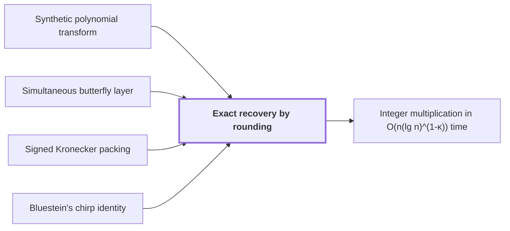

# Exact recovery by rounding

!!! info "Before this page"

    Exact recovery by rounding *works on the output of* [Synthetic polynomial transform](synthetic-transform.md "Exact recovery by rounding works on the output of the Synthetic polynomial transform run in the opposite direction."), *inherits its error from* [Simultaneous butterfly layer](simultaneous-butterfly-layer.md "Exact recovery by rounding inherits its error from each Simultaneous butterfly layer, which ends with one truncation."), *inverts* [Signed Kronecker packing](kronecker-packing.md "Exact recovery by rounding inverts the Signed Kronecker packing, which evaluates the coefficients at $2^b$.") and *is based on* [Bluestein's chirp identity](bluestein-chirp.md "Exact recovery by rounding is based on the normalized cyclic convolution that Bluestein's chirp identity produces.").

!!! abstract "Where this fits"

    1. Two $n$-bit integers can be multiplied exactly in $O(n(\lg n)^{1-\kappa})$ worst-case time on a deterministic multitape Turing machine, for a fixed $\kappa=2^{-182}$. — how: reduce the product to a digit convolution, compute that convolution through transform layers whose tape cost saves a power, and recover the exact product by rounding ([Integer multiplication in O(n(lg n)^(1-κ)) time](integer-multiplication-target.md "A deterministic multitape Turing machine that multiplies two n-bit integers exactly in O(n(lg n)^(1-κ)) worst-case time for a fixed κ = 2^(-182) > 0, beating the n log n conjecture in this model."))
    2. **This page:** The exact product is recovered: the source permutation cancels, and the coefficient error is below $1/2$, so rounding and carries give the binary product.

??? note "Symbols from earlier pages"

    - $b$ — digit width: The number of bits in one digit, a count of bits. (on [Multiplication as convolution of digits](convolution-reduction.md "Writing each integer in radix 2^b digits so that the integer product becomes a convolution of the digit sequences, which is then carried back to binary."))
    - $k$ — output position: The index of an output entry $\hat a_k$, running from $0$ to $n-1$; on this page it is not the power exponent it denotes on the roots-of-unity page. (on [Discrete Fourier transform](fourier-transform.md "The map sending a length-n sequence to its values at the n-th roots of unity, i.e. the sums of the sequence weighted by powers of a root of unity."))
    - $j$ — input position: The index of an input entry $a_j$, running from $0$ to $n-1$; on this page it is not the power exponent it denotes on the roots-of-unity page. (on [Discrete Fourier transform](fourier-transform.md "The map sending a length-n sequence to its values at the n-th roots of unity, i.e. the sums of the sequence weighted by powers of a root of unity."))

Exact recovery by rounding is the step that turns the approximate convolution coefficients into the exact binary product. It cancels a retained coordinate permutation, rounds each coefficient to an integer, and propagates carries.

Exact recovery by rounding works on the output of the [Synthetic polynomial transform](synthetic-transform.md "A transform over a polynomial ring in which the roots of unity are powers of y, so that each transform stage uses only signed shifts and butterfly additions.") run in the opposite direction. Exact recovery by rounding is based on the [normalized cyclic convolution](cyclic-convolution.md "The product of two sequences in which indices are taken modulo a fixed length, so each coefficient of the result is a sum of products over residues.") that [Bluestein's chirp identity](bluestein-chirp.md "The identity that converts a Fourier transform into a cyclic convolution by multiplying by chirp factors before and after it.") produces.

Let $\psi$ and $\chi$ be the arrays of radix-$2^b$ digits of the two integers, each zero-padded to $K$ entries, where $K$ is the source length, the number of entries of each array.

Resampling retains a coordinate permutation $Q$, where $(Q\psi)_j=\psi_{\eta j}$ for a unit $\eta$ modulo $K$, an integer coprime to $K$. Let $F_K$ be the [discrete Fourier transform](fourier-transform.md "The map sending a length-n sequence to its values at the n-th roots of unity, i.e. the sums of the sequence weighted by powers of a root of unity.") of length $K$, and $F_K^+$ the same sum with the opposite sign. Substituting $\eta k$, the index $\eta k$ taken modulo $K$, into the Fourier sum gives $QF_K^+Q=F_K^+$. Since $Q$ commutes with pointwise products, the permutation cancels: $QF_K^+(QF_K\psi\cdot QF_K\chi)=F_K^+(F_K\psi\cdot F_K\chi)$.

Write $\rho_j$ for the integer that the $j$-th computed coefficient approximates, once the known scales are removed. The paper's assembly section does this<cite class="exegenius-ref" data-source="paper" data-locator="§1.3 From transforms to the exact product" data-quote="removes the known normalizations and digit scales" title="removes the known normalizations and digit scales"> (see §1.3 From transforms to the exact product)</cite>.

If a computed value lies strictly within $1/2$ of an integer $\rho_j$, every other integer is more than $1/2$ away from that value, so $\rho_j$ is its unique nearest integer and rounding returns $\rho_j$. At distance exactly $1/2$ two integers are equally near, and rounding can pick the wrong one.

Each truncation keeps $Z=6b$ fractional bits, so it adds error below $2^{-Z}$. Exact recovery by rounding inherits its error from each [Simultaneous butterfly layer](simultaneous-butterfly-layer.md "A butterfly operation applied at once on one selected address bit of every record, with exact Gaussian dyadic intermediates and a single truncation after the layer."), which ends with one truncation. The paper proves the resulting bound on the error under its parameter choice<cite class="exegenius-ref" data-source="paper" data-locator="§1.3 From transforms to the exact product" data-quote="proves that the recovered coefficient error is strictly below $1/2$" title="proves that the recovered coefficient error is strictly below $1/2$"> (see §1.3 From transforms to the exact product)</cite>.

Exact recovery by rounding inverts the [Signed Kronecker packing](kronecker-packing.md "Encoding a polynomial with bounded signed coefficients as an integer by evaluating it at a large power of two, so that polynomial products become integer products."), which evaluates the coefficients at $2^b$. Let $\delta_j$ be the $j$-th radix-$2^b$ digit of the integer being formed and $\sigma_j$ the carry into position $j$ (the letter $\sigma$ changes meaning here). Set $\sigma_0=0$ and, for each $j$, choose $\delta_j$ and $\sigma_{j+1}$ so that $\rho_j+\sigma_j=\delta_j+2^b\sigma_{j+1}$ with $0\le\delta_j<2^b$. Multiplying the $j$-th relation by $2^{bj}$ and summing, the carries cancel in pairs, so the digits represent the same integer as $\sum_j\rho_j2^{bj}$, with the final carry written as further digits. The paper's assembly section gives the exact binary product this way<cite class="exegenius-ref" data-source="paper" data-locator="§1.3 From transforms to the exact product" data-quote="propagates carries to obtain the exact binary product" title="propagates carries to obtain the exact binary product"> (see §1.3 From transforms to the exact product)</cite>.

Example in base $2$ ($b=1$): computed values $2.9$ and $5.2$ round to $\rho_0=3$ and $\rho_1=5$, which stand for $3+2\cdot5=13$. Then $3=1+2\cdot1$ gives $\delta_0=1$ and $\sigma_1=1$; $5+1=0+2\cdot3$ gives $\delta_1=0$ and $\sigma_2=3$; $\rho_2+\sigma_2=0+3=1+2\cdot1$ gives $\delta_2=1$ and $\sigma_3=1$, and the final carry is written as the digit $\delta_3=1$. The digits $1101_2$ equal $13$.

## Connections

Used by:

- [Integer multiplication in O(n(lg n)^(1-κ)) time](integer-multiplication-target.md "The algorithm recovers its exact product by Exact recovery by rounding, which rounds the approximate coefficients to integers and propagates carries.") *recovers its exact product by* Exact recovery by rounding

??? quote "From the sources"

    > proves that the recovered coefficient error is strictly below $1/2$
    >
    > — [Integer multiplication below n log n (OpenAI, 2026)](https://github.com/openai/math/tree/fd4aeeb2ee4fc729c18d98444fed42fd0529eeeb/preprints/Integer-multiplication-below-n-log-n-September-23-2026)
