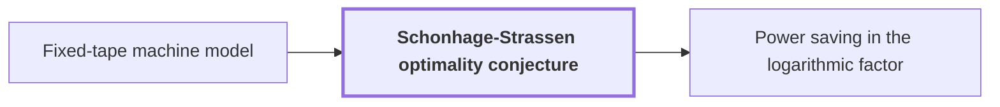

# Schonhage-Strassen optimality conjecture

!!! info "Before this page"

    Schonhage-Strassen optimality conjecture *is contrasted with* [Fixed-tape machine model](fixed-tape-model.md "The conjecture is posed for multitape machines and is contrasted with the fixed-tape machine model, in which the target result is measured."). Assumed known: Big-O notation.

!!! abstract "Where this fits"

    - Relied on to show: The integer product is computed exactly on one fixed-tape machine in $O(n(\lg n)^{1-\kappa})$ worst-case time, for $\kappa=2^{-182}$. ([Fixed-tape integer multiplication with a power saving](fixed-tape-multiplication.md "A deterministic fixed-tape Turing machine that multiplies two n-bit integers exactly in O(n(lg n)^(1−κ)) worst-case time, for a fixed κ = 2^(−182), disproving the n log n optimality conjecture in this model."))

??? note "Symbols from earlier pages"

    - $\kappa$ — fixed exponent saving: A fixed constant equal to $2^{-182}$, the same for every input length $n$. (on [Fixed-tape machine model](fixed-tape-model.md "A multitape Turing machine with one fixed finite alphabet and a fixed finite number of one-dimensional tapes, the same for every input length."))

The Schönhage–Strassen optimality conjecture is a claim about the fastest possible multiplication of two integers on a multitape Turing machine. It is the yardstick against which the target result is compared.

Here $n$ is the number of bits in each of the two integers being multiplied. The time is the worst-case number of steps over inputs of that length. The conjecture says that $n\log n$ is the best possible order of growth for it, where $\log$ denotes the same base-2 logarithm as $\lg$.

Schönhage and Strassen's 1971 algorithm multiplies two $n$-bit integers on a multitape Turing machine in $O(n\log n\log\log n)$ time<cite class="exegenius-ref" data-source="paper" data-locator="§1 Introduction" data-quote="Sch\&quot;onhage and Strassen proved in 1971 that two $n$-bit integers can be multiplied in $O(n\log n\log\log n)$ time on a multitape Turing machine" title="Sch\&quot;onhage and Strassen proved in 1971 that two $n$-bit integers can be multiplied in $O(n\log n\log\log n)$ time on a multitape Turing machine"> (see §1 Introduction)</cite>. They proposed $n\log n$ as the optimal order of growth<cite class="exegenius-ref" data-source="paper" data-locator="§1 Introduction" data-quote="proposed $n\log n$ as the optimal order of growth" title="proposed $n\log n$ as the optimal order of growth"> (see §1 Introduction)</cite>.

Harvey and van der Hoeven later gave an unconditional $O(n\log n)$ upper bound<cite class="exegenius-ref" data-source="paper" data-locator="§1 Introduction" data-quote="Harvey and van der Hoeven reached the unconditional $O(n\log n)$ upper bound" title="Harvey and van der Hoeven reached the unconditional $O(n\log n)$ upper bound"> (see §1 Introduction)</cite> for the same problem. Since the conjecture concerns multitape machines, this gives an $O(n\log n)$ multitape algorithm. The open part of the conjecture is therefore the matching lower bound: every multitape machine needs $\Omega(n\log n)$ worst-case time to multiply $n$-bit integers.

The conjecture is posed for multitape machines and is contrasted with the [fixed-tape machine model](fixed-tape-model.md "A multitape Turing machine with one fixed finite alphabet and a fixed finite number of one-dimensional tapes, the same for every input length."), in which the target result is measured. The target result, [Fixed-tape integer multiplication with a power saving](fixed-tape-multiplication.md "A deterministic fixed-tape Turing machine that multiplies two n-bit integers exactly in O(n(lg n)^(1−κ)) worst-case time, for a fixed κ = 2^(−182), disproving the n log n optimality conjecture in this model."), computes the integer product exactly on one fixed-tape machine. Its worst-case time is $O(n(\lg n)^{1-\kappa})$ for a fixed constant $\kappa>0$, and its exponent $1-\kappa$ on $\lg n$ is less than 1. The target result obtains a strict power saving in the logarithmic factor<cite class="exegenius-ref" data-source="paper" data-locator="§1 Introduction" data-quote="We obtain a strict power saving in the logarithmic factor" title="We obtain a strict power saving in the logarithmic factor"> (see §1 Introduction)</cite>, which is why it is compared with the conjecture.

## Connections

Used by:

- [Power saving in the logarithmic factor](power-saving.md "A power saving therefore undercuts the Schonhage-Strassen optimality conjecture.") *undercuts* Schonhage-Strassen optimality conjecture

??? quote "From the sources"

    > proposed $n\log n$ as the optimal order of growth
    >
    > — [Integer multiplication below n log n (OpenAI, 2026)](https://github.com/openai/math/tree/fd4aeeb2ee4fc729c18d98444fed42fd0529eeeb/preprints/Integer-multiplication-below-n-log-n-September-23-2026)
