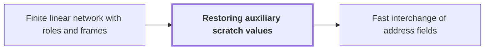

# Restoring auxiliary scratch values

!!! info "Before this page"

    Restoring auxiliary scratch values *is applied to* [Finite linear network with roles and frames](linear-network-roles.md "The procedure is applied to a Finite linear network with roles and frames, whose wires include the auxiliary registers.").

!!! abstract "Where this fits"

    - Relied on to show: Two disjoint contiguous $u$-bit address fields can be interchanged in $O(Vu^\tau)$ for a fixed $\tau<1$, although the intermediate steps are XOR combinations. ([Fast interchange of address fields](fast-address-interchange.md "Interchange two disjoint contiguous u-bit address fields in an array in O(V u^τ) for fixed τ<1, via XOR combinations that end as an exact permutation."))
    - Relied on to show: The network is built from three-element subsets with gather, scatter and cancelling auxiliary wires, so that the total number $s$ of smaller calls satisfies $s<Wm$. ([Three-element subset intersection construction](subset-intersection-construction.md "Gather/scatter with auxiliary wires cancelling unwanted coefficients, using indicator-vector orthogonality to assign subspaces; gives s<Wm smaller calls."))

Restoring auxiliary scratch values is a way to use spare wires as temporary storage while returning them to their starting contents, so that the result does not depend on those contents. A scratch wire may be overwritten along the way, but its starting value is arbitrary.

Let $\theta$ denote the starting value of a scratch wire, which may be any value. The basic move is a pair of writes. The computation adds a value $\gamma$ to the wire, where $\gamma$ is computed from data, so the wire holds $\theta+\gamma$. Later the same $\gamma$ is subtracted again, and the wire holds $\theta$ once more. This works because $\gamma$ is computed from data that the write leaves unchanged.<cite class="exegenius-ref" data-source="paper" data-locator="§3.1 Scalar operations and restored auxiliary values" data-quote="Each update leaves its control wires unchanged." title="Each update leaves its control wires unchanged."> (see §3.1 Scalar operations and restored auxiliary values)</cite>

The data is also affected by the wire's contents, so $\theta$ must be removed from it. Before the data is updated from the wire, the contribution of $\theta$ is subtracted from the data, so that $\theta$ cancels from the final data. The full schedule of writes and undo-writes then leaves every scratch wire unchanged<cite class="exegenius-ref" data-source="paper" data-locator="§1.2 Linear networks and the recursive saving" data-quote="and restores every auxiliary value." title="and restores every auxiliary value."> (see §1.2 Linear networks and the recursive saving)</cite> The interchange built this way is exact for every starting value of $\theta$.<cite class="exegenius-ref" data-source="paper" data-locator="§1.1 The two tape operations" data-quote="The final permutation is exact for arbitrary initial auxiliary values." title="The final permutation is exact for arbitrary initial auxiliary values."> (see §1.1 The two tape operations)</cite>

The procedure is applied to a [Finite linear network with roles and frames](linear-network-roles.md "Fixed linear network exchanging two banks of values with prescribed signs and restoring auxiliary values; wires have roles, rows are distributed cyclically among roles, and invertible frame operators cancel along routes leaving an endpoint operator."), whose wires include the auxiliary registers.

## Connections

Used by:

- [Fast interchange of address fields](fast-address-interchange.md "Exactness is secured by the Restoring auxiliary scratch values schedule, which subtracts the initial register value, computes, adds the result back, and reverses; the initial contents cancel, so the final permutation does not depend on them.") *is secured by* Restoring auxiliary scratch values

??? quote "From the sources"

    > The final permutation is exact for arbitrary initial auxiliary values.
    >
    > — [Integer multiplication below n log n (OpenAI, 2026)](https://github.com/openai/math/tree/fd4aeeb2ee4fc729c18d98444fed42fd0529eeeb/preprints/Integer-multiplication-below-n-log-n-September-23-2026)
