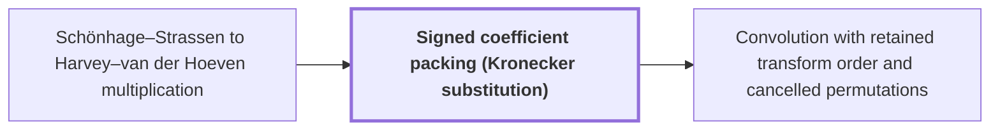

# Signed coefficient packing (Kronecker substitution)

!!! info "Before this page"

    Signed coefficient packing (Kronecker substitution) *computes its integer products by* [Schönhage–Strassen to Harvey–van der Hoeven multiplication](ss-hh-background.md "Signed coefficient packing computes its integer products by the Schönhage–Strassen to Harvey–van der Hoeven multiplication, an ordinary subroutine call that costs $O(n\log n)$."). Assumed known: Polynomials.

!!! abstract "Where this fits"

    1. An $n$-bit integer product is computed by a fixed-tape machine in $O(n(\lg n)^{1-\kappa})$ time, $\kappa=2^{-182}$. — how: reduce multiplication to ring convolution and speed up its address moves and butterfly layers ([Integer multiplication in O(n(lg n)^{1-κ}) time](main-theorem.md "Deterministic fixed-tape Turing machine multiplying n-bit integers in O(n(lg n)^{1-κ}), κ=2^{-182}, by reducing to ring convolution with fast address interchanges and simultaneous butterfly layers, disproving the n log n conjecture in this model."))
    2. Convolution over $\mathbb C[y]/(y^r+1)$ on the remaining axes is computed by synthetic transforms and packed polynomial products. — how: use two forward transforms, a pointwise product and the opposite transform, with retained frequency order ([Convolution with retained transform order and cancelled permutations](ring-convolution-retained-order.md "Two forward synthetic transforms keep the same frequency order through the pointwise product, and the opposite transform consumes it, so retained permutations cancel without separate sorts."))
    3. **This page:** Polynomial products use signed packing and the ordinary $O(n\log n)$ multiplier as a subroutine.

??? note "Symbols from earlier pages"

    - $p$ — working precision: The number of bits of precision, the power of two 2^p in each numerator's denominator. (on [Fixed-point precision and exact recovery](fixed-point-precision.md "Complex fixed-point coefficients; bounding error below 1/2 so rounding recovers exact integer coefficients and carry propagation yields the product."))
    - $y$ — ring variable: The polynomial variable of the ring, whose powers act as roots of unity. (on [Polynomial ring modulo $y^r+1$](poly-ring-y-r.md "Complex-coefficient polynomials in y reduced by y^r = -1, so multiplying by a power of y is a signed shift of the coefficient list and powers of y serve as roots of unity."))
    - $r$ — ring degree: The number of complex coefficients in each element of the ring, a power of two. (on [Polynomial ring modulo $y^r+1$](poly-ring-y-r.md "Complex-coefficient polynomials in y reduced by y^r = -1, so multiplying by a power of y is a signed shift of the coefficient list and powers of y serve as roots of unity."))
    - $T$ — power-of-two length: The power of two in [4n/b, 8n/b), the number of points in the power-of-two grid. (on [Fixed-point precision and exact recovery](fixed-point-precision.md "Complex fixed-point coefficients; bounding error below 1/2 so rounding recovers exact integer coefficients and carry propagation yields the product."))
    - $n$ — integer length: The number of bits in each of the two integers being multiplied. (on [The n log n optimality conjecture](nlogn-conjecture.md "Schönhage–Strassen's proposal that n log n is the optimal order of cost for multiplying n-bit integers."))

Signed coefficient packing (Kronecker substitution) encodes a polynomial with integer coefficients of either sign as one integer, so that a polynomial product becomes an integer product, which an ordinary $O(n\log n)$ multiplier computes.

Let $p$ be the working precision of the fixed-point page, so each coefficient of an input polynomial is an integer of absolute value at most $2^p$. Let $\Theta=2^{4p}$ be the block base. Each block is $4p$ bits wide<cite class="exegenius-ref" data-source="paper" data-locator="§7 Exact normalized polynomial products" data-quote="Every block has $4p$ bits" title="Every block has $4p$ bits"> (see §7 Exact normalized polynomial products)</cite>. Here $o$ and $\tau$ are coefficient positions, with $0\le o,\tau<r$.

Let $J=\sum_{o=0}^{r-1}J_o y^o$ denote a polynomial in $\mathbb Z[y]$ with $|J_o|\le 2^p$; its packed integer is $J(\Theta)=\sum_{o=0}^{r-1}J_o\Theta^{o}$.

Evaluation respects products. Let $\Delta=\sum_{\tau=0}^{r-1}\Delta_\tau y^\tau$ denote a second input polynomial with $|\Delta_\tau|\le 2^p$. Then $J(\Theta)\,\Delta(\Theta)=(J\Delta)(\Theta)$ exactly, where $J\Delta$ is the ordinary product in $\mathbb Z[y]$. Signed coefficient packing computes its integer products by the [Schönhage–Strassen to Harvey–van der Hoeven multiplication](ss-hh-background.md "Chain of multitape algorithms from O(n log n log log n) to the unconditional O(n log n) bound, using transforms over rings with cheap roots of unity."), an ordinary subroutine call that costs $O(n\log n)$.

Recovering the coefficients. Write $\Upsilon=J\Delta$, and $\Upsilon_\eta$ for its coefficient of $y^\eta$, with $\eta$ running over $0,\dots,2r-2$. Each $\Upsilon_\eta$ sums at most $r$ products $J_o\Delta_\tau$, so $|\Upsilon_\eta|\le r2^{2p}$. Recovery needs $|\Upsilon_\eta|<\Theta/2$, which holds because $r<2^p$: the ring degree is at most the padded length, $r\le T$<cite class="exegenius-ref" data-source="paper" data-locator="§9.2.2 Prime source lengths" data-quote="t_i\leq r\leq T&lt;8n/b&lt;2^{6b}=2^p" title="t_i\leq r\leq T&lt;8n/b&lt;2^{6b}=2^p"> (see §9.2.2 Prime source lengths)</cite>, and $T<2^p$ for sufficiently large inputs by the choice of $p$ on the fixed-point page. Hence $|\Upsilon_\eta|\le r2^{2p}<2^{3p}<\Theta/2$. Since every $\Upsilon_\eta\Theta^\eta$ with $\eta\ge 1$ is a multiple of $\Theta$, $\Upsilon(\Theta)\equiv\Upsilon_0 \pmod{\Theta}$. As $|\Upsilon_0|<\Theta/2$, $\Upsilon_0$ is the unique integer in $[-\Theta/2,\Theta/2)$ congruent to $\Upsilon(\Theta)$ modulo $\Theta$. Subtracting it and dividing by $\Theta$ leaves the same form for $\Upsilon_1,\Upsilon_2,\dots$.

Example with $\Theta=12$. For $J=2-y$ and $\Delta=1+3y$, $J(12)=-10$ and $\Delta(12)=37$, so the packed product is $-370$. Recovery gives $\Upsilon_0=2$, $\Upsilon_1=5$, $\Upsilon_2=-3$, so $\Upsilon=2+5y-3y^2$.

Gaussian products. A record is a polynomial of degree less than $r$ with complex fixed-point coefficients. A record $\Xi=2^{-p}(a_r+\sqrt{-1}\,b_i)$ has real and imaginary components $a_r,b_i\in\mathbb Z[y]$. Records have norm at most one, so their parts lie in $[-1,1]$<cite class="exegenius-ref" data-source="paper" data-locator="§6 Synthetic transforms and their tape layout" data-quote="A disk array has norm at most one." title="A disk array has norm at most one."> (see §6 Synthetic transforms and their tape layout)</cite>. Truncation puts each part on the grid $2^{-p}\mathbb Z$, so $2^p$ times each part is an integer, and its coefficients are at most $2^p$ in absolute value<cite class="exegenius-ref" data-source="paper" data-locator="§5.4 An explicit guard-width bound" data-quote="The truncated numerators have magnitude at most $2^p$" title="The truncated numerators have magnitude at most $2^p$"> (see §5.4 An explicit guard-width bound)</cite>. The second record $\Gamma=2^{-p}(c_r+\sqrt{-1}\,c_i)$ has components $c_r,c_i\in\mathbb Z[y]$, and the product is $(a_r+\sqrt{-1}\,b_i)(c_r+\sqrt{-1}\,c_i)=(a_rc_r-b_ic_i)+\sqrt{-1}\,(a_rc_i+b_ic_r)$.
The four ordinary products $a_rc_r$, $b_ic_i$, $a_rc_i$, $b_ic_r$ are each one packed product. Each is unpacked to exact coefficients before subtraction or addition, so the bound $|\Upsilon_\eta|<\Theta/2$ holds for each product, not for the sums.

## Connections

Used by:

- [Convolution with retained transform order and cancelled permutations](ring-convolution-retained-order.md "This convolution computes its products through Signed coefficient packing (Kronecker substitution): polynomial products are packed into integers and multiplied by the ordinary $O(n\log n)$ multiplier as a subroutine.") *computes its products through* Signed coefficient packing (Kronecker substitution)

??? quote "From the sources"

    > Signed coefficient
    >
    > — [Integer multiplication below n log n (OpenAI, 2026)](https://github.com/openai/math/tree/fd4aeeb2ee4fc729c18d98444fed42fd0529eeeb/preprints/Integer-multiplication-below-n-log-n-September-23-2026)
