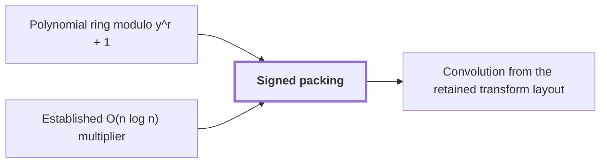

# Signed packing

!!! info "Before this page"

    Signed packing *multiplies in* [Polynomial ring modulo y^r + 1](ring-y.md "It multiplies in the Polynomial ring modulo y^r + 1 in $O(rp\log(rp))$ time, where $p$ is the number of fractional bits of each coefficient.") and *multiplies absolute values with* [Established O(n log n) multiplier](hvdh-multiplier.md "The multiplier takes nonnegative integers, so signed packing multiplies the four pairs of absolute values with the Established O(n log n) multiplier, restoring each sign, to obtain $A_aA_c,A_bA_e,A_aA_e,A_bA_c$.").

!!! abstract "Where this fits"

    1. A single deterministic Turing machine with a fixed finite alphabet and a fixed finite number of one-dimensional tapes multiplies two $n$-bit integers exactly in $O(n(\lg n)^{1-\kappa})$ worst-case time with $\kappa=2^{-182}$, disproving the $n\log n$ optimality conjecture of Sch\"onhage and Strassen in this model. — how: Build two power-saving tape procedures (chunk interchange and simultaneous butterfly layer) from fixed finite linear networks; use them to accelerate the synthetic polynomial transforms and ring convolution; use Gaussian resampling with retained permutations and chirps to reduce the prime-length cyclic convolution of the radix-digit coefficients to those power-of-two transforms; assemble the exact product with a proof that the error is below $1/2$; and total the cost to show a power of $\log n$ is saved. ([Power-saving integer multiplication](main-result.md "A deterministic fixed-tape Turing machine multiplying two n-bit integers exactly in O(n(lg n)^{1−κ}) time with κ = 2^{−182}, disproving the n log n optimality conjecture in this model."))
    2. Normalized cyclic convolution over the polynomial ring $\mathbb C[y]/(y^r+1)$ on the remaining $d-1$ axes is computed from two forward synthetic transforms in retained order, $M$ pointwise polynomial products and the opposite transform, in $O(Tp[dK+pK^{\tau-1}+\ell d^{\lambda'}+\log(rp)])$ time with error less than $\sqrt2\,M(3\ell+1)2^{-p}$. — how: Convolve by transform, pointwise product, inverse transform, using the established $O(N\log N)$ multiplier as an ordinary subroutine for the polynomial products via signed Kronecker substitution, and keep the transforms' frequency order between the forward and opposite passes. ([Convolution from the retained transform layout](ring-convolution.md "Convolution over the ring modulo y^r + 1 on the remaining axes by two forward synthetic transforms, pointwise polynomial products and the opposite transform, normalized by 1/(rM)."))
    3. **This page:** For disk-grid polynomials $f,g\in\mathcal R_r$ the exact Gaussian-integer numerators of $fg$, and then $Q_p(fg/r)$, are computed in $O(rp\log(rp))$ time using four integer products by the established multiplier at packing base $B_0=2^{4p}$.

??? note "Symbols from earlier pages"

    - $p$ — fractional bits: The number of fractional bits of the grid on which stored values lie. (on [Fixed-point Gaussian dyadic records](fixed-point.md "Complex values stored as signed two's-complement integers over a power-of-two denominator 2^{-p}; intermediate values are exact and one truncation Q_p rounds back to the p-bit grid."))
    - $r$ — record length: The number of complex coefficients in a polynomial of the ring, always a power of two. (on [Polynomial ring modulo y^r + 1](ring-y.md "Polynomials of degree below r over the complex numbers with y^r = −1, so multiplying by a power of y is a signed shift of the coefficient list."))
    - $y$ — ring variable: The indeterminate of the polynomials; it satisfies y^r = -1 in the ring. (on [Polynomial ring modulo y^r + 1](ring-y.md "Polynomials of degree below r over the complex numbers with y^r = −1, so multiplying by a power of y is a signed shift of the coefficient list."))
    - $\mathcal R_r$ — negacyclic ring: The ring of polynomials in y modulo y^r+1 over the complex numbers. (on [Phase twist](phase-twist.md "Multiplying coefficient k by e^{πik/r}, which converts the cyclic coordinate modulo x^r − 1 into the negacyclic ring modulo y^r + 1 and is removed afterwards."))
    - $Q_p$ — truncation: The truncation that drops the bits below 2^{-p} in each real and imaginary part, returning a record to the p-bit grid. (on [Fixed-point Gaussian dyadic records](fixed-point.md "Complex values stored as signed two's-complement integers over a power-of-two denominator 2^{-p}; intermediate values are exact and one truncation Q_p rounds back to the p-bit grid."))

Signed packing is a signed Kronecker substitution: it multiplies polynomials with signed integer coefficients by evaluating them at a power of two, multiplying the resulting integers, and reading the coefficients back. It multiplies in the [Polynomial ring modulo y^r + 1](ring-y.md "Polynomials of degree below r over the complex numbers with y^r = −1, so multiplying by a power of y is a signed shift of the coefficient list.") in $O(rp\log(rp))$ time, where $p$ is the number of fractional bits of each coefficient.

Assume $r<2^p$. Let $f,g$ be polynomials of the ring, written $\mathcal R_r$, whose coefficients are $2^{-p}$ times Gaussian integers of modulus at most $2^p$. Write $f=2^{-p}(a+ib)$ and $g=2^{-p}(c+ie)$, where $a,b,c,e$ (letters that change meaning here) are integer-coefficient polynomials of degree below $r$ with coefficients of absolute value at most $2^p$. Set $B_0=2^{4p}$, the packing base.

For $u\in\{a,b,c,e\}$ with coefficients $u_j$, let $A_u=u(B_0)=\sum_{j<r}u_jB_0^j$ be the signed evaluation integer. By the geometric sum, $|A_u|\le2^p(B_0^r-1)/(B_0-1)<B_0^r/2$, so its magnitude fits in $4pr$ bits.

To form $A_u$, scan the coefficients with a carry $\gamma_j$, starting from $\gamma_0=0$. Let $d_j\in[0,B_0)$ be the residue of $u_j+\gamma_j$ modulo $B_0$ and put $\gamma_{j+1}=(u_j+\gamma_j-d_j)/B_0$. Since $-B_0<u_j+\gamma_j<B_0$ whenever $\gamma_j\in\{-1,0\}$, the carry stays in $\{-1,0\}$. Telescoping gives $A_u=\sum_{j<r}d_jB_0^j+\gamma_rB_0^r$, so the blocks $d_j$ are a fixed-width two's-complement encoding of $A_u$. If $\gamma_r=0$ then $A_u\ge0$ and the blocks are $|A_u|$. If $\gamma_r=-1$ then $A_u<0$, and the blocks read as $A_u+B_0^r$. Since $B_0^r=2^{4pr}$, complementing every bit and adding $1$ gives $B_0^r-(A_u+B_0^r)=|A_u|$.

The multiplier takes nonnegative integers, so signed packing multiplies the four pairs of absolute values with the [Established O(n log n) multiplier](hvdh-multiplier.md "The earlier Harvey–van der Hoeven multitape algorithm multiplying N-bit integers in O(N log N) time, used here only as an ordinary subroutine."), restoring each sign, to obtain $A_aA_c,A_bA_e,A_aA_e,A_bA_c$. A product is negative when exactly one operand is. For the ordinary product $h=ac$ of integer polynomials, let $h_j$ be its coefficient of $y^j$ and pad $h_{2r-1}=0$. Then $A_aA_c=(ac)(B_0)=\sum_{j<2r}h_jB_0^j$. Each $h_j$ sums at most $r$ products of coefficients of size at most $2^p$, so $|h_j|\le r2^{2p}<2^{3p}<B_0/2$. So after removing lower coefficients, the next is identified by its centered residue modulo $B_0$<cite class="exegenius-ref" data-source="paper" data-locator="§7 Exact normalized polynomial products" data-quote="this strict bound identifies the next coefficient by its centered residue modulo $B_0$" title="this strict bound identifies the next coefficient by its centered residue modulo $B_0$"> (see §7 Exact normalized polynomial products)</cite>.

Take a product integer $Z=\sum_{j<2r}h_jB_0^j$. Because $|Z|<B_0^{2r}/4$, zero-filling high blocks and, for a negative sign, complementing and incrementing converts it to $Z=\sum_{j<2r}q_jB_0^j+\varepsilon B_0^{2r}$ with blocks $0\le q_j<B_0$ and $\varepsilon\in\{-1,0\}$. Put $\rho_0=0$, and let $\rho_j$ be the carry into block $j$ and $\widehat h_j$ be the unique integer in $[-B_0/2,B_0/2)$ congruent to $q_j+\rho_j$ modulo $B_0$<cite class="exegenius-ref" data-source="paper" data-locator="§7 Exact normalized polynomial products" data-quote="integer in $[-B_0/2,B_0/2)$ congruent to $q_j+\rho_j$ modulo $B_0$," title="integer in $[-B_0/2,B_0/2)$ congruent to $q_j+\rho_j$ modulo $B_0$,"> (see §7 Exact normalized polynomial products)</cite> and $\rho_{j+1}=(q_j+\rho_j-\widehat h_j)/B_0$. The carry is in $\{0,1\}$, since $q_j+\rho_j\in[0,B_0]$. If $\widehat h_i=h_i$ for $i<j$, then $\sum_{i<j}q_iB_0^i=\sum_{i<j}h_iB_0^i+\rho_jB_0^j$, so $q_j+\rho_j\equiv h_j$ modulo $B_0$. Since $h_j\in[-B_0/2,B_0/2)$, $\widehat h_j=h_j$.

The real and imaginary numerator streams are $ac-be$ and $ae+bc$. Since $y^{j+r}=-y^j$, reduce modulo $y^r+1$ by subtracting the coefficient at $j+r$ from the one at $j$ for $0\le j<r$. Let $H_j$ be the resulting Gaussian integer coefficient. For each index $j_1$ of the first factor, exactly one index $j_2$ of the second has $j_1+j_2\equiv j\pmod r$, signed $+$ if $j_1+j_2=j$ and $-$ otherwise. So $H_j$ is a sum of exactly $r$ signed products of coefficients of modulus at most $2^p$, hence $|H_j|\le r2^{2p}$.

Each coefficient of $fg/r$ is $2^{-2p}H_j/r$, of modulus at most $1$, so the normalized product of disk polynomials lies in the disk. Signed packing returns $Q_p(2^{-2p}H_j/r)$, shifting the magnitudes of the real and imaginary parts of $H_j$ right by $p+\log_2 r$ bits, an $O(p)$ step. Each part loses less than $2^{-p}$, so the error is less than $\sqrt2\,2^{-p}$ from $fg/r$<cite class="exegenius-ref" data-source="paper" data-locator="§7 Exact normalized polynomial products" data-quote="with error less than $\sqrt2\,2^{-p}$ from $fg/r$" title="with error less than $\sqrt2\,2^{-p}$ from $fg/r$"> (see §7 Exact normalized polynomial products)</cite>.

Every other stage is a constant number of scans of tapes holding $O(rp)$ bits, with a constant-size carry between blocks: forming the $A_u$, complementing, converting each $Z$, extracting the $\widehat h_j$, and the subtraction, after splitting the halves onto separate tapes to align coefficients $j$ and $j+r$. Each multiplier input has at most $4pr$ bits, so each product costs $O(rp\log(rp))$. Four exact integer products therefore dominate the linear packing, extraction, combination, wrapping and truncation costs, so the total is $O(rp\log(rp))$<cite class="exegenius-ref" data-source="paper" data-locator="§7 Exact normalized polynomial products" data-quote="in time $O(rp\log(rp))$ on a fixed number of tapes" title="in time $O(rp\log(rp))$ on a fixed number of tapes"> (see §7 Exact normalized polynomial products)</cite>.

## Connections

Used by:

- [Convolution from the retained transform layout](ring-convolution.md "Each record product is formed by Signed packing in $O(rp\log(rp))$ time and truncated by $Q_p$ to the $2^{-p}$ grid, which keeps it in the disk.") *forms each record product by* Signed packing

??? quote "From the sources"

    > Signed coefficient
    >
    > — [Integer multiplication below n log n (OpenAI, 2026)](https://github.com/openai/math/tree/fd4aeeb2ee4fc729c18d98444fed42fd0529eeeb/preprints/Integer-multiplication-below-n-log-n-September-23-2026)

    > Signed packing and normalized ring multiplication
    >
    > — [Integer multiplication below n log n (OpenAI, 2026)](https://github.com/openai/math/tree/fd4aeeb2ee4fc729c18d98444fed42fd0529eeeb/preprints/Integer-multiplication-below-n-log-n-September-23-2026)
