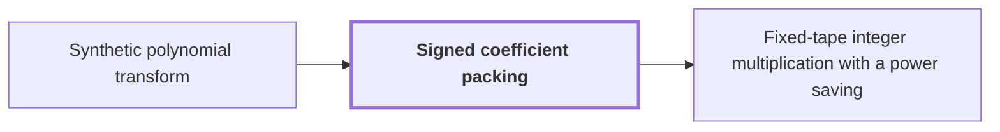

# Signed coefficient packing

!!! info "Before this page"

    Signed coefficient packing *turns the polynomial products of* [Synthetic polynomial transform](synthetic-transform.md "Signed coefficient packing turns the polynomial products of the synthetic polynomial transform into integer products, so they run on an integer multiplier."). Assumed known: Polynomials.

!!! abstract "Where this fits"

    1. The integer product is computed exactly on one fixed-tape machine in $O(n(\lg n)^{1-\kappa})$ worst-case time, for $\kappa=2^{-182}$. — how: reduce exact multiplication to convolution of radix digits on distinct prime axes, compute the convolution by synthetic transforms on tape layouts, and bound the total tape cost with a power saving ([Fixed-tape integer multiplication with a power saving](fixed-tape-multiplication.md "A deterministic fixed-tape Turing machine that multiplies two n-bit integers exactly in O(n(lg n)^(1−κ)) worst-case time, for a fixed κ = 2^(−182), disproving the n log n optimality conjecture in this model."))
    2. Normalized cyclic convolution on the power-of-two axes is computed over the polynomial ring $\mathbb C[y]/(y^r+1)$ by synthetic transforms and packed polynomial products. — how: phase twist of the last coordinate into the polynomial ring, synthetic transforms on retained layouts, pointwise product, then signed packing with the established multiplier ([Synthetic polynomial transform](synthetic-transform.md "A discrete Fourier transform whose roots of unity are powers of y in the polynomial ring, so that each twiddle multiplication is a signed shift and the transform is computed by simultaneous butterfly layers."))
    3. **This page:** Polynomial products are computed by signed packing and the established $O(n\log n)$ multiplier used as a subroutine.

??? note "Symbols from earlier pages"

    - $x$ — formal variable: The formal variable whose powers index the coefficients of a list. (on [Cyclic convolution](cyclic-convolution.md "The product of two coefficient lists in the ring of polynomials modulo x^S − 1, in which exponents wrap around modulo S."))
    - $i$ — coefficient index: The index of a coefficient, running from 0 to r-1. (on [Polynomial ring modulo yʳ + 1](polynomial-ring.md "The ring of complex polynomials of degree less than r, with multiplication reduced modulo y^r + 1; multiplication by a power of y permutes and sign-changes the coefficient list."))

Signed coefficient packing encodes a polynomial with signed integer coefficients as one integer, so that a polynomial product becomes an integer product. This is also called Kronecker substitution<cite class="exegenius-ref" data-source="paper" data-locator="§1.5 Historical context and inherited methods" data-quote="Signed coefficient packing is a form of Kronecker substitution" title="Signed coefficient packing is a form of Kronecker substitution"> (see §1.5 Historical context and inherited methods)</cite>. Signed coefficient packing turns the polynomial products of the [synthetic polynomial transform](synthetic-transform.md "A discrete Fourier transform whose roots of unity are powers of y in the polynomial ring, so that each twiddle multiplication is a signed shift and the transform is computed by simultaneous butterfly layers.") into integer products, so they run on an integer multiplier.

Let $P(x)=\sum_{i=0}^{M-1}\gamma_i x^i$ be a polynomial in $x$, where $M$ is the number of coefficients of $P$ and $\gamma_i$ is the integer coefficient of $x^i$. Each slot has width $\sigma$, the number of bits it holds, and each $|\gamma_i|<2^{\sigma-1}$.

The packed integer of $P$ is $N_P=P(2^\sigma)=\sum_{i=0}^{M-1}\gamma_i 2^{\sigma i}$, so coefficient $\gamma_i$ sits at bit offset $\sigma i$. Because a negative $\gamma_i$ borrows from the slot above, the binary digits of $N_P$ do not show the signs. Decoding reads each slot as the integer in $[-2^{\sigma-1},2^{\sigma-1})$ congruent to the remaining value modulo $2^\sigma$, subtracts it, and divides by $2^\sigma$.

Let $Q$ be a second polynomial, with packed integer $N_Q=Q(2^\sigma)$. Evaluating at $2^\sigma$ turns products into products, so $N_P N_Q=(PQ)(2^\sigma)$. Decoding $N_P N_Q$ recovers $PQ$ when every coefficient of $PQ$ also lies in $[-2^{\sigma-1},2^{\sigma-1})$.

Each of $N_P$ and $N_Q$ has about $M\sigma$ bits, since each is a sum of $M$ slots of $\sigma$ bits. The packed form of $PQ$ has $2M-1$ slots, so at most $2M\sigma$ bits, and the product of two $M\sigma$-bit integers has at most $2M\sigma$ bits. So one integer product has room for every slot of $PQ$, and one integer product computes the whole polynomial product. The product $N_P N_Q$ is computed by the [established fast multiplier](multiplier-subroutine.md "The known deterministic O(n log n) multiplication algorithm of Harvey and van der Hoeven, used as a black-box subroutine on shorter integers.") as an ordinary subroutine call.

For example, take $M=3$ and $\sigma=4$, with $P(x)=1-2x+3x^2$ and $Q(x)=2+x$. Then $N_P=737$, $N_Q=18$ and $N_PN_Q=13266$. The product $PQ=2-3x+4x^2+3x^3$ has coefficients in $[-8,8)$, and $2-3\cdot 16+4\cdot 256+3\cdot 4096=13266$, so the integer product is the packed form of $PQ$.

## Connections

Used by:

- [Fixed-tape integer multiplication with a power saving](fixed-tape-multiplication.md "It packs signed coefficients by Signed coefficient packing, so that polynomial products become integer products.") *packs signed coefficients by* Signed coefficient packing

??? quote "From the sources"

    > Signed coefficient packing is a form of Kronecker substitution
    >
    > — [Integer multiplication below n log n (OpenAI, 2026)](https://github.com/openai/math/tree/fd4aeeb2ee4fc729c18d98444fed42fd0529eeeb/preprints/Integer-multiplication-below-n-log-n-September-23-2026)
