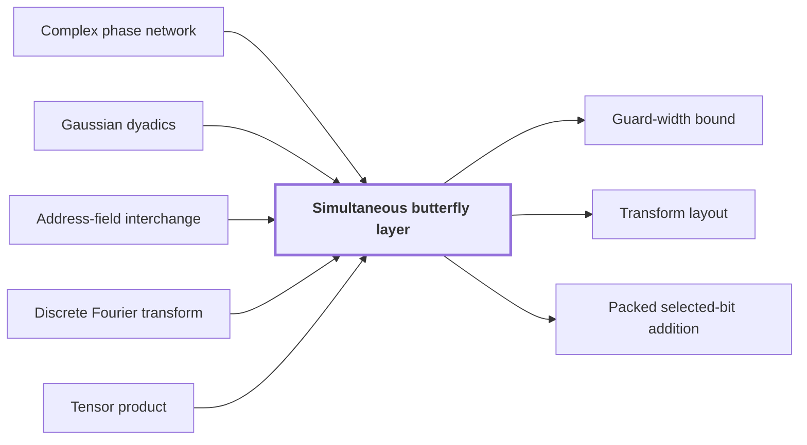

# Simultaneous butterfly layer

!!! info "Before this page"

    Simultaneous butterfly layer *is realized by* [Complex phase network](complex-phase-network.md "The layer's complex form $C^{\otimes D}$ is realized by a complex phase network with dyadic frame changes."), *keeps its intermediate values exact in* [Gaussian dyadics](glossary.md#gaussian-dyadics "The layer keeps its intermediate values exact in Gaussian dyadics."), *moves its address chunks by* [Address-field interchange](address-interchange.md "The layer moves its address chunks by address-field interchange, which realizes these changes of basis."), *is built from* [Discrete Fourier transform](discrete-fourier-transform.md "The layer is built from the normalized discrete Fourier transform of length 2, namely $H_0$, applied to each selected bit.") and *is formed as a* [Tensor product](glossary.md#tensor-product "On $D$ selected bits, the layer is formed as a tensor product of $H_0$ with itself $D$ times, so each output combines all $2^D$ values that agree with it on the unselected bits.").

!!! abstract "Where this fits"

    1. A deterministic fixed-tape machine multiplies two $n$-bit integers exactly in $O(n(\lg n)^{1-\kappa})$ time, with $\kappa=2^{-182}$, below the $n\lg n$ conjecture in this model. — how: bound the cost of an exact multiplication whose transform layers are made cheap by two tape procedures, then fix parameters so every cost term fits ([Integer multiplication below n log n](main-theorem.md "A deterministic fixed-tape machine that multiplies two n-bit integers exactly in O(n (lg n)^(1−κ)) time with κ = 2^−182, which disproves the n log n optimality conjecture in this model."))
    2. **This page:** A simultaneous normalized butterfly layer on $d$ selected chunks of stored volume $V$ costs $O(V d^{\lambda'})$.

??? note "Symbols from earlier pages"

    - $I$ — identity on two points: The identity map on a pair of points, which leaves both coordinates unchanged. (on [Complex phase network](complex-phase-network.md "A subset-intersection network whose frame change on each edge is a product of two-point kernels aI + bX on Gaussian dyadic values."))
    - $X$ — swap on two points: The map on a pair of points that exchanges its two coordinates. (on [Complex phase network](complex-phase-network.md "A subset-intersection network whose frame change on each edge is a product of two-point kernels aI + bX on Gaussian dyadic values."))
    - $V$ — stored volume: The number of bits the array stores. (on [Address-field interchange](address-interchange.md "A tape procedure that swaps two disjoint contiguous address fields of an array in time that grows like a power of the field width, rather than linearly."))

A simultaneous butterfly layer applies the two-point map $H_0$ to several selected address bits at once, in one exact pass over the array, instead of one pass per selected axis. It is the step that makes the transforms of the multiplication cheap.

On the address layout of the multiplication algorithm, the same bit position is selected in each of at most $d$ equal-width address chunks. The layer acts on $D$ selected chunks, where $1 \le D \le d$. It acts coefficientwise on the polynomial record at each address and preserves all other address fields.

The two-point map $H_0$ sends a pair with first input $z_0$ and second input $z_1$ to half their sum and half their difference: $H_0(z_0,z_1) = ((z_0+z_1)/2,\ (z_0-z_1)/2)$. The layer is built from the normalized [discrete Fourier transform](discrete-fourier-transform.md "The map sending a vector of q values to its q values weighted by powers of a q-th root of unity, normalized by 1/q.") of length 2, namely $H_0$, applied to each selected bit. On $D$ selected bits, the layer is formed as a [tensor product](glossary.md#tensor-product "The product of vector spaces, whose basis is formed by pairing basis vectors of the factors, so that a tensor power of a space collects several copies of it.") of $H_0$ with itself $D$ times, so each output combines all $2^D$ values that agree with it on the unselected bits. For $D=2$, the four values $z_{00}, z_{01}, z_{10}, z_{11}$, indexed by the two selected bits, become four sums and differences, each divided by 4. The value at index $00$ becomes $(z_{00}+z_{01}+z_{10}+z_{11})/4$.

Applying $H_0$ one selected bit at a time would take $D$ full passes over the array, one scan per selected axis. The point of the layer is to apply all $D$ bits in one pass, which avoids paying a full scan for each selected axis.

The method has two steps. The complex two-point kernel $C = aI + bX$ is a $2\times 2$ complex matrix. The layer's complex form $C^{\otimes D}$ is realized by a [complex phase network](complex-phase-network.md "A subset-intersection network whose frame change on each edge is a product of two-point kernels aI + bX on Gaussian dyadic values.") with dyadic frame changes.<cite class="exegenius-ref" data-source="paper" data-locator="§11 A consequence for matrix transposition, p. 26" data-quote="Its phase frames express a C tensor product using smaller groups of selected bits, separated by binary changes of basis." title="Its phase frames express a C tensor product using smaller groups of selected bits, separated by binary changes of basis."> (see §11 A consequence for matrix transposition, p. 26)</cite>

The second step turns this into $H_0$ with phases. Let $S$ be the diagonal $2\times 2$ matrix with diagonal entries $1$ and $i$. Multiplying out the $2\times 2$ matrices shows that $H_0$ on one bit is $SCS$ up to a scalar. The scalar $\beta_D$ is a power of $\tfrac12$ times a fourth root of unity, with at most one further factor $b$. The diagonal map $S_D$ multiplies the value at each address by $i$ raised to the number of selected bits equal to 1. Together these give

$$H_0^{\otimes D} = \beta_D\, S_D\, C^{\otimes D}\, S_D.$$

The layer keeps its intermediate values exact in [Gaussian dyadics](glossary.md#gaussian-dyadics "Complex numbers whose real and imaginary parts are integers divided by a power of two, with the Gaussian integer part also an integer.").<cite class="exegenius-ref" data-source="paper" data-locator="§11 A consequence for matrix transposition, p. 26" data-quote="These identities use only Gaussian dyadic coefficients." title="These identities use only Gaussian dyadic coefficients."> (see §11 A consequence for matrix transposition, p. 26)</cite>

The frame changes between groups of selected bits are binary changes of basis. The layer moves its address chunks by [address-field interchange](address-interchange.md "A tape procedure that swaps two disjoint contiguous address fields of an array in time that grows like a power of the field width, rather than linearly."), which realizes these changes of basis.

The phase frames split the selected bits into smaller groups, so each recursive call handles a smaller volume. Here $\lambda'$ is a fixed exponent below 1, so the cost grows more slowly than $d$ full passes over the array. The layer costs $O(V d^{\lambda'})$<cite class="exegenius-ref" data-source="paper" data-locator="§11 A consequence for matrix transposition, p. 26" data-quote="We will obtain cost O(V dλ ), with λ′ &lt; 1" title="We will obtain cost O(V dλ ), with λ′ &lt; 1"> (see §11 A consequence for matrix transposition, p. 26)</cite>.

## Connections

Used by:

- [Guard-width bound](guard-width-bound.md "A guard-width bound is an explicit number of extra bits that bounds the intermediate coefficients of a simultaneous butterfly layer and makes them exact, so that one truncation at the end suffices.") *bounds the intermediate coefficients of* Simultaneous butterfly layer
- [Transform layout](transform-layout.md "It feeds the Simultaneous butterfly layer its bits in this form.") *feeds* Simultaneous butterfly layer
- [Packed selected-bit addition](packed-bit-addition.md "It supplies the binary basis changes for the simultaneous butterfly layer, whose exact computation needs them.") *supplies the binary basis changes for* Simultaneous butterfly layer

??? quote "From the sources"

    > a common butterfly layer on several axes
    >
    > — Integer multiplication below n log n (OpenAI, 2026)
