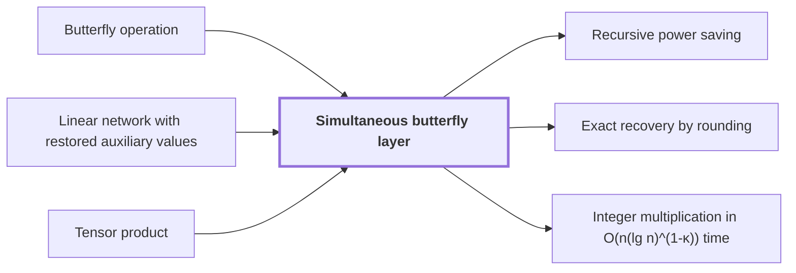

# Simultaneous butterfly layer

!!! info "Before this page"

    Simultaneous butterfly layer *applies* [Butterfly operation](butterfly-operation.md "A simultaneous butterfly layer applies the butterfly operation to one selected address bit of every record at once."), *computes its chunk moves by* [Linear network with restored auxiliary values](linear-network-exchange.md "The layer computes its chunk moves by the linear network with restored auxiliary values, which carries each input role to an output role with a prescribed sign and restores every auxiliary value.") and *is formed as* [Tensor product](glossary.md#tensor-product "The layer is formed as the tensor product of $D$ copies of the butterfly operation, one for each selected bit, acting on each coefficient and leaving the other address bits unchanged."). Assumed known: Complex numbers.

!!! abstract "Where this fits"

    1. Two $n$-bit integers can be multiplied exactly in $O(n(\lg n)^{1-\kappa})$ worst-case time on a deterministic multitape Turing machine, for a fixed $\kappa=2^{-182}$. — how: reduce the product to a digit convolution, compute that convolution through transform layers whose tape cost saves a power, and recover the exact product by rounding ([Integer multiplication in O(n(lg n)^(1-κ)) time](integer-multiplication-target.md "A deterministic multitape Turing machine that multiplies two n-bit integers exactly in O(n(lg n)^(1-κ)) worst-case time for a fixed κ = 2^(-182) > 0, beating the n log n conjecture in this model."))
    2. Both tape procedures cost $O(V)$ times a power of their parameter whose exponent is strictly below one. — how: give each procedure a fixed linear network with fewer smaller calls than roles, and iterate the resulting recursion ([Recursive power saving](recursive-power-saving.md "The mechanism in which a network with s smaller calls on W roles and parameter m gives a recursion with cost ratio s/W < m, so that repeated recursion saves a power of the parameter."))
    3. **This page:** A simultaneous butterfly layer on $d$ chunks costs $O(Vd^{\lambda'})$ for a fixed $\lambda'<1$.

??? note "Symbols from earlier pages"

    - $V$ — stored bit volume: The number of data bits the array holds. (on [Fast address interchange](address-interchange.md "A tape procedure that swaps two disjoint contiguous address fields of an array in time O(V u^τ) for width u, computed through XOR combinations of intermediate data."))

A simultaneous butterfly layer applies the [butterfly operation](butterfly-operation.md "The two-point map (u, v) ↦ ((u + v)/2, (u − v)/2) applied to a pair of values, the basic step of a fast transform.") to one selected address bit of every record at once. It is the transform step of the [target multiplication algorithm](integer-multiplication-target.md "A deterministic multitape Turing machine that multiplies two n-bit integers exactly in O(n(lg n)^(1-κ)) worst-case time for a fixed κ = 2^(-182) > 0, beating the n log n conjecture in this model.") whose tape cost must save a power, so the layer's cost is what the proof has to bound.

An address chunk is a block of consecutive address bits. Here $d$ is the largest number of equal-width chunks a layer acts on, and $D \le d$ is the number used in one layer; the letter $D$ changes meaning here. The layer selects the same bit position in each of those $D$ chunks.

Each record is a polynomial with complex fixed-point coefficients, each stored with a fixed number of binary places. The layer is formed as the [tensor product](glossary.md#tensor-product "The tensor product V ⊗ W of two vector spaces, whose basis consists of all pairs of basis vectors of V and W, together with the tensor product A ⊗ B of linear maps, which acts on each coordinate separately.") of $D$ copies of the butterfly operation, one for each selected bit, acting on each coefficient and leaving the other address bits unchanged. Intermediate values are exact Gaussian dyadics, complex numbers whose real and imaginary parts have power-of-two denominators, so the division by two in the butterfly causes no rounding; one truncation follows the completed layer.

Applying the $D$ factors one at a time takes one pass over the array per selected bit. A pass that touches all $V$ stored bits costs $O(V)$ steps, so this method costs $O(VD)$, at most $O(Vd)$. Here $\lambda'$ is a fixed exponent below one. The layer runs in $O(Vd^{\lambda'})$ tape steps<cite class="exegenius-ref" data-source="paper" data-locator="§1.1 The two tape operations" data-quote="the cost is $O(Vd^{\lambda'})$ for a fixed $\lambda'&lt;1$" title="the cost is $O(Vd^{\lambda'})$ for a fixed $\lambda'&lt;1$"> (see §1.1 The two tape operations)</cite>, where $V$ is the number of stored data bits. Since $\lambda'<1$, the layer saves a factor $d^{1-\lambda'}$, a power of $d$, over the factor-by-factor method.

The layer computes its chunk moves by the [linear network with restored auxiliary values](linear-network-exchange.md "A fixed linear network that exchanges banks of values with prescribed signs and restores every auxiliary value, with each gate acting on the stored array through a frame operator that cancels between edges."), which carries each input role to an output role with a prescribed sign and restores every auxiliary value. The address bound behind this cost is proved in the source's tape-interchange section<cite class="exegenius-ref" data-source="paper" data-locator="§1.1 The two tape operations" data-quote="Section~\ref{sec:tape-interchange} proves the address bound" title="Section~\ref{sec:tape-interchange} proves the address bound"> (see §1.1 The two tape operations)</cite>, and the layer bound is stated in its fast-butterfly section<cite class="exegenius-ref" data-source="paper" data-locator="§1.1 The two tape operations" data-quote="Section~\ref{sec:fast-butterfly-layers} gives the numerical layout, precision hypotheses, and layer bound" title="Section~\ref{sec:fast-butterfly-layers} gives the numerical layout, precision hypotheses, and layer bound"> (see §1.1 The two tape operations)</cite>.

## Connections

Used by:

- [Recursive power saving](recursive-power-saving.md "The same mechanism is applied to the Simultaneous butterfly layer, with chunk count $d$ as the parameter.") *is applied to* Simultaneous butterfly layer
- [Exact recovery by rounding](rounding-recovery.md "Exact recovery by rounding inherits its error from each Simultaneous butterfly layer, which ends with one truncation.") *inherits its error from* Simultaneous butterfly layer
- [Integer multiplication in O(n(lg n)^(1-κ)) time](integer-multiplication-target.md "The algorithm builds each transform level from a Simultaneous butterfly layer, which acts on one address bit of every record, and whose cost is $O(V d^{\lambda'})$ for $\lambda'<1$.") *builds each transform level from* Simultaneous butterfly layer

??? quote "From the sources"

    > simultaneously on selected coordinate bits of the numerical arrays
    >
    > — [Integer multiplication below n log n (OpenAI, 2026)](https://github.com/openai/math/tree/fd4aeeb2ee4fc729c18d98444fed42fd0529eeeb/preprints/Integer-multiplication-below-n-log-n-September-23-2026)
