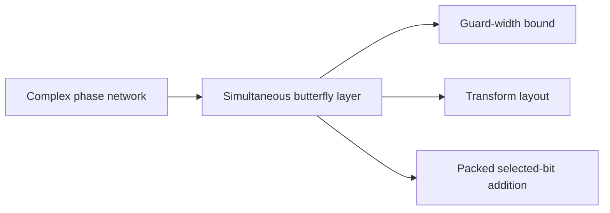

# Simultaneous butterfly layers

This part gives the main cost step: a butterfly layer applied to several selected address bits at once. The [Complex phase network](../complex-phase-network.md "A subset-intersection network whose frame change on each edge is a product of two-point kernels aI + bX on Gaussian dyadic values.") provides the frame changes, and the [Simultaneous butterfly layer](../simultaneous-butterfly-layer.md "The tensor product of the two-point map H0 applied to several selected address bits at once, computed exactly in one pass rather than one axis at a time.") applies them in one pass. The [Transform layout](../transform-layout.md "A permutation of address bits that places the selected bits of all participating axes at a common offset in consecutive chunks, so that a simultaneous butterfly layer applies to each transform round.") places the selected bits so that each transform round can use this layer, and [Guard-width bound](../guard-width-bound.md "An explicit number of extra fractional and integer bits that makes every intermediate coefficient of a butterfly layer exact, so that a single final truncation suffices.") controls the precision it needs.

## Pages

1. [Complex phase network](../complex-phase-network.md "A subset-intersection network whose frame change on each edge is a product of two-point kernels aI + bX on Gaussian dyadic values.") — A subset-intersection network whose frame change on each edge is a product of two-point kernels aI + bX on Gaussian dyadic values.
2. [Simultaneous butterfly layer](../simultaneous-butterfly-layer.md "The tensor product of the two-point map H0 applied to several selected address bits at once, computed exactly in one pass rather than one axis at a time.") — The tensor product of the two-point map H0 applied to several selected address bits at once, computed exactly in one pass rather than one axis at a time.
3. [Guard-width bound](../guard-width-bound.md "An explicit number of extra fractional and integer bits that makes every intermediate coefficient of a butterfly layer exact, so that a single final truncation suffices.") — An explicit number of extra fractional and integer bits that makes every intermediate coefficient of a butterfly layer exact, so that a single final truncation suffices.
4. [Transform layout](../transform-layout.md "A permutation of address bits that places the selected bits of all participating axes at a common offset in consecutive chunks, so that a simultaneous butterfly layer applies to each transform round.") — A permutation of address bits that places the selected bits of all participating axes at a common offset in consecutive chunks, so that a simultaneous butterfly layer applies to each transform round.
5. [Packed selected-bit addition](../packed-bit-addition.md "An operation that adds one selected bit position across several address chunks at once, using cyclic shifts and a small deterministic correction for exceptional addresses.") — An operation that adds one selected bit position across several address chunks at once, using cyclic shifts and a small deterministic correction for exceptional addresses.

## Map

Arrows point from a page to the pages that build on it.

